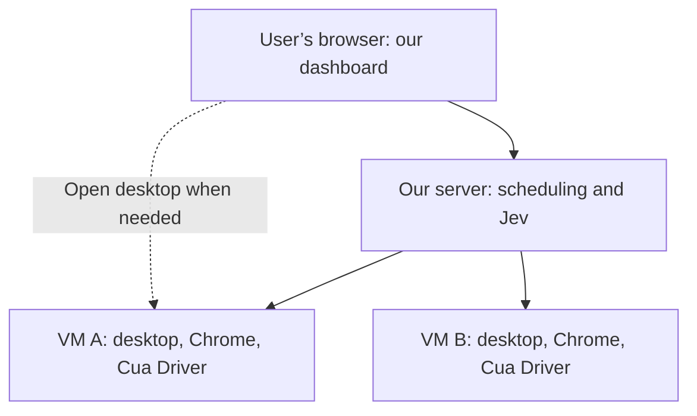

# Architecture

Agreed product direction: September 27, 2026. This document describes the target architecture; it does not mean these capabilities are already implemented in the repository.

Users interact with agents through our website. Agents work on private desktops on cloud servers, independently of the user's own computer. The normal experience is a dashboard showing agents and their progress. A live desktop viewer is available when needed for inspection, debugging, login, or manual interaction.

The diagram shows two example workers. The same optional desktop access applies to every authorized worker. The server's Jev integration makes action-selection calls; the diagram does not imply that we host the Jev model ourselves.

The initial design uses one Linux VM with a private desktop per simultaneously acting agent. Cua Driver observes applications and performs actions inside that desktop; Jev selects actions through our existing selection approach. Foreground input within a worker affects that worker's desktop, leaving the user's computer and other workers independent.

The website provides three desktop interactions:

- **View desktop:** inspect the selected agent's screen without sending mouse or keyboard input. Observation can happen while the agent continues working.
- **Take control:** pause the agent, ensure it has stopped issuing actions, then enable the human's mouse and keyboard input for that desktop.
- **Resume agent:** end human input, capture fresh application state, and return control to the agent.

Only one actor controls a worker's desktop at a time. Closing the viewer after taking control does not implicitly resume the agent. Agents otherwise continue working without a connected viewer; continuous desktop streaming to the user's browser is not required.

Use noVNC or an equivalent browser-based remote-desktop client for occasional viewing and interaction. Our application connects the signed-in user to the correct worker and implements the control handoff. Cua documents a noVNC path for Omarchy Fleet desktops; the application's authentication and pause/resume integration remain our responsibility. [Cua noVNC guide](https://cua.ai/docs/how-to-guides/sandbox/connect-to-omarchy-with-novnc)

Browser profiles, login state, and working files belong in persistent storage associated with the appropriate user and worker. Recreating a worker from its software image must not silently discard required user state. Users can upload files through our website for agents to work on and retrieve the resulting files through the website.

VMs are the agreed starting point. Keep worker provisioning, desktop observation/action delivery, Jev selection, and desktop viewing modular, reusing existing interfaces and models. A Linux desktop container may later replace a VM worker while preserving the dashboard and control-handoff behavior. Containers are optional for hosting backend services; nesting a container inside every agent VM is not required.

The exact Linux image and hosting provider remain evaluation choices. Omarchy has a documented cloud VM recipe. Its experimental feature for independent background input within a shared desktop is not required for this private-desktop design. Chrome workflows and website acceptance still require verification; VM isolation alone does not establish browser compatibility or remove bot detection. [Cua Linux desktop concepts](https://cua.ai/docs/concepts/linux-desktops-and-computer-use)

The control loop now targets Cua Driver in an Omarchy cloud desktop. Browser Use has been removed. The preserved Hermes/CUA compatibility demo remains separate; the broader website, scheduling, storage, and control-handoff capabilities above remain product direction.
