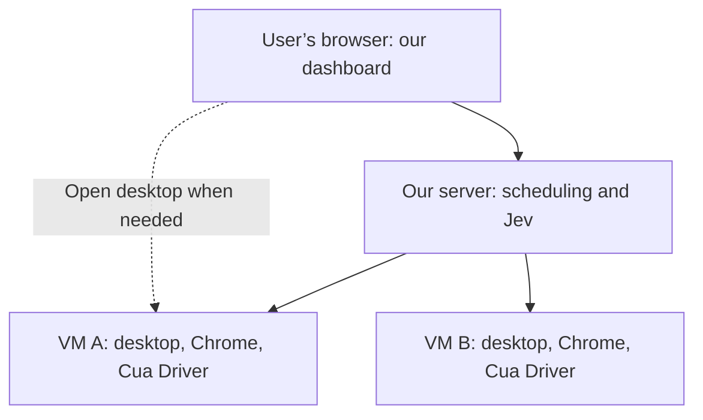
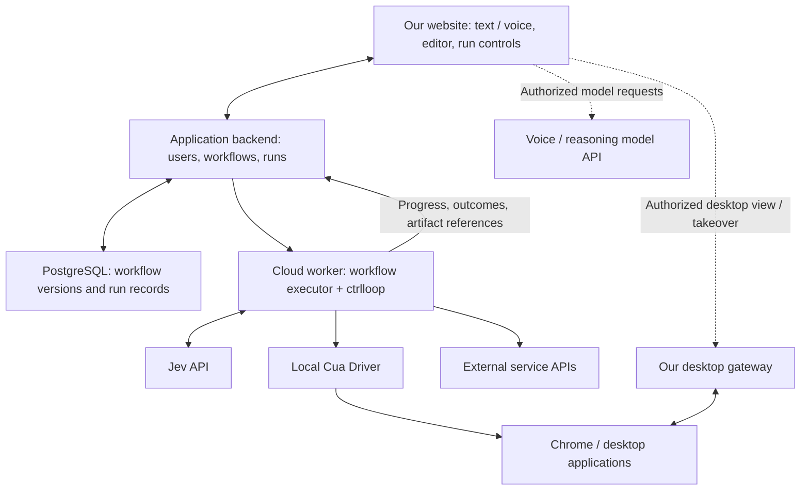

# Vision

The overall goal for our company, [CTRL] Loop, is to propagate ai technology throughout the real economy, there is this exponential curve of what's possible technologically and there is this nearly flat curve of what the world does today. Our mission is to bridge that gap in order to increase the scientific, productive, and human well being outputs and of course, make money along the way.

You should be able to run your entire company with 1 laptop, all of Costco, Walmart, Amazon, SpaceX, Tesla, or OpenAI. There will come a point when ai does all the intelligence work and humans only observe or give occasional commands, thus 1 laptop. Or maybe later we'll communicate directly through our minds, then no laptop either.

The current environment makes transitioning slow and painful. Obviously you can't just change everything in one go, and frankly the technology is not totally ready yet, so you need a product that is go-to-market-able. Thankfully, we have a solution that should check all our boxes. 

We need to make a product where users can talk/type to an ai and it outputs an executable workflow you can run over and over again or edit, maybe we call these ctrl loops. Very similar to coding agents, just talk/type and it spits out executable code. This is the holy-grail, this will dramatically increase the scientific and productive outputs and usher in the Exponential Age.

That executable workflow will fundamentally consist of api calls and computer actions (when there are no api's)
Users at companies should go to our website, login, and from there see, edit, or execute the list of ctrl loops they have or make new ones. The browser acts as a portal between servers where the actual executions are ran and user's interface. User can always upload files or whatever needed to run things in that ctrl loop environment.

Further details on exactly how this will all work, like VMs vs containers, user chrome profiles, editing workflows, how to notify users when workflows need something, etc still need be ironed out. 

# Architecture

Agreed product direction: September 27, 2026. This document describes the target architecture; it does not mean these capabilities are already implemented in the repository.

Users interact with agents through our website. Agents work on private desktops on cloud servers, independently of the user's own computer. The normal experience is a dashboard showing agents and their progress. A live desktop viewer is available when needed for inspection, debugging, login, or manual interaction.

The diagram shows two example workers. The same optional desktop access applies to every authorized worker. The server's Jev integration makes action-selection calls; the diagram does not imply that we host the Jev model ourselves.

The initial design uses one Linux VM with a private desktop per simultaneously acting agent. Cua Driver observes applications and performs actions inside that desktop; Jev selects actions through our existing selection approach. Foreground input within a worker affects that worker's desktop, leaving the user's computer and other workers independent.

The website provides three desktop interactions:

- **View desktop:** inspect the selected agent's screen without sending mouse or keyboard input. Observation can happen while the agent continues working.
- **Take control:** pause the agent, ensure it has stopped issuing actions, then enable the human's mouse and keyboard input for that desktop.
- **Resume agent:** end human input, capture fresh application state, and return control to the agent.

Only one actor controls a worker's desktop at a time. Closing the viewer after taking control does not implicitly resume the agent. Agents otherwise continue working without a connected viewer; continuous desktop streaming to the user's browser is not required.

Use noVNC or an equivalent browser-based remote-desktop client for occasional viewing and interaction. Our application connects the signed-in user to the correct worker and implements the control handoff. Cua documents a noVNC path for Omarchy Fleet desktops; the application's authentication and pause/resume integration remain our responsibility. [Cua noVNC guide](https://cua.ai/docs/how-to-guides/sandbox/connect-to-omarchy-with-novnc)

Browser profiles, login state, and working files belong in persistent storage associated with the appropriate user and worker. Recreating a worker from its software image must not silently discard required user state. Users can upload files through our website for agents to work on and retrieve the resulting files through the website.

VMs are the agreed starting point. Keep worker provisioning, desktop observation/action delivery, Jev selection, and desktop viewing modular, reusing existing interfaces and models. A Linux desktop container may later replace a VM worker while preserving the dashboard and control-handoff behavior. Containers are optional for hosting backend services; nesting a container inside every agent VM is not required.

The exact Linux image and hosting provider remain evaluation choices. Omarchy has a documented cloud VM recipe. Its experimental feature for independent background input within a shared desktop is not required for this private-desktop design. Chrome workflows and website acceptance still require verification; VM isolation alone does not establish browser compatibility or remove bot detection. [Cua Linux desktop concepts](https://cua.ai/docs/concepts/linux-desktops-and-computer-use)

The control loop now targets Cua Driver in an Omarchy cloud desktop. Browser Use has been removed. The preserved Hermes/CUA compatibility demo remains separate; the broader website, scheduling, storage, and control-handoff capabilities above remain product direction.

# Current MVP plan

Recorded: **2026-09-27 13:43:12 America/Los_Angeles (PDT, UTC-07:00)** / **2026-09-27 20:43:12 UTC**.

Status: planning only. This section records the current product direction and proposed development workflow; it does not authorize or claim implementation. The Vision and earlier Architecture sections are retained. Where execution placement differs, this dated plan takes precedence: workflow creation stays outside the desktop VM, while the workflow executor and its Jev/Cua control loop move into the cloud worker. The backend still owns run management and durable records.

## Product and first complete experience

[CTRL] Loop is a website where a company user describes work, creates an executable workflow (a "ctrl loop"), saves it, edits it, and runs it repeatedly. Workflows combine service API calls with computer actions where a suitable API is unavailable. The user's browser is the interface; execution continues in the cloud when the browser closes or the laptop disconnects.

The first milestone is one useful workflow for a pilot customer that completes this whole experience:

1. Sign into our website and see the company's saved ctrl loops.
2. Describe a workflow through text or voice, and refine the generated workflow in the browser.
3. Review and save an identifiable workflow version in PostgreSQL.
4. Provide inputs, upload required files, connect the necessary accounts, and start a run.
5. See progress, current work, outputs, and requests for user input.
6. Open the desktop when needed, pause the agent, complete a login or manual action, and explicitly resume it.
7. Retrieve results, rerun the saved version with new inputs, or edit it into a new version.

The first pilot workflow and supported external applications still need to be selected. Success means repeatable useful work with understandable outcomes, not a demonstration that merely sends clicks. Supporting arbitrary companies and applications is the long-term vision, not the first release's coverage claim.

## Responsibilities and execution placement

These are module boundaries first. They do not require separate repositories, duplicated APIs, or a large collection of services.

| Responsibility | Planned location | Purpose |
| --- | --- | --- |
| Website and workflow-building experience | User's browser | Text/voice input, model interaction, workflow editing, saved-loop list, inputs, run controls, and results. |
| Builder model | External voice/reasoning model API | Generate or revise workflow source; it does not need the Omarchy desktop. |
| Application backend / run manager | Our cloud application, outside execution VMs | Authenticate users, authorize company access, store versions, assign workers, track runs, and surface requests for input. |
| Workflow executor, including the existing `ctrlloop` GUI logic | Assigned cloud worker; initially an Omarchy VM | Execute the saved workflow's API operations and observe/select/act cycles, and report progress and results. |
| Jev inference | TypeSafe's API | Answer the existing selection questions called by the worker; we do not host the Jev model in the VM. |
| Native Cua Driver and desktop applications | The same desktop VM | Observe and control that VM's Chrome and other applications. |
| Workflow definitions and durable run records | PostgreSQL outside the execution VM | Preserve customer workflows and run history independently of worker lifetime. |

The model request arrow describes the browser-based builder experience, not a decision to expose a permanent provider key in frontend code. The specific voice/reasoning API and direct-browser versus backend-mediated request flow remain implementation choices; use server-held credentials or a provider-supported temporary browser credential as appropriate. Workflow building does not require putting the builder or Codex in a customer VM.

## Saved workflows and generated code

- Store workflow source as text in PostgreSQL, along with version and ownership information and the configuration needed to run it. The exact serialization and execution contract are not finalized; do not invent a custom workflow language or redundant data model before one is needed.
- Use the current Python execution stack as the starting point. Distinguish a customer's complete saved workflow from the current `ctrlloop` observe/select/act implementation used for its GUI steps.
- A run uses an identifiable saved workflow version and its supplied inputs. Editing a workflow creates a new version rather than silently changing code underneath an active run. Record the executor/Driver/model versions as well.
- Reuse saved workflow code on later runs. Do not regenerate a new plan automatically on every run. Where runtime judgment is required, the saved code can invoke the appropriate model or GUI operation explicitly.
- Prefer direct API operations when suitable. GUI steps must observe current application state and use fresh native control identities; a recording of coordinates or old element tokens is not a reliable reusable workflow.
- Generated source runs in the assigned isolated worker, not inside the web application's privileged backend process. Before execution, check the workflow's required inputs, allowed integrations, and ability to report a meaningful outcome. The validation mechanism remains to be designed.
- Workflow definitions reference authorized account connections; they should not contain embedded API keys, passwords, or browser cookies.

## Worker and lifecycle scope for the MVP

Start with one private Linux desktop worker for the pilot company and a separate dedicated development worker. Reuse the pilot desktop across runs while its supported lifetime permits. Only one GUI executor or human controller may send input to a desktop at a time; additional concurrent GUI work needs another isolated desktop.

For the first mixed API/GUI workflow, both kinds of operation can run in the same worker. API-only workflows should eventually be able to run without allocating a desktop. A separate container worker pool, sophisticated autoscaling, and one permanent VM per customer are not prerequisites for the first milestone.

The worker must run under a managed process whose lifetime is independent of a developer terminal or user's browser. The backend retains the run record, workflow version, important outputs, and recovery information outside the disposable VM. A worker failure must be visible as an interrupted or uncertain run; it must not silently erase the workflow or its history.

Cost-saving sleep/resume with retained customer state is a desired later capability. It is explicitly deferred for now. Keeping capacity running, disconnecting a viewer, stopping a VM, deleting a claim, and deleting a pool are different operations. Our current six-hour trial deletes its resources at expiry; its saved claim reference is not a disk backup. Current Fleet documentation does not establish a persistent-disk stop/resume contract for this setup, and claim-backed snapshots are unsupported. Do not promise laptop-like sleep or persistence across deletion until the chosen storage/provider path is verified. [Cua lifecycle](https://cua.ai/docs/concepts/sandbox-lifecycle)

## Website, desktop access, and human intervention

The normal product screen is our workflow dashboard and run details. Desktop streaming is optional for observation, debugging, logging in, or taking control; it is not required for the agent to keep running.

Embed noVNC or an equivalent viewer in our website, using our backend to authorize the user for the correct worker and forward its desktop connection. Keep Fleet management credentials on the server. This is our own viewer, not an assumption that the Fleet portal can be placed in an iframe. Fullscreen, fit-to-window, connection status, and clear control ownership belong in our interface. The authenticated gateway and viewer integration still need implementation and verification. [Cua noVNC guide](https://cua.ai/docs/how-to-guides/sandbox/connect-to-omarchy-with-novnc)

Preserve the previously agreed interaction contract: viewing can be read-only while the agent runs; taking control first pauses execution and waits until agent input has stopped; resuming disables human input and obtains fresh application state. Closing a viewer after taking control does not automatically resume the agent.

When a workflow needs information, a login, approval of a consequential action, or recovery from an uncertain outcome, show the specific pending step and what the user needs to do. Resume from an explicit recorded boundary after that input. The dashboard is the minimum notification surface; email, push, voice notifications, and their delivery provider remain open decisions. Manual start and repeat execution are required for the first milestone; the first release's scheduling and external-trigger scope remains to be chosen.

## Customer data and credentials

PostgreSQL holds workflow definitions, versions, ownership, run metadata, and references to outputs. Uploaded files, screenshots, and generated artifacts should live in authorized durable file/object storage with references in the database; the exact storage provider and retention policy remain open. Copy required inputs into the assigned worker and return important results before that worker is removed.

Browser profiles, account sessions, and desktop preferences need a private persistence strategy associated with the correct company/user. This is a requirement for retained environments, not a capability already delivered by the trial. Preserving a profile does not guarantee that an external website will never require another login.

Use protected account-connection/secret storage and grant a worker only what its assigned run needs. Do not place broad Fleet management keys in generated workflows or the customer's browser. The credential provider, user login flow, recovery procedure, and profile portability mechanism have not been selected. Separate different customers' execution state and account access.

## Run outcomes, recovery, and observability

The website should distinguish queued/running work, waiting for user input, cancellation, failure, uncertain outcomes, and successful completion. These describe product behavior, not a new independently implemented state model; define and reuse a single backend/frontend contract when implementation begins.

Record step outcomes and available evidence. A timeout after a mutation is not proof that nothing happened. Do not blindly repeat a submitted order, message, or other external effect after a crash; use operation identifiers, readback, or human resolution as appropriate. Reuse an existing durable execution mechanism when needed rather than writing a competing retry/orchestration framework. A workflow engine does not by itself make external GUI actions safe to replay. [Temporal activity behavior](https://docs.temporal.io/activities)

Expose useful progress, returned files, errors, and the current pending decision. Retain the existing detailed run reporting: window/control selection rounds, candidate and group counts, questions and probabilities, choices, API call counts, stage durations, input tokens, and input-token cost using the configured Jev price of $0.042 per million tokens. Preserve the requested shared-scale loop timing chart and timeline, including observation, focus, selection rounds, action, settling, overhead, and action-sent/loop-end markers. A loop runs from obtaining current state through sending its final computer-use command, before the next observation. Keep the distinction between action dispatch, action return, and verified task completion.

Keep Jev pinned to `jev-1.13.0` until a deliberate model change is evaluated. Reuse the current questions and selection logic, keep inputs compact, and preserve grouped/batched calls rather than one question per call. New Jev questions require the user's audit before implementation. The current iteration limit is a bounded stop, not a successful-completion detector; the full workflow needs explicit outcome checks.

## Development and deployment workflow

Develop on the laptop with Codex and the local Git checkout. The VM is the deployment and execution target. Running Codex inside it is optional and unnecessary for the planned workflow. PostgreSQL-stored customer workflow versions and Git-versioned platform/executor source are different artifacts; a platform deployment should record which executor revision a run used.

The proposed development deployment is a small local command that performs these steps. That command does not exist yet:

1. Select the exact dedicated development VM using its saved Fleet claim identity. A development deploy must not select a customer's worker implicitly.
2. Package the intended saved working-tree files, including edited/uncommitted source, `pyproject.toml`, and `uv.lock`. Record a revision/content identity. Exclude `.env*`, `.git`, `.venv`, `.local`, reports, credentials, browser profiles, and unrelated files. Upload a complete selected source snapshot into a new revision directory so removed source files cannot linger from an earlier deployment.
3. Transfer that bundle using the existing Fleet SDK file operations. Fleet already exposes file upload/write and remote shell execution; SSH, an editor in the streamed desktop, and a new deployment API are not prerequisites. [Sandbox file and shell interfaces](https://cua.ai/docs/reference/sandbox-sdk/interfaces)
4. On the Linux VM, unpack into a user-owned development directory, for example `/home/omarchy/ctrlloop-dev/releases/<revision>`. This is a proposed path, not an existing deployment. Install a supported Python and `uv` if needed, then run `uv sync --locked --no-dev` there to create Linux's own environment. Never copy the Windows `.venv` or Windows executables into it. Lock/dependency incompatibility must be surfaced rather than silently resolved to new versions. [uv locked synchronization](https://docs.astral.sh/uv/concepts/projects/sync/)
5. Supply required runtime settings and authorized secrets separately from the code bundle. Configure the worker's existing Driver adapter to use the local native Driver transport once that transport is implemented. Merely copying today's code into the VM would still make it route through Fleet.
6. Let an existing development run finish or stop it deliberately, then launch a new run against the new revision. A running Python process does not automatically adopt source edits. Do not overwrite a running deployment or restart the native Driver for an ordinary Python-loop change.
7. Return the run identity, stdout/stderr, reports, and screenshots to the developer; watch the same desktop through our viewer. Keep the preceding revision available for a subsequent rollback run without implying that already-performed external effects can be rolled back.

For early development, a managed user service or equivalent process supervisor can keep execution independent of the initiating shell. The exact launch/log-streaming mechanism remains to be chosen. Later, package qualified executor and Driver versions into a reproducible worker image so newly created workers begin with the right software. Development source synchronization and production image releases are separate concerns; rebuilding an image is not required for every Python edit.

## Linux compatibility and current implementation gap

The desired deployment requires Linux qualification, not a wholesale rewrite of the project. Much of the core uses Python, `asyncio`, `pathlib`, and HTTP APIs. The Driver adapter already branches between Windows `msvcrt` locking and POSIX `fcntl`, but that lock only coordinates its current checkout and must not be mistaken for multi-worker ownership enforcement.

The work still required includes:

- Verify the pinned Python 3.11-3.13 dependency set on Linux and use a Linux-built environment. Source portability alone does not establish wheel/native-library compatibility.
- Add/select a VM-local native Driver transport within the existing adapter while preserving the existing native MCP/tool records and shared pipeline. Do not create a second control-selection system or near-identical API. The current adapter unconditionally reconnects through a Fleet claim and sends requests through Fleet's service proxy.
- Separate provider lifecycle/management configuration from the worker's local desktop-control connection. A worker using its local Driver should not need broad Fleet credentials merely to observe or click its own desktop.
- Ensure the native Driver runs with access to the correct Omarchy graphical session, accessibility bus, and compositor. Validate actual application observations and action behavior in Linux; Windows UIA-specific assumptions do not transfer to Linux AT-SPI/Wayland.
- Use Linux paths and executable names, LF shell scripts, appropriate executable permissions, and a managed worker launch. Preserve the Windows Hermes compatibility launcher as a separate workflow; do not route it through the new Linux worker.
- Keep native Driver builds separate from Python-loop deploys. The current cloud image/adapter pin is Driver `0.24.0`; the repository's existing native build script and patches target Windows Driver `0.28.2`. Updating one does not update the other. Any later Linux Driver change needs an explicit compatible build and version/transport verification.

As of this timestamp, the implemented main path remains laptop `ctrlloop` -> authenticated Fleet MCP -> Driver inside Omarchy. The browser builder, PostgreSQL workflow service, VM-local executor deployment, website viewer/control handoff, and durable customer-state path are plans, not completed features. The browser/helper repair scripts are saved locally but are not automatically included in new-worker provisioning.

## Scope boundaries and decisions still open

The MVP should establish the complete save/edit/run/rerun experience for a limited set of useful workflows, with visible failures and human intervention. It should preserve modular boundaries for the builder model, Jev selection, native Driver, worker provider, viewer, and storage, using one shared set of application contracts.

Still to decide: the first customer workflow and integrations; generated workflow language/entry contract; voice/reasoning provider; scheduling scope; identity and account-connection setup; PostgreSQL and artifact hosting; durable run-management mechanism; Linux local Driver transport; worker launch/deployment command; customer profile persistence; notification channels; and measured pricing/usage limits. Exact choices should follow the pilot's requirements rather than being implied by this document.

Deferred: sleep/hibernate and automatic idle shutdown with retained profiles; large worker pools and autoscaling; moving API-only execution to a separate container pool; broad multi-OS/application coverage; and advanced workflow-editing interfaces. Reusing a supported backend/SDK is preferred over building redundant infrastructure.

This documentation update changes no implementation, deployment, cloud lifetime, driver, or Jev questions. No tests are being added or run as part of this planning work.
