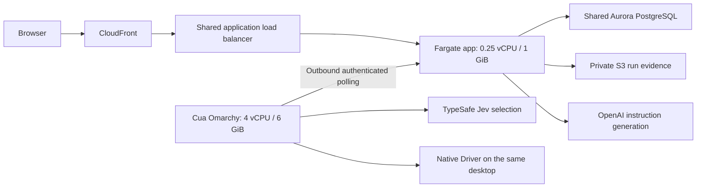

# CTRL Loop infrastructure, costs, and delivery

Audited September 28, 2026, approximately 22:47–22:59 UTC (3:47–3:59 PM PDT), in AWS account `686458136219`, profile `mangorts-dev`, region `us-west-1` (Northern California). This is a point-in-time inventory; deployments later in the day can change image revisions and artifact counts.

**The new app's continuously allocated Fargate compute is approximately $12.23 per 730-hour month. Its existing Cua desktop is approximately $228.03 for the same continuous runtime.** These are list-price estimates, not invoices. Shared Aurora, ALB, and NAT capacity already existed and must not be counted as newly created app infrastructure. Model usage preserved for the six requests and fourteen runs inspected is less than one cent, but is not an account-wide model bill.

## What runs where

The website and API run in Fargate, not in S3. The original S3 bucket stages source archives for explicit CodeBuild builds. CodeBuild produces an image in ECR; ECS runs that image. The separately deployed worker runs inside the Cua desktop. Saving code or pushing Git alone updates neither runtime. The desktop viewer uses its own authenticated WebSocket path; it does not deliver worker jobs.

## Allocated resources and ownership

| Resource | Live allocation / role | Attribution |
|---|---|---|
| ECS service `ctrlloop-mvp` in `mangorts-dev-cluster` | Desired/running tasks: 1/1; Linux x86 Fargate; 256 CPU units = 0.25 vCPU; 1,024 MiB = 1 GiB; no task public IPv4 | New CTRL Loop compute. Existing cluster reused; cluster itself is not an extra VM |
| App deployment | Task definition revision 2 at first inventory; rolling maximum 200%, minimum healthy 100% | A deployment can briefly run two tasks; that overlap is billable |
| CloudFront `EFZQEEWLIM0FZ` | Enabled, deployed, `PriceClass_100`; HTTPS origin `origin.dev.mangorts.com`; public site `d1t0sm9jhdinfi.cloudfront.net` | New distribution; charges depend on traffic and account allowances |
| Target group / ALB listener rule | `ctrlloop-mvp` target group and dedicated routing rule | New routing configuration on the existing ALB; no new ALB hourly charge |
| ECR `ctrlloop-mvp` | Two image manifests at first inventory; reported image sizes 269,547,341 and 269,493,279 bytes | New storage. Summing image sizes is not exact billed storage because layers may be shared |
| CodeBuild `ctrlloop-mvp` | Linux `BUILD_GENERAL1_SMALL`; 2 vCPU / 4 GiB / 64 GB build-disk class; 20-minute timeout; no reserved compute | New project; compute runs only during builds |
| S3 `ctrlloop-mvp-build-686458136219-us-west-1` | Three source ZIPs totaling 1,500,206 bytes; `source/` expires after seven days | New, temporary build storage |
| S3 `ctrlloop-mvp-reports-686458136219-us-west-1` | Created during this work; public access blocked in all four settings; SSE-S3 AES256; empty at 22:58 UTC readback | New durable report storage; no automatic expiry. Storage grows with retained evidence |
| CloudWatch `/ecs/ctrlloop-mvp`, `/aws/codebuild/ctrlloop-mvp` | Both 14-day retention; `storedBytes` reported 2,205 and 44,470 at inventory | New ingestion/storage. `storedBytes` is not cumulative billed ingestion and can lag |
| Secrets Manager `ctrlloop/mvp/app` | One app secret | New secret. Existing `mangorts/dev/openai-api-key` is reused |
| IAM roles and app security group | Execution/build roles, application report-access role, `sg-0d4deb56c3c883c02` | New access configuration; no standing per-role/per-security-group charge |
| Aurora cluster `miraerts-northerncalifornia-devcluster` | PostgreSQL 17.7, one `db.serverless` writer, 0.5–1 ACU, seven-day backups; existing since April 9 | Shared existing database capacity. `ctrlloop_mvp` is a new logical database/user, not a new database server |
| ALB `mangorts-dev-api` | Internet-facing application ALB in `us-west-1a` and `us-west-1c`; existing since May 5 | Shared existing hourly capacity; CTRL Loop can add LCU usage and traffic |
| NAT `nat-062748df75bbac4e7` (`mangorts-dev-nat-1`) | One available gateway; existing since May 5 | Shared existing hourly capacity; app outbound traffic adds processed bytes |
| Existing VPC, subnets, DNS/TLS, ECS cluster | Reused networking/control plane | Not new app-specific standing capacity |
| Cua pool `ctrlloop-omarchy-20260927-1708` | One replica, min/initial/max all 1; 4 vCPU, 6,144 MiB; one Bound claim `omarchy-trial` | Existing dedicated CTRL Loop desktop, separately billed by Cua |
| Older Cua namespace `ctrlloop-omarchy-20260927-01a0e1e6` | No pools and no claims at 22:55 UTC | No remaining pool/claim allocation observed there; namespace existence alone does not prove a charged desktop |

The CodeBuild class capacity comes from the current [AWS compute-type reference](https://docs.aws.amazon.com/codebuild/latest/userguide/build-env-ref-compute-types.html). The Cua claim names sandbox `ctrlloop-omarchy-20260927-1708-e33048ae`. Its shutdown policy is `Delete`, auto-renew is false, and the configured deadline is September 30 at 21:19:52 UTC (2:19:52 PM PDT). This is the extended deadline returned by the live service; older six-hour trial documentation is stale. Deletion is asynchronous, so configured expiry is not proof that billing stopped. `ready_replicas=0` means no unclaimed spare is ready when the sole replica is already claimed; it does not mean zero allocated replicas.

## Allocation versus measured use

The preceding 24 hours of five-minute CloudWatch samples reported mean app CPU utilization **11.32%**, peak **100%**, and mean memory **5.48%**, peak **5.76%**, of the allocated task resources. The latest sample was about 1.86% CPU and 5.66% RAM. These are service metrics, not a capacity proof for every future workload. Fargate charges allocated CPU/RAM even while idle.

Aurora averaged **0.653 ACU**, ranged **0.5–1 ACU**, and was at **0.5 ACU** in the latest sample. Its latest `VolumeBytesUsed` was **1,595,072,512 bytes**, covering the entire shared cluster. The RDS `AllocatedStorage=1` compatibility field is not the measured data size and must not be described as a one-GB fixed database disk. No attribution of Aurora capacity or disk bytes to this one logical database was available from these CloudWatch metrics.

The native guest readback exposed 4 CPUs, about 6.20 billion usable memory bytes, and a root filesystem of 19,010,662,400 bytes. Its template reserves 6 GiB RAM. Public Cua pricing below specifies CPU and RAM; no separate disk invoice was retrieved.

## Unit prices and app estimates

All amounts below are USD before taxes, credits, discounts, free-tier offsets, and unmeasured transfer. AWS regional rates were read directly from the official Pricing `GetProducts` API on September 28; the supporting SKU/rate records are retained in the private audit snapshot. Monthly comparisons use **730 hours**, not a predicted invoice period.

| Resource | Verified list rate | What this allocation implies |
|---|---|---|
| Fargate Linux x86, Northern California | $0.04656/vCPU-hour + $0.00511/GB-hour | `0.25 × 0.04656 + 1 × 0.00511` = **$0.01675/hour**, **$0.402/day**, **$12.2275/730 hours** |
| Cua Fleet desktop | $0.044625/vCPU-hour + $0.0223125/GiB-hour | `4 × 0.044625 + 6 × 0.0223125` = **$0.312375/hour**, **$7.497/day**, **$228.03375/730 hours** |
| New Secrets Manager secret | $0.40/secret-month; $0.05/10,000 API requests | Approximately $0.40/month plus access requests |
| New report/build S3 Standard storage | $0.026/GB-month in the first 50 TB | 1 GB retained for a month ≈ $0.026; 100 GB ≈ $2.60. Actual retained bytes matter |
| S3 requests | $0.0055/1,000 PUT/COPY/POST/LIST; $0.0044/10,000 GET/other tier-2 requests | Separate from storage; ZIP size and download traffic also matter |
| ECR storage | $0.10/GB-month | Approximately $0.05/month if both displayed image sizes were fully distinct stored bytes; this is a rough upper comparison, not measured repository billing |
| CodeBuild small Linux | $0.005/build minute, rounded per build | Three observed builds lasted about 34.2, 109.5, and 82.7 seconds wall time: at most roughly five rounded minutes / $0.025 at this rate before allowances. Wall-time estimate is not a billing record |
| CloudWatch logs | $0.67/GB standard log ingestion; $0.033/GB-month storage | Usage dependent. Fourteen-day retention limits future stored history, not ingestion charges |
| CloudFront | Usage based; North America/Europe next-tier egress $0.085/GB after allowance | The published shared account free tier includes 1 TB egress and 10 million HTTP(S) requests/month. No remaining allowance was verified for this account |

The **new Fargate task plus its one secret are about $12.63/month** before variable storage, builds, logs, traffic, model calls, and any extra shared-infrastructure usage. Adding a continuously running dedicated Cua desktop makes those two fixed-capacity items plus the secret about **$240.66/month**. This is not the application's full bill, and the current desktop has a finite deadline rather than an indefinite 730-hour reservation. Sources: [AWS Fargate](https://aws.amazon.com/fargate/pricing/), [Cua pricing](https://cua.ai/#pricing), [S3](https://aws.amazon.com/s3/pricing/), [CloudFront](https://aws.amazon.com/cloudfront/pricing/pay-as-you-go/).

This audit does not establish the cheapest possible deployment. For example, if validated for this workload, halving app RAM to 0.5 GiB would save only about **$1.87/month** at the same CPU allocation. The observed CPU peaks make it inappropriate to claim that low average utilization alone establishes adequate smaller compute. The dedicated Cua runtime is the much larger continuous allocation in this comparison. No sizing changes were made by this audit.

## Shared infrastructure: existing charges versus incremental use

| Shared resource | Full existing capacity cost | Costs CTRL Loop can add |
|---|---|---|
| Aurora at 0.5–1 ACU | $0.16/ACU-hour → **$58.40–$116.80/730 hours** for compute, plus storage/I/O/backups | Extra ACU consumption within the existing limit, data, I/O, backups. No separate writer was added |
| Aurora Standard data and I/O | $0.11/GB-month; $0.22/million I/O requests | Actual additional database bytes and I/O; not all shared cluster storage |
| Existing ALB | $0.0252/hour → **$18.396/730 hours**, plus $0.008/LCU-hour | New traffic can increase LCU usage; the listener rule did not create another hourly ALB |
| Existing NAT | $0.048/hour → **$35.04/730 hours**, plus $0.048/GB processed | Outbound app/viewer/model traffic, image pulls, and any transfer charges; not another gateway-hour charge |
| Public IPv4 | $0.005/address-hour when applicable | App task has no public IPv4. Existing ALB/NAT/database addresses belong in shared costs, and exact attributable address-hour allocation was not measured |

The three shared capacity lines alone total **$111.836–$170.236/730 hours**, excluding storage, I/O, LCU, IPv4, and transfer. They are **not** an amount this application newly added. The app may keep the database busy or increase variable usage; that effect was not isolated from other workloads. Sources: [Aurora pricing](https://aws.amazon.com/rds/aurora/pricing/), [ALB pricing](https://aws.amazon.com/elasticloadbalancing/pricing/), [NAT and public IPv4 pricing](https://aws.amazon.com/vpc/pricing/).

## What AWS billing actually returned

Cost Explorer returned **$523.372096** of account-wide `UnblendedCost` for September 1 through the exclusive end date September 29. Every returned current-month period was marked **`Estimated=true`**. These are metered, posted month-to-date estimates with reporting lag, not a final invoice, and include unrelated resources. September 28 was visibly incomplete: NAT had only six reported hours although the audit occurred after 22:00 UTC.

| Account-wide service | Posted September month-to-date estimate |
|---|---:|
| RDS | $157.4170 |
| ECS | $89.8978 |
| Registrar | $87.0000 |
| EC2 Other (includes NAT and other items) | $48.8797 |
| Elastic Load Balancing | $41.4037 |
| CloudWatch | $32.0323 |
| VPC | $24.7624 |
| WAF | $20.6195 |
| ElastiCache | $11.8865 |
| Secrets Manager | $3.7610 |
| Route 53 | $2.5244 |
| EC2 Compute | $2.0654 |
| S3 | $0.8938 |
| ECR | $0.1901 |
| Cost Explorer | $0.0300 |
| CloudFront | $0.0082 |
| SES | $0.0006 |
| CodeBuild | $0.0000 posted; this is not proof that builds consumed no compute |

**The `Project` cost-allocation tag is inactive.** A query filtering `Project=ctrlloop` returned zero, but it does not establish a free app or reliable service attribution. Resource tags exist; billing tag activation is a separate setting. No final paid AWS invoice, Cua invoice, OpenAI organization bill, or TypeSafe account bill was accessed. Those unavailable figures are not replaced with invented zeroes. Cost Explorer queries themselves can add small account charges after the snapshot. [AWS Cost Explorer API guidance](https://docs.aws.amazon.com/cost-management/latest/userguide/ce-api-best-practices.html).

## Model usage retained by this application

The application snapshot at 22:55 UTC contained six generated requests and fourteen persisted execution runs. OpenAI usage is counted once per generated request, not once per repeated execution. Jev usage below comes from each stored selection API-call record, including preserved failed-run selections; no API call was made to either model for this audit.

| Provider and scope | Observed usage | Published-price estimate |
|---|---|---:|
| OpenAI `gpt-6-luna`, high reasoning; six responses | 749 input tokens; 431 output tokens; 0 cached input; 0 cache-write tokens | **$0.000290400** |
| TypeSafe `jev-1.13.0`; sixteen preserved API calls | 62,068 input tokens | **$0.002606856** |
| Combined recorded model use | App records only | **$0.002897256** |

GPT-6 Luna Standard short-context rates verified September 28 are $0.10/million ordinary input, $0.01/million cached input, $0.125/million cache writes, and $0.50/million output. All inspected requests have zero cache reads/writes, so the estimate is `(749 × 0.10 + 431 × 0.50) / 1,000,000`. Reasoning tokens are already part of output usage; they must not be charged twice. This small-request estimate is not a rate promise for other context lengths or processing tiers. [Official OpenAI API pricing](https://developers.openai.com/api/docs/pricing).

Jev charges **$0.042/million input tokens**, with no output-token charge. Cost is `input_tokens × 0.042 / 1,000,000`. Independent questions in one selection round are batched into API calls; counting every question as another call would overcount. The current [selection contract](main-workflow.md#selection-contract) sizes candidate groups and request batches by compact SDK bytes, up to 255 options per Choice. A large round can have multiple batches, and token-limit recovery adds real API attempts within that same round. Count returned usage for each attempt once; missing rejection usage leaves cost unknown. [Official TypeSafe model reference](https://docs.typesafe.ai/models).

The sixteen preserved Jev input counts, each corresponding to one API call, were: `3761, 3844, 3817, 3817, 3844, 3759, 3844, 3845, 3913, 3846, 3809, 3809, 4133, 4133, 4133, 3761`. Their individual costs are respectively `$0.000157962, $0.000161448, $0.000160314, $0.000160314, $0.000161448, $0.000157878, $0.000161448, $0.000161490, $0.000164346, $0.000161532, $0.000159978, $0.000159978, $0.000173586, $0.000173586, $0.000173586, $0.000157962`.

The existing final result snapshots retain tokens and selections but do not by themselves provide every historical raw response or per-call duration. Partial local report copies exist; the guest-loss finding below limits recovery of the complete old record. These totals do not include unknown lost calls, calls made outside this app, or separate Codex/ChatGPT subscription usage. A returned zero or missing usage field must not be interpreted as proof that a failed model call incurred no charge.

## Why the worker polls every two seconds

The current worker waits two seconds **after an empty response** from `POST /api/worker/poll`. It is an implementation choice for simple outbound-only delivery to one assigned desktop, not a requirement of Cua, Jev, PostgreSQL, or AWS. The actual cycle is request time plus the two-second sleep. Work does not pause every two seconds after delivery; execution proceeds inside the worker. The independent five-second heartbeat tells the server whether the worker is alive. See [`src/cloud_worker.py`](../src/cloud_worker.py).

The database is the durable queue. The server transaction locks the worker row, checks ownership and mode, takes the next queued run, marks it running, records dispatch, and returns the persisted instruction. The worker journals receipt before acting and reports completion. An interrupted delivery or execution is recovered as uncertain/interrupted, without replaying desktop actions. See `create_run`, `worker_poll`, and `worker_recover` in [`src/webapp.py`](../src/webapp.py).

At negligible request time, one idle worker produces approximately **43,200 polls/day**, plus **17,280 heartbeats/day**: about **60,480 requests/day** before user activity, events, or reports. Request latency reduces the poll count because the wait follows each response. For jobs arriving independently of the polling cycle, the two-second sleep contributes roughly zero to two seconds of pickup delay, averaging about one second; network/server time adds to that. Browser activity refresh is a separate two-second timer in [`web/app.js`](../web/app.js), so status display can lag again. The live desktop WebSocket is separate from both timers.

Server notification can remove most idle requests and pickup delay. It still needs the same durable run records and ownership transaction:

| Option | How it would work | Main tradeoff |
|---|---|---|
| Long polling | Keep the worker's outbound request open until a run is queued or a bounded timeout expires; return the same existing delivery payload | Small protocol change, fewer idle requests; connection and proxy timeouts still need handling |
| Worker WebSocket or SSE | Worker opens an authenticated outbound connection; app sends a wake-up/run-available notice; worker claims the durable run | Low pickup delay; requires reconnect, missed-notice recovery, per-worker routing, and multiple-app-instance coordination |
| PostgreSQL `LISTEN`/`NOTIFY` behind the app | Commit the queued row, then wake the app listener; app notifies its connected worker | Reuses PostgreSQL, but notification is a wake-up hint, not durable delivery; reconnect must recheck the queue |
| Managed queue such as SQS | Persist a queued message/reference, consume with long polling, and acknowledge using an ownership/recovery protocol | Adds a service and coordination model; not necessary merely to explain today's polling |

The [PostgreSQL notification contract](https://www.postgresql.org/docs/current/sql-notify.html) delivers notifications around transaction completion; it does not replace saved run state or the no-replay rule. A persistent worker connection still originates from the guest, so server notification does not require opening an inbound port on the desktop. Browser status updates could separately use SSE/WebSocket. **This task does not rewrite delivery; the two-second poll remains.**

## Guest evidence loss observed during this audit

At **22:58:42 UTC**, a read-only query connected to the exact recorded sandbox name as `uid=1000(omarchy)`. The guest reported boot time **22:34:48 UTC**. `/home/omarchy/ctrlloop-dev` (including releases and reports), `/home/omarchy/.config/systemd/user`, and `/home/omarchy/.config/google-chrome` were absent. Only the image's base computer-server/Driver services and WayVNC on port 5901 were present; the custom worker and viewer proxy were absent. The app independently reported worker `offline`, no active run, and last heartbeat **22:30:42.113254 UTC**.

This establishes missing guest state after a new boot; it does **not** establish the provider's underlying cause or who initiated a restart. The audit made no Fleet mutation, restart, deletion, or profile change. The old guest-only artifacts/profile were unavailable at inspection. Saved AWS run rows/events and local report copies remain available. Restoring worker services to the same assigned guest is separate from recovering lost Chrome state or historical files; success of a redeploy must not be described as recovery of absent evidence.

The new private report bucket addresses off-guest persistence for subsequently uploaded evidence. A process/VM failure can still leave captures that were never written or uploaded missing, so report completeness must remain explicit.

Private, credential-free AWS snapshots are in `.local/mvp/infra-audit-20260928.json`, `price-audit-20260928.json`, and `metrics-audit-20260928.json`. The private provider/app snapshot is `provider-audit-20260928.json`; guest readback is `fleet-bootstrap-verified.json`. These local files are ignored by Git and are not a public billing export. The process-only `fleet_dns.py` workaround resolved the two exact Fleet hostnames against a secondary resolver when the hotspot resolver returned NXDOMAIN; it changed no system DNS/proxy settings and preserved TLS hostname verification.

## Deployment follow-through — September 28, 2026, through 23:46 UTC

The implementation pass subsequently created and verified the private report bucket `ctrlloop-mvp-reports-686458136219-us-west-1` and the application's scoped S3 IAM access. Four historical archives were recovered from the available copies, uploaded with HTTP 200 responses, and read back through authenticated application routes. These are **incomplete historical archives**: the manifest records unavailable captures, and an upload does not recover files already missing from the guest. Anonymous report routes returned HTTP 401; direct public S3 access returned HTTP 403. Retention has no automatic expiry. The storage/request rates above apply to this new marginal usage; the original billing snapshot is unchanged.

The worker and required desktop services were restored on the **same assigned guest**. Worker revision `c239319d3eaea74a` was active. This restores execution service, not the absent historical Chrome profile or lost guest-only report files. At an earlier checkpoint, app revision `20260928-run-evidence-002`, ECS task definition revision 4, reached steady state at **23:26:58 UTC**. The final revision **`20260928-run-evidence-004`**, ECS task definition revision **6**, reached steady state at **23:45:23 UTC**. Readback at 23:46 UTC verified one running task, no pending tasks, its sole load-balancer target healthy, HTTP health 200, and report assets matching the reviewed source. These service checks are separate from the result of the live run.

DBeaver access was verified against the real application tables and the `workers` data grid. The database connection used a single-source `/32` TCP 5432 rule and negotiated TLS 1.3. The inspected database snapshot contained 6 loops, 14 runs, and 213 events. These counts describe that snapshot, not a lifetime usage bill.

A read-only source review confirmed the four follow-up corrections: saved selection records provide historical Jev usage when the worker trace is absent; missing recorded screenshot files become explicit archive gaps; permanent archive-upload failures retain local evidence and a repair receipt while releasing the active worker slot; and missing OpenAI cache-write usage produces an unknown cost rather than an assumed zero. This was source verification, with no new tests or live failure injection. Deployment and access results in this section were recorded by the implementation pass; the earlier audit tables remain the separately timestamped allocation and billing evidence.

The subsequent authorized Writer verification, run [`0499cd53-ec33-4328-a441-9965414f1fb5`](https://d1t0sm9jhdinfi.cloudfront.net/reports/runs/0499cd53-ec33-4328-a441-9965414f1fb5), adds **$0.028084686 estimated Jev usage** (32 calls, 668,683 input tokens) and **$0.0000392 estimated OpenAI usage** (117 input and 55 output tokens). These are separate from the earlier audit's model totals. The full worker record took **47,879.814 ms**, including report generation, and the uploaded worker archive was **8,715,978 bytes**. All eight screenshots, raw-file hashes and exact dispatch boundaries passed readback verification, with no capture gaps. Four bounded loops selected Bold controls; task status remains **unverified** because no general completion check exists. See [acceptance evidence](mvp.md#general-executor-and-evidence-archive--september-28-2026).
