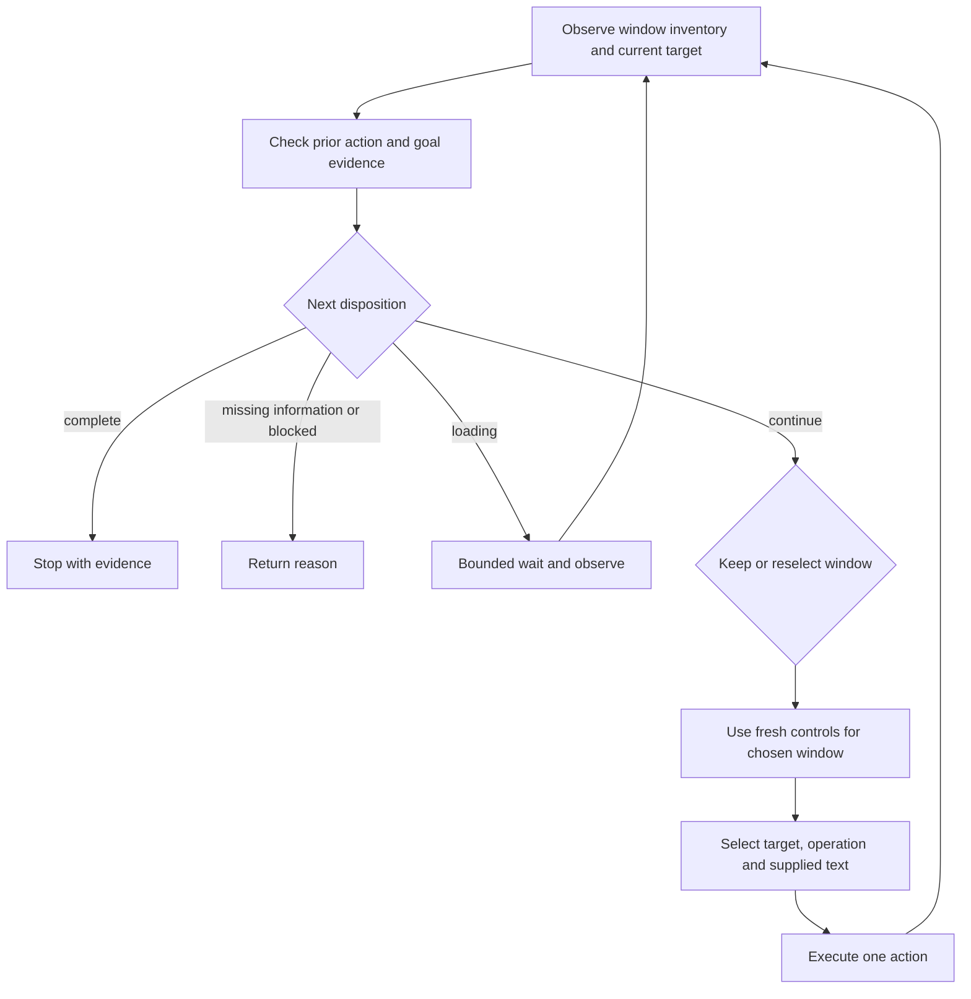

# Text entry and an observed action loop

Research date: 2026-09-21, America/Los_Angeles.

Historical proposal: the baseline and recommendations below describe the
implementation inspected on that date. A basic click/observe loop has since been
implemented; [main workflow](../main-workflow.md) is the current behavior and
explicitly lists the advanced work still deferred. Every run now loops without
an iteration cap, superseding this proposal's suggested run limits. This research did not itself
change runtime code.

Recommendation: extend the existing CUA adapter with its native text tools, then extend the existing pipeline into a bounded action/observation loop. Retain the current window when appropriate, rediscover windows after actions, and rerun window selection when evidence warrants switching. Keep full window reselection available as a comparison policy. Continue pinning `jev-1.13.0` and CUA Driver 0.28.2 while evaluating this change.

This is a research proposal. Tool contracts and implementation were inspected; no typing, messaging, live Jev experiment, or application-control test was performed for this research. Runtime code is unchanged.

## What already exists

- `src/pipeline.py` selects a window, brings it forward, takes one snapshot, selects a control, optionally clicks, and returns. It does not verify after the click.
- `src/driver.py` already owns transport, native dictionaries, target validation, and action errors. Its allowlist currently exposes only reads, foreground activation, and clicking.
- `src/selection.py` already owns `Candidate`, batched Choice questions, request budgets, response validation, and model pinning. Its current question and string-only state are insufficient for progress-aware selection.
- `src/reporting.py` already records every Jev question, probability distribution, native action, and terminal event. Iteration metadata can be added to the same event stream.
- Synthetic Start Menu/Search is a semantic destination only. Adding typing does not automatically implement opening Start or resolving a real search field.

These are extension points; a separate agent framework, second control model, or parallel frontend API is unnecessary.

## Text entry: delivery and content are separate problems

### Delivery choices

The installed 0.28.2 tool registry advertises `type_text`, `set_value`, `press_key`, `hotkey`, clipboard tools, `browser_type`, and `verify_state`. Their availability does not establish that each route works in a particular application.

| Route | Useful for | Semantics and limitations |
| --- | --- | --- |
| Native `type_text` with an observed element target | Ordinary text entry through the current Windows adapter | Send the complete string once. Windows chooses a UIA or input-event route; `delay_ms` is not a universal per-character guarantee. |
| Native `set_value` with an observed element target | Replacing a writable field's complete value | Uses UIA ValuePattern. The provider must support the write and the application must consume it. |
| Native `press_key` / `hotkey` | Enter, Tab, selection shortcuts, and navigation | Keep special keys separate from literal text. Enter can submit a form/message depending on context. |
| Typed browser `browser_type` | A supported browser/Electron editor with an established exact binding | Has bulk insertion, keystroke, and replacement options, but uses browser references, not native element tokens. Binding support must be checked. |
| Clipboard write followed by paste | A fallback when the application's paste behavior is useful | Changes shared clipboard state; requires an exact focused target. The current clipboard API cannot guarantee restoration of every original rich format. |

The native routes and standard text-field replacement are documented in the [Windows tool reference](https://cua.ai/docs/reference/cua-driver/mcp-tools-windows#type_text). Browser modes are documented in [Drive a Web Page](https://cua.ai/docs/how-to-guides/driver/drive-a-web-page). Microsoft confirms that [TextPattern reads rather than edits text](https://learn.microsoft.com/en-us/dotnet/framework/ui-automation/ui-automation-textpattern-overview), and [SetValue requires an enabled, writable control](https://learn.microsoft.com/en-us/windows/win32/api/uiautomationclient/nf-uiautomationclient-iuiautomationvaluepattern-setvalue).

The additional installed schemas were inspected with `cua-driver dump-docs --type mcp --pretty`; this is documentation introspection, not an input action. The checked-in `installed-tool-definitions.json` contains only the previously selected read tools and is not evidence for the additional tools.

### Important version-specific finding: `type_text` is not uniformly caret insertion

In CUA Driver 0.28.2, the targeted background UIA path reads the current ValuePattern value, concatenates the new text to its end, and calls SetValue with that whole string. It therefore appends regardless of the caret position. Other input routes deliver characters to the current selection. Native `type_text` has no `replace` or `mode` argument. See the [versioned implementation](https://github.com/trycua/cua/blob/cua-driver-rs-v0.28.2/libs/cua-driver/rust/crates/platform-windows/src/tools/impl_.rs#L4577-L4587).

That implementation treats a failed current-value read as an empty string. Preservation of existing contents therefore cannot be assumed for an unreadable pre-filled field; this is a source finding that needs a targeted test.

Consequences for our API:

1. Preserve the existing native tool names and arguments; do not expose another near-identical `insert_text` wrapper that pretends all routes have identical semantics.
2. Offer whole-value replacement through native `set_value` where supported. Use `type_text` only with delivery semantics appropriate to the intended edit.
3. If precise insertion into the middle of existing text is required, validate an input-event or browser route. Do not claim native UIA append satisfies that request.
4. If typing character events matters to autocomplete or editor behavior, test the selected route explicitly. Sending one tool call per character is unnecessary.

`browser_type` already distinguishes `mode: "insert_text"` from `mode: "keystrokes"`, and supports `replace: true`. That is a useful optional backend for supported surfaces, not an assumption that our current Slack window can already be attached. Use the driver's existing browser contract if this backend is added.

### Obtaining the exact text

Jev returns decisions over supplied alternatives, not arbitrary generated prose. It can choose the recipient, field, operation, and which supplied string belongs in a field; code must retain and deliver the original string. This follows TypeSafe's [System One model](https://docs.typesafe.ai/concepts/system-one) and [value-selection pattern](https://docs.typesafe.ai/cookbooks/pre_parsed_value_extraction_cookbook).

Start with exact user-supplied text: an explicit input value, quoted span, or file content. When multiple spans are candidates, use Jev to choose a candidate ID and copy the original bytes/string locally. Candidate extraction must have an escape outcome when nothing fits; quoted-span parsing is not a general solution to arbitrary natural-language extraction.

For example, `Message Alex: "Running ten minutes late"` supplies potential recipient and body values. `I want to send a message on Slack` supplies neither a recipient nor a body. A loop should reach a useful point and request missing information rather than invent those values or keep clicking.

Generating a new message from an instruction such as `write a friendly introduction` would require a separate text-generation capability or user-provided content. That capability can be swappable, but is not needed to implement exact text entry.

### Verification

Read the field after delivery and compare the expected value in code when the full value is available. Preserve punctuation, Unicode, whitespace, and multiline content; normalize only documented application transformations. A text-capability label alone does not prove that a field accepts writes.

An action response may be `unverifiable` even when text was delivered. Deferred UIA providers may publish a value later, and web accessibility providers may echo a write without the editor consuming it. See the local Windows companion at `skills/cua-driver-skill-0.28.2/WINDOWS.md`, particularly its text-delivery section near line 778.

Never immediately resend an uncertain append operation. Observe and resolve the effect first; otherwise the same message may be inserted twice. A timeout can occur after dispatch. Cua's [verification example](https://cua.ai/docs/how-to-guides/driver/verify-a-desktop-action) explicitly separates unknown delivery from an independently observed outcome.

## Loop variations

| Policy | Each iteration | Strength | Cost or failure mode |
| --- | --- | --- | --- |
| Full reselection | Discover windows, choose window, observe its controls, choose and execute next action | Simple reference policy; naturally considers cross-app moves | Repeats window inference and can bounce between plausible windows without progress context |
| Current window only | Keep the window, refresh controls, select the next action | Fewer window decisions; works for contained tasks | Misses separate dialogs, replacement windows, or a required move to another app |
| Hybrid, recommended | Refresh observations and window inventory; retain the current window unless evidence calls for reselection | Handles ordinary in-app steps and window transitions | Requires an explicit routing decision and measured recovery rules |

The window policy should be a small replaceable decision inside one loop. All policies should share the same observation, control selection, execution, verification, and reporting code.

Suggested hybrid flow:

After an action, discover whether the old window still exists and whether a relevant new window/dialog appeared. A notification in an unrelated app must not automatically take over the task. Window z-order alone does not establish dialog ownership. A modal inside the same HWND is detected through fresh controls even though the window inventory did not change. If the old window has disappeared, route using fresh discovery before attempting to read it.

Reuse the post-action observation as the next decision's observation where possible. After switching windows, obtain that window's controls. Bring a target forward when needed rather than blindly repeating the current pipeline's activation at every iteration.

## What makes repetition a useful loop

### Progress and stopping

Do not simply call the present `run_pipeline` repeatedly with the original request. Its current question always selects a winner; it cannot express completion, lack of a suitable action, or missing input. Earlier tournament winners can also be passive text nodes that are unsuitable execution targets.

Add an explicit disposition with outcomes such as continue, wait/reobserve, complete, need input, and blocked. These are controller outcomes, not invented UI elements competing inside every control group. For continuing steps, select controls and operations supported by the observed target and implemented driver. Do not map every winner to a click.

Completion requires evidence of the requested result. A click being delivered, a field accepting text, and a message being sent are different postconditions. Use exact checks in code when possible; let Jev judge semantic evidence when a deterministic comparison is insufficient. Weak or incomplete observation must remain unknown, not be treated as success or proof of absence.

Bound the run in code by an action count, elapsed deadline, polling budget, and repeated lack of progress. Make limits explicit configuration for experiments, not unexplained model judgments. Compute counts, timeouts, and date/arithmetic transformations in code. No universal confidence cutoff is established by this research.

### Minimal state and batched questions

Keep the original request intact, but send the context now needed to choose the next step: relevant current facts, the last action and its observed outcome, unresolved input, and a short bounded action history. Keep complete observations and full history in the local report. Do not repeatedly send every previous tree, raw token, or report.

TypeSafe supports named structured state and independent questions evaluated together. Batch disposition, routing, and other independent judgments when they share sufficient evidence. A speculative text-source question can accompany an operation choice if its premise and candidate values are already known; consume it only when that operation wins. A question cannot depend on another answer from the same call. See [State](https://docs.typesafe.ai/concepts/state) and [speculative fan-out](https://docs.typesafe.ai/patterns/fan-out).

Continue batching independent candidate groups with the existing budgets. Only make another model call when dependencies require fresh evidence or new candidates. Changing the state's shape and the instruction to account for progress should happen in the existing selector, not a second Jev client with different validation rules.

### Fresh targets, waits, and errors

- Rebuild the control candidates after every action. Old `element_token` values and indices are not durable control identities.
- CUA replaces handles on a newer snapshot of the same window. Use the target from the observation that produced the decision, without inserting another snapshot before dispatch. If a refresh is necessary, reselect against it.
- A stale-target refusal before execution permits a bounded refresh and new decision. Unknown delivery after an action requires observation before any possible retry.
- Compare meaningful state for progress detection. New snapshot IDs, timestamps, cursor decorations, and unrelated changing content are not task progress.
- Poll for an expected state within a deadline; avoid treating a single unchanged snapshot during loading as failure.

The existing [0.28.2 cache contract](../cua-driver/0.28.2/README.md) is the basis for target freshness. The installed `verify_state` tool also supplies bounded predicate polling. It accepts one to eight AND predicates, `timeout_ms` from 0 to 10000 (default 5000), and `stable_samples` from 1 to 5 (default 2). Element selectors use only `role` and `label_contains`, not native tokens or IDs. Simple element predicates support `value_equals`, `enabled`, `selected`, and `exists: true`; element `exists: false` is rejected because an incomplete tree cannot prove absence. Results distinguish satisfied, unsatisfied, and unknown.

This is useful for exact field values and known transitions, but cannot decide arbitrary task completion. Its effect on the element cache was not verified in this research. Finish verification before obtaining the next actionable snapshot and selecting targets. Export and validate its full versioned contract before integration rather than inventing a second verification wire format.

## Existing Jev + Cua reference

Cua publishes a [jev-use example](https://cua.ai/docs/how-to-guides/driver/jev-use) that fills and submits a local browser form. Jev selects supplied action IDs; the application executes them, observes again, and checks completion independently. It includes reobserve and abstain outcomes.

This is an architectural reference, not a general desktop planner to adopt wholesale. Its form flow offers only the next valid action, uses a browser-specific environment, and sends one choice question per call. The inspected adapter also constructs `TypeSafeClient()` without an explicit model pin. Our workflow must discover controls, handle window transitions, batch questions, and retain `jev-1.13.0`. Its live source can evolve beyond our pinned driver's contract. See the example's [candidate builder](https://github.com/trycua/cua/blob/main/libs/cua-driver/examples/jev-use/python/core.py), [controller](https://github.com/trycua/cua/blob/main/libs/cua-driver/examples/jev-use/python/run.py), and [Jev adapter](https://github.com/trycua/cua/blob/main/libs/cua-driver/examples/jev-use/python/jev_adapter.py).

## Implementation sequence and evaluation

1. Export the installed text, key, and verification schemas beside the existing versioned schemas. Extend `CuaDriver` and the existing `Driver` protocol; reuse common target checks, action-result validation, and native errors.
2. Implement one text action plus post-action observation first. Support exact supplied strings and an explicit distinction between whole-value replacement and text insertion/append semantics.
3. Refactor the existing pipeline into reusable stages and one bounded controller. Reuse `Candidate`, `PipelineResult`, the selector, and `RunReport`; add only genuinely new iteration/progress fields. Preserve a one-action configuration for comparison.
4. Add full-reselection and hybrid window policies to the same controller, then compare them on identical tasks using pinned Jev and driver versions.
5. Extend the existing report with iteration numbers, disposition, window-route reason, action arguments, post-action evidence, and terminal reason. Keep the current raw question/probability records.

Before enabling general desktop use, evaluate in disposable fixtures:

| Case | Evidence to collect |
| --- | --- |
| Empty and pre-filled native fields | Exact final value; append versus replacement; no accidental duplication |
| Unicode, emoji, punctuation, multiline, and longer strings | Exact content and input-event behavior, including any unintended submission |
| Rich browser/Electron editor | Application state and event counters, not just UIA echo |
| New dialog, same-window modal, closed/replaced window | Correct routing and no reuse of stale controls |
| Delayed state update and unknown action response | Wait/observe before retry; at most the intended number of mutations |
| Repeated unchanged state and already-complete goal | Correct bounded stop instead of repeated clicking |
| Missing recipient or message body | Need-input outcome without fabricated text |
| No suitable editable control or incomplete observation | Explicit unknown/blocked outcome rather than a forced click |

Measure task success, duplicate input, wrong-window actions, action count, Jev calls/tokens, end-to-end latency, and time spent waiting. These tests determine route defaults and limits; the research alone does not establish Slack compatibility or an optimal loop policy.
