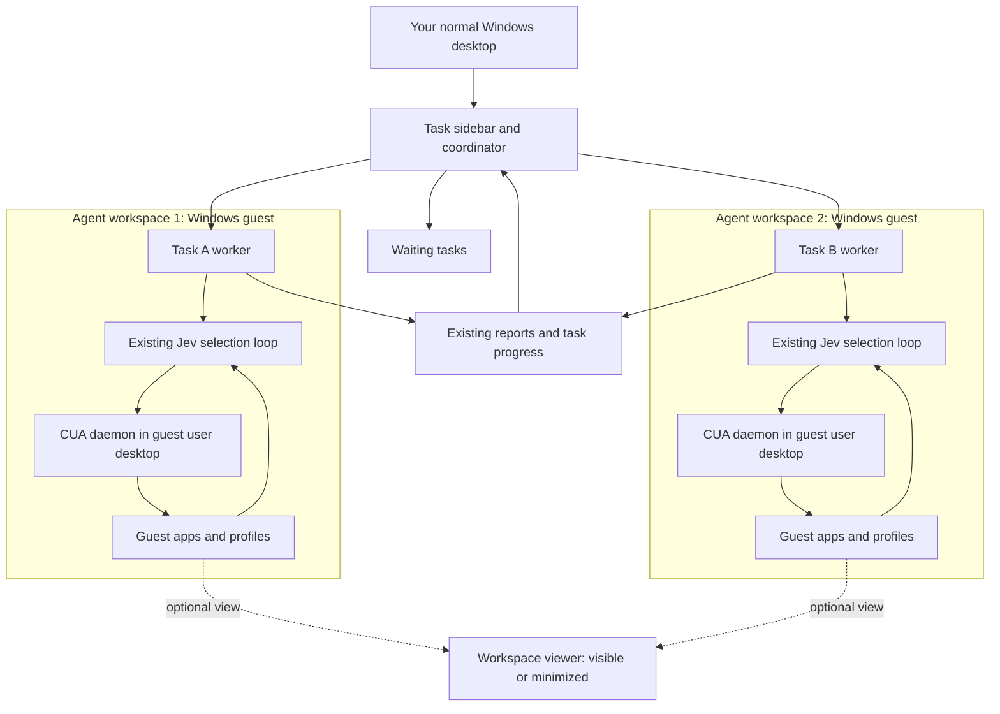

# Background Windows agents: research and architecture decision guide

Research date: **September 24, 2026**. Local repository examined at `f89adbc`
with the working-tree requirement from this conversation. This investigation
used primary documentation, the pinned driver source and patches, and read-only
host capability checks. It did not install a hypervisor, create a VM/session,
change the driver, run computer-use actions, or add automated tests.

## Answer to the user's question

**Yes: a task sidebar can manage one or several agents that work on this PC
while the owner uses the normal desktop.** The implementation needs independent
execution environments for simultaneously acting general-purpose GUI workers,
or a narrower automation method that does not consume shared desktop input.
The sidebar itself does not create that separation.

The strongest initial direction for ctrlloop is **one persistent Windows VM
per active general-purpose GUI worker, with a viewer that is independent of
the worker**. Start with one, prove minimized-viewer operation, then demonstrate
two workers at once. This is an engineering recommendation, not an already
implemented capability or a measured guarantee for every Windows application.

A child-session workspace is a credible lighter option for **one** companion
worker. Pattern-only UIA on a hidden desktop deserves a focused investigation.
Headless browser environments are another useful option for web-only tasks.
These options have different capability limits and should remain replaceable.

A local VM still runs on this physical PC; each agent does not need a separate
physical computer or a cloud desktop. Jev's remote API calls remain a separate
part of the existing architecture.

The requested behavior is recorded in the [product requirement](../../background-execution.md).

## Product dependency decision

The user's follow-up favors local Windows VMs per active GUI worker. This remains
the recommended first backend. UiPath is a feasibility reference, not a selected
runtime dependency.

UiPath's main automation platform is proprietary licensed software. Its RobotJS
integration SDK is separately Apache-2.0 licensed and supports custom applications,
but communicates with installed UiPath Robot components. Thus third-party
integration is possible; that is different from having a standalone open-source
PiP engine to bundle. These sources do not establish redistribution rights for
our proposed product; those would require the applicable agreement.
[UiPath licensing](https://licensing.uipath.com/),
[RobotJS SDK](https://docs.uipath.com/robot/standalone/2025.10/developer-guide/about-the-robot-javascript-sdk),
[commercial terms framework](https://www.uipath.com/legal/trust-and-security/legal-terms)

Our own worker on a supported hypervisor retains control of the Jev loop, driver,
workspace lifecycle, viewer, and task scheduling without adding UiPath as a
required runtime. It still requires Windows/app entitlements and the operational
work of guest provisioning, updates, profiles, and resource management. Prefer
one VM per concurrently operating worker, reused across tasks where appropriate,
rather than one permanently allocated VM for every sidebar entry.

## Reading map and evidence levels

| Document | What it answers |
| --- | --- |
| This guide | Feasibility, recommended architecture, local hardware, concurrency, product behavior, and next decisions |
| [Windows isolation](isolation.md) | Sessions, window stations, Win32 desktops, UIA, input, clipboard, security, and hidden-desktop limitations |
| [Sessions and VMs](sessions-and-vms.md) | PiP precedents, child sessions, Hyper-V, RDP lifecycle, RDS/AVD, Sandbox, and licensing boundaries |
| [Runtime and browser audit](runtime-and-browser.md) | Our pinned CUA/ctrlloop implementation, transport and snapshot scoping, browser alternatives, and implementation seams |

**Documented** means a cited primary source establishes the platform/product
behavior. **Locally observed** means a read-only command or source inspection
established it here. **Recommended** means our engineering judgment.
**Unverified** means the actual configuration still needs a manual experiment.
Documentation about another automation product is precedent, not a compatibility
certificate for our driver.

## What the task sidebar actually represents

The screenshot shows independently tracked work. A task can have its own
instructions, context, logs, progress, and result without having a private
Windows desktop. Codex documents Git worktrees as separate repository checkouts
for parallel work. That is file/branch separation; it does not establish a
separate input surface or Windows login for each task. The screenshot alone
does not reveal how any particular task's tools execute.
[Official worktree documentation](https://learn.chatgpt.com/docs/environments/git-worktrees)

For ctrlloop, distinguish four things:

1. **Task:** the user's request and its retained progress.
2. **Worker:** the running controller/loop that performs it.
3. **Workspace:** the applications, profiles, files, and interactive environment
   assigned to that worker.
4. **Viewer:** the optional presentation of that workspace to the user.

Our product can show ten tasks with two workspaces: two tasks can be operating
apps while the rest wait, plan, or perform independent non-GUI work. It must
show that difference honestly. Ten Python processes attached to the same
desktop would not provide ten independent GUI workers.

There is existing industry precedent for this scheduling distinction: UiPath
describes concurrent background jobs separately from GUI execution and provides
a queue for jobs that need a foreground execution slot. Our scheduler design
can borrow the ownership principle without adopting that product or its APIs.
[Job execution environments](https://docs.uipath.com/robot/standalone/latest/admin-guide/job-executions),
[foreground scheduling](https://docs.uipath.com/activities/other/latest/ui-automation/use-foreground)

## The options, compared

The conclusions below are supported in detail in the linked research notes.
“Parallel” refers to independent execution, not merely multiple task cards.

| Approach | Human can keep working? | Several general GUI workers? | Main limitation / role |
| --- | --- | --- | --- |
| Hidden Python process on the current desktop | Process is hidden; its GUI actions can still interfere | No input isolation | Our launcher already does this; insufficient |
| Win+Tab virtual desktops | Windows can be organized out of sight | No independent input environments | Presentation, not worker isolation |
| Direct background UIA in existing apps | Sometimes, for supported controls | Limited/app-dependent | App responses can still change focus or visible content |
| Hidden Win32 desktop | Plausible for qualified UIA-only workloads | Multiple UI surfaces, but not independent normal input streams | Shared account/station resources; app and capture compatibility unproved |
| Product virtual-desktop automation | Current UiPath precedent | Product supports multiple PiP user sessions | No hardware-event/image-based automation in that mode; does not establish a CUA backend |
| Child-session PiP | Documented product precedent | One connected child session per system | Useful one-worker candidate, not an arbitrary workspace pool |
| Persistent Windows VM per worker | Strong candidate with guest-local automation | Yes, bounded by resources and setup | Guest OS/app setup, display/session lifecycle, storage and entitlements |
| Windows Server RDS | Separate user sessions | Yes, with proper deployment | Shared-OS compatibility and server/session administration |
| AVD multi-session | Separate user sessions | Yes, managed infrastructure | Not a normal Windows Pro configuration option |
| Stock Windows Sandbox | Separate temporary OS environment | Multiple simultaneous instances unsupported | Disposable state; useful single experiment |
| Headless browser contexts/processes | Yes, for browser-protocol operations | Many web tasks, not arbitrary desktop apps | Browser scope, profile/account and shared-server-state conflicts |
| Ordinary Windows containers | Not a full interactive Windows desktop | Not a desktop-worker solution | Different from a VM packaged/orchestrated through Docker |

Sources and exact qualifications: [isolation](isolation.md),
[sessions and VMs](sessions-and-vms.md), [runtime/browser](runtime-and-browser.md).
This comparison intentionally does not assign unsupported speed, cost, or
reliability scores.

There is current evidence for the lighter route: UiPath documents a virtual-
desktop workspace with a preview and multiple PiP user sessions per machine.
Its compatibility table excludes hardware input and image-based automation.
That makes a non-VM implementation worth investigating for supported apps,
while our current mixed-input loop still favors a guest as the first proof.
[UiPath virtual desktop](https://docs.uipath.com/assistant/standalone/latest/user-guide/pip-virtual-desktop),
[compatibility comparison](https://docs.uipath.com/assistant/standalone/latest/user-guide/technology-comparison)

## How an agent would operate its own apps

The following is a proposed deployment of the existing loop, not a new action API.

The coordinator assigns an available workspace. That workspace already has a
usable Windows user session, the intended app/profile, and the compatible CUA
daemon. The existing loop discovers **guest** windows, reads their controls,
asks Jev to choose, and dispatches the native action inside the guest. Bringing
Chrome forward there changes the guest desktop, not the host's foreground app.
The host viewer displays the result but does not deliver the automation's clicks.

The UIA driver must run beside the target applications. Running the host driver
against the VMConnect window would mostly expose the viewer and would make
automation depend on that window's visibility. A guest-local driver returns
native guest window/control observations instead.

Microsoft's Windows Agent Arena is a concrete research precedent: its local
environment contains a Windows VM with an in-guest command server, while its
parallel cloud execution allocates separate environments. It is evidence for
the deployment pattern, not a ready-made ctrlloop integration or a claim of
current agent accuracy. [Microsoft project overview](https://www.microsoft.com/applied-sciences/projects/windows-agent-arena),
[repository setup](https://github.com/microsoft/WindowsAgentArena)

OmniTool likewise separates the Windows VM, the agent/controller, and a web
interface for watching execution. Its Docker packaging still hosts an actual
Windows VM and depends on virtualization; it does not show that ordinary
Windows GUI apps run inside normal Windows containers.
[OmniTool architecture](https://github.com/microsoft/OmniParser/blob/master/omnitool/readme.md)

## Minimizing the viewer must be an explicit contract

The accepted user experience is feasible, but “background” hides several
different states. A running OS process and an automation-ready desktop are
separate conditions.

| Event | Required interpretation for our product |
| --- | --- |
| Switch to another task card | Existing worker retains its workspace and continues |
| Minimize workspace viewer | Worker, guest desktop, and actions remain healthy; this is required |
| Restore viewer | Show current state without replaying actions or restarting the task |
| Close viewer | Proposed behavior: detach observation; keep worker alive. Verify backend supports it |
| Minimize an app inside the guest | Different event; current direct-click patch rejects minimized target apps |
| Disconnect RDP | Processes may survive while input/rendering capability changes; never infer readiness from process liveness |
| Lock the guest | Some automation paths stop working; should become an explicit readiness/attention condition |
| Lock the host | Separate from guest lock; qualify behavior for the selected backend |
| Sign out of the worker's user session | Session/UI state can disappear; task must not silently continue against another desktop |
| Host sleeps, hibernates, shuts down, or loses power | Local work is interrupted; minimizing a viewer does not provide cloud-style availability |

UiPath's versioned child-session product explicitly supports minimizing while
continuing, but closing that viewer stops its process. Power Automate's newer
virtual-desktop preview permits closing its viewer while execution continues.
These different behaviors demonstrate why our own contract must be deliberate.
[UiPath PiP lifecycle](https://docs.uipath.com/assistant/standalone/2023.10/user-guide/pip-child-session),
[Power Automate PiP](https://learn.microsoft.com/en-us/power-automate/desktop-flows/run-desktop-flows-pip)

Hyper-V Enhanced Session Mode uses RDP and can redirect clipboard, audio, and
devices. A VM's OS boundary does not prevent redirected resources from touching
the host. For this product, sharing should be intentional, and viewer input
should be disabled while merely observing. A human takeover should suspend
agent actions and require fresh observations afterward.
[Enhanced Session Mode](https://learn.microsoft.com/en-us/windows-server/virtualization/hyper-v/enhanced-session-mode)

Microsoft documents failures when ordinary RDP windows are minimized. A registry
workaround in an RPA troubleshooting article is not a universal proof for our
app/driver combination. No such workaround was applied here.
[RDP automation failure modes](https://learn.microsoft.com/en-us/troubleshoot/power-platform/power-automate/desktop-flows/ui-automation/uipi-issues)

Local workers also depend on the host remaining in a working power state. An
unattended remote worker would be a separate deployment choice if tasks must
continue while the laptop sleeps.
[Windows power states](https://learn.microsoft.com/en-us/windows/win32/power/system-power-states)

## What is feasible on this computer

These are **locally observed** capability readings from this research session,
not published requirements or performance results. Available RAM and disk are
point-in-time values.

| Property | Observation |
| --- | --- |
| OS | Windows 11 Pro, build 26200 |
| Processor | AMD Ryzen AI 9 HX PRO 375 |
| Cores / logical processors | 12 / 24 |
| Physical RAM visible to Windows | 63.3 GiB |
| Available RAM when sampled | 30.7 GiB |
| Free space on C: when sampled | 575.6 GiB |
| Firmware virtualization | Reported enabled |
| Hypervisor present | Reported true |
| Virtual Machine Platform optional feature | Enabled |
| Full Hyper-V optional feature | Disabled |
| Windows Hypervisor Platform optional feature | Disabled |
| Windows Sandbox optional feature | Disabled |
| Hyper-V PowerShell module | Not returned by module enumeration |

Feature-state values were interpreted using Microsoft's documented
`Win32_OptionalFeature.InstallState` enumeration.
[Optional-feature reference](https://learn.microsoft.com/en-us/windows/win32/cimwin32prov/win32-optionalfeature)

WMI reported SLAT as false despite an active hypervisor. This report does not
treat that isolated reading as a definitive hardware failure. Microsoft notes
that an active hypervisor changes visibility of ordinary requirement checks.
The relevant next check is supported Hyper-V readiness, not assuming a working
VM backend from `HypervisorPresent` alone.
[Hyper-V requirements](https://learn.microsoft.com/en-us/windows-server/virtualization/hyper-v/host-hardware-requirements)

**Planning recommendation, not a benchmark:** begin with one Windows guest
budgeted around 8 GiB RAM and four virtual CPUs, then assess a second comparable
worker. Two such RAM allocations total 16 GiB, leaving roughly 14.7 GiB of the
sampled free RAM before additional host/guest overhead and workload growth.
This is a starting experiment, not a promise that all workloads fit or that
four vCPUs equal four dedicated physical cores. Measure actual peaks and host
responsiveness before expanding the pool.

The model calls in this project use a remote Jev API. The local workspace
budget therefore primarily covers Windows, the driver, browser/app processes,
and viewing—not an assumed local copy of a large model. API concurrency and
usage remain a separate resource from GUI-worker capacity.

## Parallelism needs ownership at more than one level

The recommended first scheduler gives each active GUI worker exclusive use of
one workspace for its task. Hold that ownership across observation, Jev
selection, action, and the next observation. Locking only a single `click`
request leaves room for another task to alter state between the snapshot and
the action based on it.

The pinned driver's snapshot cache makes this concrete: another observation of
the same target window can supersede previous tokens. A private MCP client or
named pipe does not automatically create a new desktop or independent app.
See the [runtime audit](runtime-and-browser.md) for the cache and transport code.

A passive preview should use worker-published observations or a capture path
that does not replace the worker's control snapshot. Polling `get_window_state`
independently just to refresh a preview can itself invalidate the selection
the worker is about to execute.

Workspace isolation does not eliminate shared-business-state conflicts. Two
separate Chrome instances logged into the same account may still edit the same
document, change the same cart, or repeat an external operation. This is our
design inference: use resource ownership or task ordering where the jobs share
a mutable target, even when their mouse/keyboard environments are independent.

Do not migrate a task between workspaces with old HWNDs, PIDs, element tokens,
or screenshot coordinates. Those identities belong to a particular runtime
and observation. A move or reconnect needs a fresh read before further action.
The existing driver already avoids replaying an action after a lost response;
the scheduler must preserve that behavior instead of automatically restarting
the task from the top.

Ten sidebar tasks need not mean ten permanently running Windows guests. A small
warm pool with queued work is a sensible first product. Idle workspaces can be
retained for app login continuity or stopped under an explicit lifecycle policy.
Resuming an old guest requires a health check and fresh UI state, not trust in
the last saved control identity.

## Accounts, apps, files, and persistence

A guest has its own Windows filesystem, installed apps, and application profile.
It does not automatically contain the user's unsaved Word document, current
browser tabs, desktop Slack session, or host credentials. The implementation
must choose whether a task needs the exact current app instance or can operate
an agent-owned instance with access to the same underlying service/files.

For a persistent workspace, provision apps once and establish its intended
sign-ins deliberately. Keep its browser profile exclusive while it is in use.
For local files, use a selected shared location or explicit import/export.
Decide how simultaneous user edits and agent edits are reconciled. For SaaS
tasks, a fresh sign-in can expose the same account data without sharing the
host browser's live profile directory. See the [browser audit](runtime-and-browser.md)
for profile and authentication limits.

Human login, MFA, or app prompts should mark the relevant task as needing
attention and reveal its workspace only on user request. This is proposed
product behavior; no credentials or profiles were accessed during research.

Checkpoints help recover a worker environment, but rolling back its disk or
memory cannot undo an external action already performed. Microsoft also
distinguishes memory-bearing standard checkpoints from production checkpoints.
Treat those as infrastructure recovery tools, not task transactions.
[Hyper-V checkpoints](https://learn.microsoft.com/en-us/windows-server/virtualization/hyper-v/checkpoints)

Windows guest and app entitlements must be established before deployment.
The existing Windows Pro installation does not by itself establish unlimited
guest rights. The [sessions/VM note](sessions-and-vms.md) links the relevant
official licensing sources and keeps their commercial/program scope explicit.

## Fit with ctrlloop and what would change

Keep the current `Driver` protocol, `CuaDriver`, native observation/action
records, Jev selection questions, model pin, `PipelineResult`, and `RunReport`.
Execution placement is outside Jev's control-selection problem. No new Jev
question is needed for this research recommendation.

The smallest first experiment runs the **existing loop and compatible daemon
inside one Windows guest**. This retains the local native transport instead
of inventing a second click/type API. A later coordinator can launch and track
that same worker contract and reuse its JSON results and report artifacts.
Any authenticated cross-environment channel must be chosen deliberately; the
current named-pipe adapter does not already route to a guest.

Evaluate existing lifecycle tooling before writing a custom VM manager. Cua
already publishes a separate sandbox runtime for local computers; its lifecycle
distinguishes disconnecting from destroying a persistent environment. That is
a close conceptual fit for an optional viewer. Its newer SDK is separate from
our pinned Driver 0.28.2, and the published image/runtime table is not proof
that a chosen Windows image boots and works here. Adoption needs explicit
version and compatibility qualification.
[Cua local lifecycle](https://cua.ai/docs/how-to-guides/sandbox/manage-local-lifecycle),
[runtime support matrix](https://cua.ai/docs/reference/sandbox-sdk/runtime-support)

The actual UI driver belongs in the guest's interactive user desktop. A host
service or PowerShell provisioning session can help manage the guest, but its
ability to run commands does not establish access to that desktop.
[PowerShell Direct](https://learn.microsoft.com/en-us/windows-server/virtualization/hyper-v/powershell-direct),
[service/UI separation](https://learn.microsoft.com/en-us/windows/win32/services/interactive-services)

Current behavior that matters:

- The loop activates a real window before each control observation.
- Browser typing ordinarily uses foreground delivery; Windows Search sends
  desktop commands. These can remain inside a qualified guest environment.
- Direct-accessibility clicks still draw a cursor overlay and reject minimized
  target apps. The viewer may be minimized while guest apps remain restored.
- The Hermes plugin launches with `CREATE_NO_WINDOW` and returns a launch
  receipt. It provides no task completion tracking or stop control.
- The loop stops at `iteration_limit` without assessing task completion.
  A future sidebar must not label that result as verified success.

These findings are local source observations, documented in the
[runtime audit](runtime-and-browser.md). VM placement addresses desktop
interference; it does not fix task-completion assessment, every text-entry
limitation, or unsupported controls automatically.

## Recommended research-to-implementation sequence

This is a manual validation plan, consistent with the repository's current
no-new-tests instruction. No steps below have been executed yet.

1. **Prove one persistent worker.** Prepare one supported Windows guest with
   a known app, compatible pinned driver, and the current ctrlloop. Verify
   window discovery, UIA controls, direct activation, exact text entry, and a
   fresh observation. Record the guest session/desktop identity.
2. **Prove the core user experience.** Run several loops while the user types
   in a host app. Minimize and restore the viewer. Observe focus, mouse,
   keystrokes, clipboard, overlays, and continuing guest progress throughout.
3. **Probe lifecycle separately.** Close/reopen the viewer, disconnect/reconnect
   any RDP path, lock/unlock host and guest separately, and restart the worker.
   Record supported behavior and explicit failures rather than assuming all
   forms of “background” behave alike.
4. **Prove two simultaneous workers.** Use independent apps/profiles, verify
   no cross-target input or token confusion, and measure host responsiveness,
   RAM peaks, UI action latency, and API pressure.
5. **Add task management using existing contracts.** Retain task-to-workspace
   ownership, waiting/running/attention state, current reports, and stop control.
   Keep process exit, iteration-limit stop, and verified completion distinct.
6. **Evaluate the lighter options against the same requirements.** Compare a
   child-session worker for single-worker use and a UIA-only hidden desktop for
   selected apps. Evaluate browser contexts when the task is entirely web-based.

Measure cold workspace startup, warm reuse, app sign-in/setup, queue delay,
and the existing per-loop stage timings separately. Otherwise a fast action
path can conceal a long VM/session setup cost. Use the existing report system
where applicable rather than creating competing timing formats.

## Decisions the evidence supports now

- A minimizable agent workspace is feasible; it has documented product
  precedents. It is not a capability switch already present in our loop.
- One worker and multiple truly concurrent GUI workers have different backend
  choices. Child-session limits make that distinction especially important.
- A persistent local VM pool is the leading broad-application route for this
  PC and this existing driver architecture. Actual minimized-viewer and app
  compatibility still require the manual proof above.
- Keep browser-only and semantic UIA paths available as lower-overhead options;
  do not force every kind of task through a full Windows desktop.
- Source-backed research settles the architecture constraints. It does not
  establish a measured maximum worker count, guest licensing entitlement,
  or universal application compatibility on this machine.
