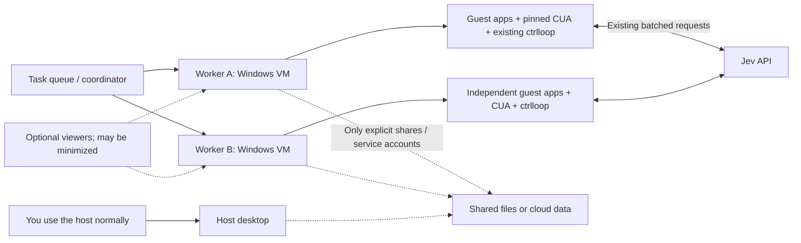

# Local Windows VM workers for ctrlloop

**Research and architecture recommendation — September 24, 2026.** No VM
prototype has been demonstrated. This dossier extends the earlier
[background-execution research](../windows-background/README.md) and the
[product requirement](../../background-execution.md) into a concrete VM design.
It preserves the existing Jev/CUA contracts and proposes no new Jev questions,
runtime changes, or automated tests.

## The answers in plain language

**Yes, Windows apps inside a VM can expose UIA.** Put CUA Driver **inside that
Windows VM**, beside the apps it controls. The host can receive the driver's
native observations over a controlled connection. Inspecting the host's VM
viewer is different: its screen image is not automatically the guest apps'
native accessibility tree. Actual compatibility of our pinned driver and app
set still needs the manual proof below.
[Microsoft UIA architecture](https://learn.microsoft.com/en-us/windows/win32/winauto/uiauto-uiautomationoverview),
[pinned-stack audit](architecture-and-scheduling.md)

**VM-A and VM-B normally have independent Windows environments.** Each has its
own installed apps, files, registry, processes, browser profiles and desktop
input. An app brought to the foreground inside A does not become the foreground
app on your host. But VMs still share physical CPU, RAM, storage and networking,
so a busy VM can slow the host or its sibling.
[Hyper-V architecture](https://learn.microsoft.com/en-us/windows-server/virtualization/hyper-v/architecture),
[resource and isolation distinctions](isolation-and-networking.md)

**Changes can cross boundaries when you connect the data.** If A edits an
explicitly shared host folder, that is a change to the host's file. If A edits
the same cloud document you have open, you see the document change. Those are
expected data effects, even though A's mouse and keyboard remain separate.
VMs are also not absolute protection from software vulnerabilities or from
an overbroad sharing/network configuration; the trusted host administrator
controls the VMs.
[Sharing and visibility matrix](isolation-and-networking.md),
[Microsoft security-boundary criteria](https://www.microsoft.com/en-us/msrc/windows-security-servicing-criteria)

**VMs can browse the web.** Give each guest a usable network path, DNS, and any
required proxy/VPN configuration. Internet access does not grant access to your
host's files. Conversely, a redirected drive or a hypervisor management channel
can provide host/guest access without internet connectivity.
[Microsoft NAT networking](https://learn.microsoft.com/en-us/windows-server/virtualization/hyper-v/setup-nat-network),
[VMConnect resources without guest networking](https://learn.microsoft.com/en-us/windows-server/virtualization/hyper-v/use-local-resources-virtual-machine-connection)

**A minimized viewer can be compatible with a running worker, but this exact
combination remains unproved.** Run the agent inside the guest and use the
viewer only to view or deliberately take control. The best first candidate is
Hyper-V with basic VMConnect. Enhanced VMConnect uses RDP; Microsoft documents
minimized RDP as a possible automation failure. Even basic mode has a
`LockOnDisconnect` setting, so closing/disconnecting is a separate qualification
from minimizing. Keep the actual target apps restored inside the VM: our click
patch refuses minimized targets.
[VMConnect modes](https://learn.microsoft.com/en-us/windows-server/virtualization/hyper-v/enhanced-session-mode),
[RDP automation failure modes](https://learn.microsoft.com/en-us/troubleshoot/power-platform/power-automate/desktop-flows/ui-automation/uipi-issues),
[basic-mode lock setting](https://learn.microsoft.com/en-us/powershell/module/hyper-v/set-vm?view=windowsserver2025-ps#-lockondisconnect),
[viewer deep dive](viewer-and-lifecycle.md)

### Your File Explorer and app examples

Assume separate guest disks/profiles and no sharing or account sync unless the
row says otherwise. These are expected outcomes from the documented mechanisms,
not observations from an installed prototype.

| You or an agent does this | Where the change appears |
| --- | --- |
| A creates/deletes `C:\AgentWork\notes.txt` | Only A's guest filesystem. Host and B do not gain/lose the same local file. |
| Host installs an app or changes a local Windows setting | Host only. A/B have their own installations/settings. Account roaming or remote-management policy is a separate exception. |
| A edits `\\HOST\AgentExchange\report.docx` | The actual host file changes. B sees it if B also accesses that share. An already-open editor buffer may lag; competing writes can conflict. |
| A edits/deletes a file in a synced OneDrive/Dropbox folder | Other subscribed devices and the cloud can change when synchronization occurs. Offline clients lag; conflicts depend on the app/service. |
| A changes a Google Doc or mailbox used on host/B | The same online document/account changes. Refresh, network state, permissions and app behavior govern visibility. |
| A types into an editor's truly local unsaved buffer | Host/B do not inherit that process's text, caret or undo state. Autosaving/cloud drafts can be exceptions. |
| A uses its own browser profile with sync disabled | Cookies, local history and site storage remain in A. The same website account can still share server-side data. |
| A downloads to its local Downloads folder | File stays in A until exported, shared, or synced. A's upload sends the selected guest-accessible file to the chosen service. |
| A copies text with viewer/cloud clipboard integration enabled | Content may reach the host and other connected/synced sessions. Disable unwanted integrations deliberately; enhanced mode has sharing defaults. |

The [full host/A/B matrix](isolation-and-networking.md) includes propagation,
conflict, account, redirected-drive, read-only-share, browser-sync and upload
exceptions with nearby primary citations. A familiar folder name such as
“Documents” is not proof the folder is private: inspect its actual storage/sync
location during later setup.

## Recommended architecture

**Use one persistent local Windows 11 Hyper-V VM per concurrently acting GUI
worker, initially one and then two. Reuse those VMs across compatible tasks.**
Keep the existing loop and patched CUA daemon inside the guest for the first
proof. Use a small warm pool with app/account affinity; keep task state and
viewer attachment independent of VM lifetime. This is an engineering
recommendation, not a measured capacity or a completed implementation.

The coordinator selects the VM connection **before** window discovery. All
native PIDs, HWNDs, controls and snapshot tokens are interpreted through that
connection. A and B can have identical numeric PIDs and window titles; those
numbers are not global worker identities. Preserve `Driver`, `CuaDriver`, native
MCP payloads, `PipelineResult`, `DriverError` and existing reports rather than
adding another family of VM-specific actions/windows/controls.
[Execution path and contract audit](architecture-and-scheduling.md)

Ten task cards do not require ten permanently running VMs. Two workers can act
while eight tasks wait. Tasks depending on unsaved app state keep their assigned
workspace; unrelated work can reuse a free compatible workspace. One actor owns
each guest desktop across observation, Jev selection and dispatch. Merely using
different driver sessions/pipes does not isolate foreground focus or protect
snapshot tokens inside one guest.
[Ownership and scheduling](architecture-and-scheduling.md)

Human takeover pauses agent dispatch in that guest, then invalidates prior
observations before resumption. Cancellation stops future actions; it does not
reverse an already-sent action. Transport loss after a click means its effect
may be unknown. Reobserve and reconcile instead of blindly replaying.

The current Hermes integration is only a launch receipt. It has no durable task
manager or Stop integration. Current loop termination, including
`iteration_limit`, does not assess task completion. A VM backend therefore
requires lifecycle/ownership work around the existing loop, not just a different
launch command. Current reports are buffered until close and are not a durable
crash journal.
[Hermes implementation](../../../plugins/hermes/__init__.py),
[pipeline](../../../src/pipeline.py), [reporting](../../../src/reporting.py)

## What this investigation adds to the earlier research

| New finding or sharper distinction | Consequence |
| --- | --- |
| Basic VMConnect supports lock-on-disconnect configuration | Closing a basic viewer is not guaranteed to leave an unlocked guest. Qualify minimize and close separately. |
| Pinned CUA has authenticated loopback MCP HTTP **and a separate private Driver-envelope carrier** | Neither is a ready LAN endpoint. The envelope carrier requires trusted upstream authorization and is not the bearer-authenticated MCP interface. |
| Current Cua sandbox documentation and inspected source have different versions | Pin lifecycle package, driver, image and guest together; latest SDK examples do not certify our driver. |
| Inspected Cua Hyper-V stop removes the per-worker disk; persistent lookup/suspend/resume/delete have gaps | “Persistent sandbox” cannot be assumed to mean a durable restartable signed-in Windows worker. |
| Inspected Windows provisioning helper bypasses requirements and changes UAC, RDP authentication, update and login behavior | Do not adopt those defaults automatically for our product. Normally provisioned Windows 11 is the recommended baseline. |
| Default Switch convenience differs from manually configured WinNAT | Do not assume NAT supplies DHCP or “internet-only” access in every configuration. |
| Cloud clipboard/browser sync are separate from viewer redirection | Disabling RDP clipboard or using separate profiles does not close all account-mediated sharing paths. |
| Restoring VM state does not restore shared/cloud state | A resumed worker can repeat actions against a newer external world; invalidate ownership/tokens and reconcile. |

Primary source detail for these findings is in the linked deep dives below.
The Cua implementation findings are a source audit of a specific revision,
not a claim that every Cua release/provider behaves identically.

## Existing tooling before custom infrastructure

Use supported Hyper-V management first: PowerShell/WMI for VM lifecycle,
VMConnect for initial viewing, PowerShell Direct for bounded bootstrap/artifact
transfer, and native guest Windows sessions for automation. Hyper-V sockets are
a later option for a guest control channel independent of IP addresses. Windows
Hypervisor Platform is a lower-level virtualization API; using it directly would
require building substantially more of the VM platform than this task needs.
[Platform/API comparison](platform-and-images.md)

Cua already has local sandbox lifecycle tooling and a real Windows-on-Windows
Hyper-V backend. That is worth reusing if qualified, but this investigation found
material persistence, provisioning and version issues. Do not adopt it solely
because `Image.windows()` exists or a `/status` endpoint responds. The
[versioned source assessment](platform-and-images.md) separates advertised
capabilities from implementation. UiPath remains a feasibility precedent and is
not a selected runtime dependency.

A browser-only headless backend can later be much lighter for wholly web-based
tasks. It changes capability scope and would need an explicit contract decision;
it does not provide native Windows apps or transfer the host's live unsaved state.
Server/RDS, QEMU, cloud workers and Windows Sandbox have different tradeoffs
covered in [platform and images](platform-and-images.md) and the earlier
[alternatives study](../windows-background/README.md).

## Fit for this PC

The prior read-only inventory found Windows 11 Pro build 26200; an AMD Ryzen AI
9 HX PRO 375 with 12 cores/24 logical processors; 63.3 GiB usable RAM, 30.7 GiB
available RAM and 575.6 GiB free disk **at the time sampled**. Virtual Machine
Platform was enabled; full Hyper-V, Windows Hypervisor Platform and Sandbox
were disabled, and a hypervisor was present. These readings were carried forward,
not remeasured as a performance benchmark.
[Recorded local inventory](../windows-background/README.md)

This is a reasonable machine for a one-then-two-worker experiment. It is not
evidence for a promised worker count. An initial 8 GiB/four-vCPU guest budget is
a planning choice; vCPUs are scheduled resources, and Windows updates, browsers,
app memory, SSD traffic and viewer capture add overhead. Measure host
responsiveness and peaks before increasing concurrency.

The WMI SLAT=false reading conflicts with the active-hypervisor context; it is
not sufficient to declare the hardware incompatible. Microsoft notes the effect
of an existing hypervisor on requirement reporting. Full Hyper-V readiness,
guest licensing, image setup, and the minimized-viewer proof are still separate
gates. No feature was enabled and no reboot was requested here.
[Hyper-V requirements](https://learn.microsoft.com/en-us/windows-server/virtualization/hyper-v/host-hardware-requirements)

## Identity, persistence, and shipping this as our product

A guest needs its own Windows/app setup and deliberate sign-ins/MFA. It does not
inherit the host's installed Slack, current browser session, or unsaved Word
document. Persist a worker's approved profile inside its own guest; transfer
specified documents/artifacts rather than sharing an entire live profile.

Use a clean, generalized, unsigned-in image plus distinct per-workspace disks.
Install/update guest components through a versioned process, then assign app
accounts deliberately. Keep durable signed-in workspaces separate from
disposable experiment clones. Checkpoints are useful local recovery tools,
not backups of the internet or an undo button for sent mail, shared-folder
deletions or cloud transactions.
[Image, checkpoint and provisioning strategy](platform-and-images.md)

Owning Windows Pro with Hyper-V does not establish rights to every Windows
guest or redistribution of Windows/app images. Product packaging needs an
explicit entitlement/distribution route and applicable application licensing,
including unattended Office scenarios where relevant. The dossier identifies
primary licensing sources and unresolved deployment choices rather than
guessing this user's agreement or recommending a purchase.
[Licensing and product packaging](platform-and-images.md)

## Reading map and remaining proof

| Chapter | What to use it for |
| --- | --- |
| [Architecture and scheduling](architecture-and-scheduling.md) | Exact host/guest/session/app/UIA path, pinned source audit, transport options, exclusive ownership, task state and uncertain-action recovery. |
| [Isolation and networking](isolation-and-networking.md) | Full visibility matrix, resource/security boundaries, switches/NAT/DNS/VPN/proxy/firewalls, accounts/profiles and precise sharing exceptions. |
| [Viewer and lifecycle](viewer-and-lifecycle.md) | Basic/enhanced/RDP behavior, minimizing vs locking/disconnecting, host power/session changes, screen capture, resolution/DPI and evidence gaps. |
| [Platform and images](platform-and-images.md) | Existing Cua/Windows tooling, versions/source audit, guest setup, licenses, checkpoints/clones, storage and product strategy. |
| [Manual prototype](manual-prototype.md) | Bounded one-then-two-guest plan, concrete pass evidence and timing artifacts; no automated tests. |

**Documented** means primary documentation establishes the mechanism. **Local
source observation** means inspected code establishes an implementation detail,
not that a running binary was tested. **Recommendation/inference** means the
design follows from that evidence. **Unverified** marks behavior requiring a
manual run with the chosen versions/settings/apps. Current upstream source and
the pinned driver are labeled separately. Key platform, viewer and isolation
claims were researched independently; the architecture was cross-reviewed.

The decisive missing evidence is: native observations and successful guest input
continue while basic VMConnect is minimized, the host remains usable throughout,
two guests remain correctly routed, and failures/locks/reconnects cannot replay
uncertain actions or fall back to the host. Also unmeasured are sustained capacity,
app compatibility, capture freshness and startup/recovery behavior. The manual
plan records these separately, so a working VM cannot be mistaken for a finished
background-worker product.

All new work for this dossier is documentation under this directory. Existing
main-branch runtime edits from other tasks were left in place. Research did not
enable virtualization, install/boot guests, change network/security settings,
run GUI automation, inspect secrets, send messages or purchase services.
