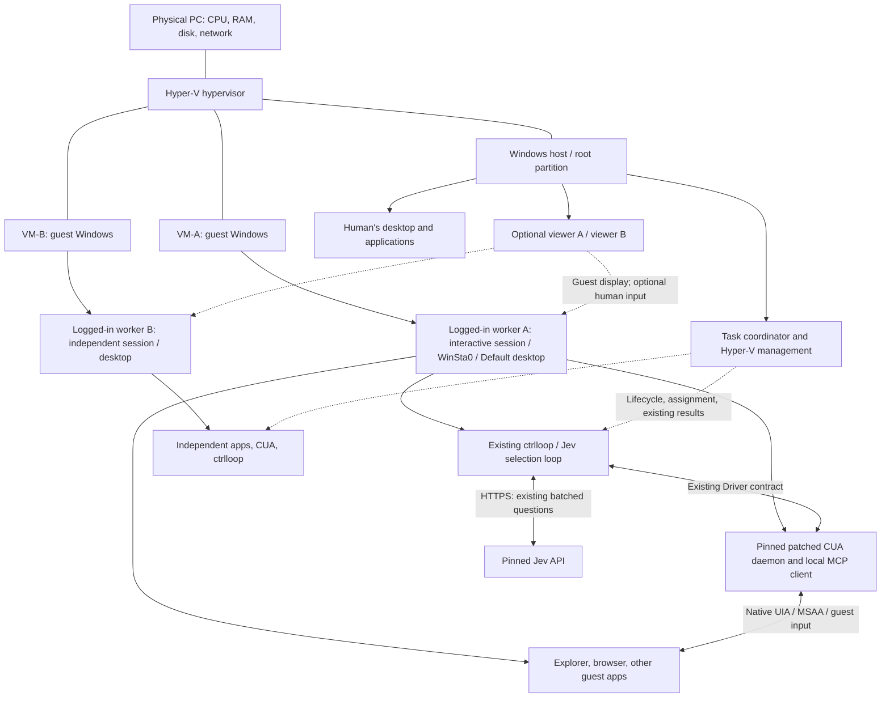

# Execution architecture, pinned-driver audit, and worker scheduling

Research date: **2026-09-24**. These are design recommendations supported by
primary documentation and read-only source inspection. No guest was run.
Start with the [plain-language guide](README.md); the
[manual prototype](manual-prototype.md) defines the missing evidence.

## 1. Exactly where the computer-use work happens

Hyper-V is a type-1 hypervisor: the physical machine runs a privileged Windows
root partition plus child partitions containing guest operating systems. The
host manages virtual hardware and storage; each guest has its own kernel and
private virtual memory. The familiar diagram “host → hypervisor → guest” is
useful operationally, but the host Windows desktop is not the guest's parent
desktop. They are different OS instances above the hypervisor.
[Microsoft Hyper-V architecture](https://learn.microsoft.com/en-us/windows-server/virtualization/hyper-v/architecture)



**Recommended first placement:** run the existing Python loop, MCP client,
patched daemon, and target apps in the same guest user session. The host owns
task assignment, VM lifecycle, and artifact collection. Bringing Chrome to the
foreground, Windows Search, foreground text entry, and cursor feedback then
affect the guest desktop. Automation does not click the host-side VM viewer.
This is an engineering design, not a feature already implemented in ctrlloop.

The guest user must be logged in and the correct desktop available. An OS that
has booted to its login screen is not an automation-ready worker. A background
service can supervise the guest-side user process; it should not itself own the
GUI. Windows services run in Session 0, and Microsoft describes a separate
user-session process plus IPC for service/UI interaction.
[Interactive services](https://learn.microsoft.com/en-us/windows/win32/services/interactive-services)

For a bounded prototype, signing into the guest and launching the worker there
is sufficient. For later startup, an interactive-token scheduled task requires
an already logged-in user; it does not create that session. “Run whether user
is logged on or not” is not a substitute for an interactive desktop. Session
creation, restart recovery, and any unattended sign-in policy remain explicit
product work, subject to the deployment's security policy.
[Task logon types](https://learn.microsoft.com/en-us/windows/win32/api/taskschd/ne-taskschd-task_logon_type),
[task security contexts](https://learn.microsoft.com/en-us/windows/win32/taskschd/security-contexts-for-running-tasks)

The pinned driver's own [Windows autostart source][autostart] uses a logon-triggered
scheduled task with an interactive principal and highest available run level.
It starts the daemon through a hidden wrapper. This supports the session-placement
recommendation, but does not provision a login or establish that all elevated
or secure-desktop actions will work. No autostart task was registered here.

## 2. UIA works inside a Windows VM; it does not cross the VM boundary by magic

**Documented:** UI Automation connects a Windows client with app providers
through UIAutomationCore and COM. Providers expose properties, trees, patterns,
and events. Running Windows on virtual hardware does not remove this framework.
**Inference:** in-guest CUA can use the same framework against in-guest apps;
the actual app/driver/display combination still requires qualification.
[UI Automation overview](https://learn.microsoft.com/en-us/windows/win32/winauto/uiauto-uiautomationoverview)

Consider a guest browser displaying a Save button. Host UIA enumeration sees
host windows, including VMConnect's controls and its guest-display surface.
It does not turn the guest browser's PID, HWND, or UIA element into a host UIA
object. A screenshot of the display contains pixels, not native control handles.
In-guest CUA obtains the guest button's native identity and can serialize its
existing observation back to the host. The host then sends an action to that
same guest driver. This is remote execution of native automation, not host UIA
walking through a virtual screen.

This claim is scoped to ordinary full-desktop viewers and this stack. Microsoft
documents UIA redirection policy for remote applications but explicitly
distinguishes Remote Desktop sessions. Specialized accessibility redirection
or remote automation agents exist; they are additional protocols, not a
capability established for our pinned VMConnect/CUA combination.
[Microsoft UIA redirection policy](https://learn.microsoft.com/en-us/windows/client-management/mdm/policy-csp-admx-terminalserver#ts_uia)

App support still matters inside the VM. Standard controls often have providers;
custom controls may expose little or no actionable accessibility data. A VM
does not add missing Invoke/Value support or fix a provider that reports success
without a visible effect. Elevated apps, UAC secure desktops, different-user
processes, and locked sessions also retain their access restrictions. Do not
automatically weaken those restrictions to make a task proceed.
[UIA providers](https://learn.microsoft.com/en-us/windows/win32/winauto/uiauto-providersoverview),
[UIA security](https://learn.microsoft.com/en-us/windows/win32/winauto/uiauto-securityoverview)

## 3. What the pinned stack actually supports

**Local source observations:** main checkout `f89adbce94d9354d6c436aff9c27832fdc76c4a5`
had preexisting edits. The inspected CUA source is release `0.28.2`, commit
`fc188250b4ca8549b8e61f937fdb1fb560770e86`. Its working tree has a preexisting
keyboard-file modification. This is not proof that an installed or running
daemon contains the direct-accessibility patch. The repository's
[build recipe](../../../scripts/build-cua-driver.ps1) pins that commit and the
[keyboard](../../../scripts/patches/cua-driver-0.28.2-left-windows-key.patch) and
[direct-accessibility](../../../scripts/patches/cua-driver-0.28.2-direct-accessibility-only.patch)
patches. No build or live daemon probe was performed in this research.

| Inspected contract/source | Actual behavior | VM consequence |
| --- | --- | --- |
| [Existing `Driver`](../../../src/pipeline.py) | Window discovery/state, bring-to-front, click, hotkey, text; native dictionaries | Move execution without introducing `VmWindow`, `VmControl`, or another action vocabulary. |
| [Existing `CuaDriver`](../../../src/driver.py) | Accepts injected transport; validates native records, snapshot targets, MCP results and refusals | A remote carrier can plug in at this seam; it must preserve validation and errors. |
| [Existing `McpTransport`](../../../src/cua_mcp.py) | Starts `cua-driver mcp --socket ...`; serialized stdio MCP connection; does not start/stop daemon | An explicit pipe is local to its OS. A guest IP cannot simply replace the pipe string. |
| Same transport, `_require_accessibility_click` | Checks connected daemon's click schema for the direct-only route | Qualify the actual guest endpoint, not merely a client version string. |
| `get_window_state` in `CuaDriver` | Accessibility enabled, screenshot disabled | Keep viewer capture separate from the selection snapshot. |
| [Current pipeline](../../../src/pipeline.py) | Activates windows; browsers use foreground typing by default; synthetic Search uses desktop hotkey/text | These operations are acceptable only on the assigned guest desktop. |
| [Direct click patch](../../../scripts/patches/cua-driver-0.28.2-direct-accessibility-only.patch) | UIA/MSAA activation, no synthetic click fallback; refuses minimized element target; overlay feedback remains | Keep target apps restored. Viewer minimization is a different condition. |
| [Pinned diagnostics][diagnostics] and [UIA enumeration][windows-enum] | Checks interactive desktop/session; enumerates its own desktop root; Session 0 is rejected for runtime ownership | Starting a daemon through a service/SSH command does not establish the right GUI placement. |
| [Pinned cache][cache] | New snapshot replaces the previous snapshot for the same PID/window in that runtime | A second observer of that window can stale a token selected by the first. |
| [Pinned action coordinator][tool-core] | Process-wide action synchronization and PID text admission | Does not reserve the whole observe–Jev–act transaction or isolate two daemons on one desktop. |
| [Current CLI](../../../src/main.py), [Hermes adapter](../../../plugins/hermes/__init__.py) | CLI reports existing result; Hermes returns only launch PID/directory | No VM task manager, durable worker registry, Stop, or completion tracking exists here yet. |

`jev-1.13.0` and `typesafe-sdk==0.7.1` are the current
[project pins](../../../pyproject.toml). Keep the existing questions, batching,
and data reduction. VM routing belongs outside Jev's window/control choices;
Jev must see candidates from the assigned worker only. This proposal neither
adds questions nor changes selection behavior.

### Transport capability audit beyond the earlier report

The pinned source offers **two distinct optional HTTP surfaces**. Neither is
currently used by ctrlloop's `McpTransport`.

| Pinned surface | Verified source behavior | Appropriate interpretation |
| --- | --- | --- |
| [MCP HTTP][mcp-http] | `CUA_DRIVER_RS_MCP_HTTP_PORT`, guest `127.0.0.1`; bearer token required; browser-Origin requests refused; POST JSON-RPC; connection-scoped cleanup | Existing native MCP path, suitable for evaluation behind an authenticated encrypted tunnel. Not a LAN listener or a complete remote SDK guarantee. |
| [Private Driver-envelope HTTP][envelope-http] | `CUA_DRIVER_ENVELOPE_HTTP_PORT`; loopback; connection/generation, exchange, cancellation and close routes; trusted upstream authorization required | This is not the bearer-authenticated MCP endpoint. Do not expose it or treat connection IDs as credentials. A typed SDK path requires its existing envelope contract and qualified packaging. |
| [Named-pipe server][serve] | Current-user ACL and peer SID check before request parsing; embedded mode also considers host PID | Retain local principal checks. A per-worker pipe name alone is neither a login nor a desktop boundary. |

The MCP HTTP implementation describes request/response JSON and says SSE/session
headers are follow-up work. Preserve a stable connection and qualify the client's
actual initialization/lifecycle behavior; do not assume every latest
“Streamable HTTP MCP” client is interchangeable. Per-connection concurrency is
not a guarantee that two clients can safely manipulate one desktop.
Its protocol guard recognizes `2024-11-05`, `2025-03-26` and `2025-06-18` and
rejects modern `server/discover` negotiation. ctrlloop currently initializes with
`2025-06-18`; that protocol match still does not implement the remote transport.
[Pinned MCP HTTP implementation][mcp-http]

### Placement and transport choices

| Choice | What remains unchanged | Extra work / recommendation |
| --- | --- | --- |
| **Loop and daemon inside guest** | Entire existing local Driver/MCP path and existing result/report files | **First proof.** Supply credentials through an approved guest setup later; collect reports deliberately. Host needs only lifecycle/launch/artifact control. |
| Host loop → secured stream → guest-local MCP proxy → guest daemon | Existing MCP tool names, native payloads, errors, snapshot scoping | Candidate for centralizing Jev credentials and scheduling. Persistent SSH stdio or a local bridge is possible, but authentication, same-user pipe access, cancellation and connection loss need implementation/qualification. The proxy is not the GUI daemon. |
| Host loop → encrypted authenticated tunnel → guest loopback MCP HTTP | Native MCP request/result model | Candidate with an injected transport. A loopback bind stays loopback; tunnel termination is required. Keep driver token and tunnel identity separate. |
| Host → Hyper-V socket → guest broker → existing local Driver/MCP | Native contracts can remain unchanged | Useful later where stable IP addresses or VPN behavior complicate control. Microsoft addresses by VM ID and service ID, independent of TCP/DNS. Registration and a broker are additional work. |
| Existing Cua sandbox SDK / qualified guest service | Can reuse lifecycle and existing typed Driver envelope if compatible | Evaluate first, but do not silently replace pinned MCP with a different SDK action model. Version/persistence gaps are in [platform and images](platform-and-images.md). |

Hyper-V sockets supply a byte stream over the host/guest channel, not a task
scheduler, UIA bridge, or authentication policy for arbitrary application
requests. Use VM identity, service access controls, and application authorization;
keep the guest broker's authority narrow.
[Microsoft Hyper-V sockets](https://learn.microsoft.com/en-us/virtualization/hyper-v-on-windows/user-guide/make-integration-service)

PowerShell Direct is already available for compatible host/guest versions,
requires appropriate host privileges and guest credentials, and can execute
commands and transfer files without guest networking. Use it for provisioning
and bounded supervision rather than issuing every UIA call through a new shell.
An “interactive PowerShell session” is not an interactive Windows GUI login.
[Microsoft PowerShell Direct](https://learn.microsoft.com/en-us/windows-server/virtualization/hyper-v/powershell-direct)

The transport must be owned by the worker/supervisor, not the viewer. Closing
a TCP connection ends that connection's driver sessions in the audited MCP HTTP
source; it does not shut down the daemon or VM. Closing a product preview must
not inadvertently close the worker's transport.
Do not implement a host-desktop fallback when the guest endpoint is missing.

## 4. Native identities must remain native and local

VM-A and VM-B can both have PID `4321` and the same numeric HWND. A guest HWND
has no meaning in the host's `user32` handle table. Neither a title such as
“Untitled - Notepad” nor a PID identifies a workspace.

**Recommended routing rule:** select one worker connection from the
hypervisor/sandbox's existing stable identity first; resolve all native IDs
through that connection. Retain the original records unchanged. The supervisor
associates an existing run/report directory with that worker and runtime
lifetime; it does not add fields to every native control or invent a parallel
window schema.

Never carry an element token, cached screenshot coordinate, or assumed focus
across reconnect, reboot, restore, human takeover, or reassignment. Discard those
references and observe again. Do not rely solely on a driver's stale-token
refusal to detect a restored memory checkpoint: a restored runtime can also
restore its old cache. The coordinator must invalidate its own prior ownership
and observations after a restore.

Use VMConnect or an independent capture path for passive preview. If the UI
shows a control tree, reuse a worker-published observation or request a fresh one
only at an agreed boundary. An extra `get_window_state` between selection and
action is not a harmless viewer refresh with this cache implementation.
[Pinned snapshot replacement][cache]

## 5. Tasks, workers, persistence, and the warm pool

These are proposed scheduling rules, not new public API/data-model definitions.
Reuse the selected provider's VM/sandbox IDs and lifecycle methods. Add only the
assignment and ownership information that those tools and existing run reports
do not already supply.

| Concept | Lifetime and ownership |
| --- | --- |
| Task | User request, supplied text, results and unresolved outcome; can outlive a running worker. |
| Worker | One active ctrlloop controller with exclusive action access to a guest desktop. |
| Workspace | Persistent guest disks, installed apps, user/profile and sign-ins; can serve later tasks. |
| Viewer | Optional display attachment; normally passive while the agent acts. |

**One VM per concurrently acting general GUI worker** is the initial rule.
It does not mean one VM per sidebar task forever. Ten queued tasks can use two
workers. Tasks that need only reasoning/network computation need not occupy an
interactive guest until their next GUI work; tasks whose next step relies on
unsaved app state must keep that workspace reserved.

Start with one warm workspace. Expand to two only after observing actual
resource use and isolation. A warm pool avoids boot/login/app startup on every
request. Maintain affinity for the required app/account/project and return a
continuing task to its workspace when possible. Affinity is not exclusive data
ownership: two browser profiles signed into one cloud account can still mutate
the same server record. Serialize tasks on shared files, documents, accounts or
other mutable resources when concurrent edits would conflict.

Do not hand an arbitrary idle signed-in workspace to another customer or user.
Persistent workspaces retain downloaded files, browser state and unsaved work.
Account changes and cleanup are explicit transitions, not a new tab or a new
driver session. For distinct trust principals, use distinct provisioned guests
or a controlled reset to a clean image, followed by fresh identity setup.

### Whole-loop ownership

Reserve the guest before discovering windows. Keep the reservation through
window selection, activation, control rounds, action, settling, and subsequent
observation. Release it only when the worker has stopped dispatching and no
action is in flight. Per-click locks leave a race while Jev is selecting.

```mermaid
stateDiagram-v2
    [*] --> Queued
    Queued --> Preparing: compatible workspace assigned
    Preparing --> Acting: session and driver ready
    Acting --> Attention: login, lock, takeover, unsupported UI
    Attention --> Preparing: user resolves and returns ownership
    Acting --> Reconciling: crash or uncertain action
    Reconciling --> Preparing: evidence supports safe continuation
    Reconciling --> Attention: effect remains unknown
    Acting --> Reviewing: run stops
    Reviewing --> Done: requested outcome verified
    Reviewing --> Attention: result incomplete or unassessed
    Acting --> Cancelling: stop requested
    Cancelling --> Stopped: dispatch halted; in-flight outcome recorded
```

These are explanatory product states, not replacements for `PipelineResult`
statuses. The task UI should derive what it can from existing process/result
evidence and state what remains unknown.

**Current gap:** the [Hermes adapter](../../../plugins/hermes/__init__.py)
ignores context kwargs, launches a child, and returns `launched`, PID and directory.
It does not poll, bind Stop, reserve a desktop, or collect completion. Its existing
description forbids overlap. VM routing and a supervisor must exist before
loosening that constraint. A PID may be recycled, so retained process handles
or a provider-owned run identity are needed for future cancellation.

The [pipeline](../../../src/pipeline.py) explicitly says `iteration_limit` does
not assess completion. “Run ended,” “last action reported success,” and “task
achieved” must remain different. Retain existing stdout, native refusals,
per-round Jev outputs and timing; assess a bounded prototype's outcome manually.
No new Jev completion question is proposed.

## 6. Human takeover, cancellation, and recovery

| Situation | Recommended behavior | What must not be inferred |
| --- | --- | --- |
| User opens viewer | Show current guest display; do not change worker ownership automatically | Opening a view is not permission for simultaneous typing. |
| User requests takeover | Stop new dispatch; settle/reconcile current action; mark guest human-owned | A UI toggle cannot undo a click already delivered. |
| User returns control | Require fresh window/control observations and readiness | Old tokens/focus are no longer reliable. |
| User cancels task | Halt further actions, preserve result/logs and workspace; distinguish confirmed stop from cancellation requested | Terminating the loop does not reverse uploads or clicks already sent. |
| Loop crashes | Keep workspace reserved until orphaned activity is ruled out; inspect current state before reuse | Process absence does not prove the last action failed. |
| Driver or transport fails | Retain the existing error path; reconnect only for fresh observations; reconcile effect | Do not replay a timed-out click/type. |
| Guest reboot/restore | Re-establish guest identity, session and daemon, then observe | Reused PID/VM name does not restore the task's exact prior world. |
| Host app closes/crashes | Defined supervisor ownership decides whether guest job continues; reattach and reconcile later | Viewer-independent VM life alone does not prove task-manager independence. |
| Host sleeps/restarts | Show interrupted/unavailable, then requalify after wake/boot | Local jobs cannot promise uninterrupted progress without a running host. |

The existing [CuaDriver retry path](../../../src/driver.py) retries eligible
reads once after transport loss, while never replaying input or activation.
Preserve this policy above the transport as well. For a sent email or submitted
form, a missing response can mean either “not executed” or “executed but reply
lost.” A fresh screenshot may still be insufficient; the target service's
observable state or human review is needed before repetition.

Current reports are buffered and written on close; they are not a durable
per-action journal. Abrupt termination can lose buffered evidence. Reusing
existing report contracts is still preferable, but a production supervisor
needs an explicit crash-evidence strategy before claiming reliable resume.
[Current reporting implementation](../../../src/reporting.py)

A future ownership timeout must fence the old controller, not merely give its
guest to a new controller. Otherwise a slow model call can return after
reassignment and send stale input. Use provider/process lifecycle controls to
stop old dispatch and reject late work before granting ownership again. This
is scheduler logic, not another native action API.

## 7. Readiness evidence and reporting

Keep four separate facts visible: VM power state, worker process/connection
health, interactive desktop/app readiness, and the most recent verified task
effect. A successful heartbeat or Cua `/status` alone is not evidence for all
four. Readiness checks that publish control snapshots must be coordinated with
the worker, rather than racing its selected tokens.

Preserve [existing timing](../../timing.md): guest monotonic durations for each
stage, rounds and actual API calls. Record host assignment/boot/viewer events
in surrounding lifecycle notes and associate them with existing run directories.
Do not subtract unsynchronized host and guest wall clocks to compute a stage's
duration. For manual analysis keep UTC timestamps plus host/guest clock offset.

Reports can contain request text, control labels, document names, and prepared
text. Export selected report/artifact directories through an explicit channel;
do not map the whole host profile to make logging convenient. The bounded
[prototype evidence plan](manual-prototype.md) deliberately uses nonsensitive
fixtures and has no automated tests.

[diagnostics]: https://github.com/trycua/cua/blob/fc188250b4ca8549b8e61f937fdb1fb560770e86/libs/cua-driver/rust/crates/platform-windows/src/diagnostics.rs
[windows-enum]: https://github.com/trycua/cua/blob/fc188250b4ca8549b8e61f937fdb1fb560770e86/libs/cua-driver/rust/crates/platform-windows/src/uia/windows_enum.rs
[cache]: https://github.com/trycua/cua/blob/fc188250b4ca8549b8e61f937fdb1fb560770e86/libs/cua-driver/rust/crates/cua-driver-core/src/element_cache.rs
[tool-core]: https://github.com/trycua/cua/blob/fc188250b4ca8549b8e61f937fdb1fb560770e86/libs/cua-driver/rust/crates/cua-driver-core/src/tool.rs
[mcp-http]: https://github.com/trycua/cua/blob/fc188250b4ca8549b8e61f937fdb1fb560770e86/libs/cua-driver/rust/crates/cua-driver/src/mcp_http.rs
[envelope-http]: https://github.com/trycua/cua/blob/fc188250b4ca8549b8e61f937fdb1fb560770e86/libs/cua-driver/rust/crates/cua-driver/src/driver_service_http.rs
[serve]: https://github.com/trycua/cua/blob/fc188250b4ca8549b8e61f937fdb1fb560770e86/libs/cua-driver/rust/crates/cua-driver/src/serve.rs
[autostart]: https://github.com/trycua/cua/blob/fc188250b4ca8549b8e61f937fdb1fb560770e86/libs/cua-driver/rust/crates/cua-driver/src/autostart.rs
