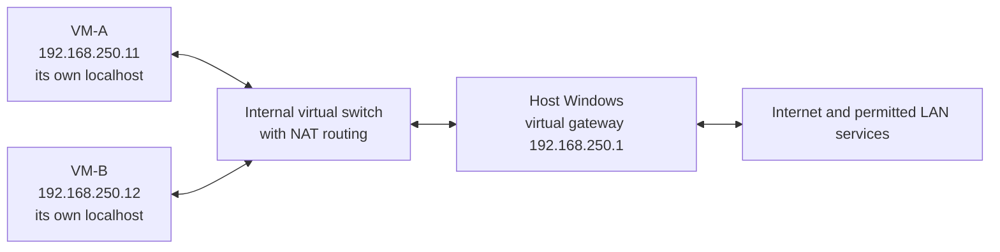

# What stays inside a worker VM, what can be shared, and how networking works

Research date: **2026-09-24**. This is a design and evidence dossier, not a report of a working VM deployment. No VM, virtual switch, firewall rule, account, share, browser profile, or credential store was created or changed. The only local inspection for this chapter was repository/source reading. Read the [main guide](README.md) for the overall architecture and prototype decision.

The labels used below matter:

- **Documented:** behavior supported by the linked primary source.
- **Local source observation:** behavior found in this checkout; this does not prove a particular installed executable has that behavior.
- **Design inference/recommendation:** how the documented mechanisms should apply to ctrlloop.
- **Unverified:** an outcome that needs a bounded manual demonstration on the chosen guest, networking, viewer, and driver versions.

## The user's examples, answered directly

**If the agent creates `C:\AgentWork\notes.txt` in VM-A's File Explorer, your host and VM-B do not get that file.** Each normal Windows guest has its own disks and operating system. The host stores VM-A's virtual disk as a container file, but that does not make the guest's `C:\` the host's `C:\`. Hyper-V documents separate guest partitions and virtual devices, and supports separate VHD/VHDX disks. The example assumes this is an ordinary guest-local folder, without sync, redirection, or a share. [Hyper-V architecture](https://learn.microsoft.com/en-us/windows-server/virtualization/hyper-v/architecture), [Hyper-V storage terminology](https://learn.microsoft.com/en-us/windows-server/virtualization/hyper-v/features-terminology)

**If VM-A edits a file in an explicitly shared host folder, the host sees the edit.** VM-B sees it too if it is authorized to access that same folder. That is the same remote file being edited, rather than three independent copies. File-sharing access still needs the applicable network path, sharing service, and permissions. SMB is one available mechanism; VMConnect drive redirection is a different one. [SMB traffic and isolation](https://learn.microsoft.com/en-us/windows-server/storage/file-server/smb-secure-traffic), [VMConnect resource sharing](https://learn.microsoft.com/en-us/windows-server/virtualization/hyper-v/enhanced-session-mode)

**If VM-A changes a Google Doc or sends an email from the same account you use on the host, the account's real data changes.** A VM is not a private copy of the internet. Other authorized sessions see server-side changes as their apps update. A private browser profile separates local browser state; it does not fork a Google Doc, Slack workspace, or Gmail account. Google documents live collaborative edits and synchronization of Gmail messages and labels; Slack documents editing/deleting server-visible messages. [Google Docs collaboration](https://support.google.com/docs/answer/6239410?hl=en), [Gmail synchronization](https://support.google.com/mail/answer/7126229?hl=en), [Slack message changes](https://slack.com/help/articles/202395258-Edit-or-delete-messages)

**VMs can use browsers and the web.** They need a network adapter, a usable route, name resolution, and any required proxy/VPN/account configuration. Internet connectivity does not automatically expose host files. Conversely, no internet connection does not mean no host access: configured redirected drives, PowerShell Direct, and Hyper-V sockets can cross the host/guest boundary without internet access. [NAT setup](https://learn.microsoft.com/en-us/windows-server/virtualization/hyper-v/setup-nat-network), [PowerShell Direct](https://learn.microsoft.com/en-us/windows-server/virtualization/hyper-v/powershell-direct), [Hyper-V sockets](https://learn.microsoft.com/en-us/windows-server/virtualization/hyper-v/make-integration-service)

**A VM can affect the host or another VM through authorized sharing, reachable network services, the same online accounts, or resource consumption.** It should not be able to arbitrarily modify another guest's private memory or disks merely because it is on the same PC. Microsoft treats unauthorized access across its VM boundary as a security issue; that is a security objective supported by patching, not an assertion that virtualization has no vulnerabilities. [Microsoft security boundaries](https://www.microsoft.com/en-us/msrc/windows-security-servicing-criteria)

## A concrete host / VM-A / VM-B visibility matrix

Unless a row says otherwise, assume: three separately installed Windows environments; distinct writable guest disks and local browser profiles; one interactive owner per guest; no redirected drives or clipboard; no cloud clipboard; no folder sync; and no configured network shares. “No” means no ordinary app-visible propagation through this setup. It does not mean the trusted Hyper-V administrator cannot inspect or manage a VM.

These rows are **design inferences** from the cited storage, service, and application semantics. Propagation times are deliberately qualitative; no measured latency or immediate-consistency guarantee is claimed.

| Operation and precise location | Host sees | VM-A sees | VM-B sees | When it propagates / what can conflict |
|---|---|---|---|---|
| Host creates or deletes `C:\LocalWork\host.txt` in its own local File Explorer | Its local change | No file change | No file change | Never automatically. Copying into a worker later creates a separate copy. |
| VM-A creates/deletes `C:\AgentWork\a.txt` on its own VHDX | No ordinary file in host `C:\AgentWork`; the backing VHDX changes | The local change | No file change | Never automatically. An existing VHDX occupying host storage is not a mapped guest folder. |
| VM-B creates a file with the same absolute path and name as VM-A | No local file change | Its own original file | Its own new file | Matching path text is not shared identity. Each OS resolves its own `C:\`. |
| Install an editor, browser, or Office in VM-A | Host install unchanged | Installed app, its local registration/services/settings | Install unchanged | Local installation is local. Account-based app settings, deployment policies, license limits, and portable executables on a share are separate exceptions. |
| Change a guest-local registry value, mouse setting, or firewall rule in VM-A | Host setting unchanged | VM-A setting changes | VM-B setting unchanged | Registry hives belong to the running OS/user. Remote administration or account/policy-based roaming can deliberately apply changes elsewhere; not all settings roam. [Registry structure](https://learn.microsoft.com/en-us/windows/win32/sysinfo/structure-of-the-registry), [roaming versus backup/restore](https://learn.microsoft.com/en-us/windows/configuration/windows-backup/faq) |
| VM-A renames/deletes `Z:\report.docx`, where `Z:` maps to host `\\HOST\AgentExchange` and VM-B also accesses that share | The host-owned file changes | Its remote view changes | Same file change when its view refreshes | It is one shared object. App/SMB locks may reject a competing write; cached directory listings or an open editor buffer can lag. Deleting a shared file is not undone by restoring VM-A. [SMB](https://learn.microsoft.com/en-us/windows-server/storage/file-server/smb-secure-traffic) |
| Same mapped folder, but VM-A is given read-only access | Reads are possible; write/delete denied if permissions enforce it | Error/refusal for write/delete | Its own authorized access continues | “Read-only” must be enforced by the sharing mechanism/permissions, not merely written in a task prompt. |
| VM-A accesses a host drive redirected through enhanced VMConnect/RDP | Changes affect actual host files permitted by that redirection | Host drive is visible separately from guest `C:` | No direct change unless B is given access to the same host files | Depends on connection and resource-sharing settings. Redirecting host `C:` is a broad grant, not an artifact-only channel. A lost viewer connection can remove this route. [VMConnect redirected drives](https://learn.microsoft.com/en-us/windows-server/virtualization/hyper-v/use-local-resources-virtual-machine-connection) |
| VM-A copies text with all clipboard sharing disabled | Host clipboard unchanged | VM-A clipboard changes | VM-B clipboard unchanged | Independent guest clipboards. This is the desired worker baseline. |
| VM-A copies text while RDP clipboard redirection is enabled | Host may receive redirected clipboard content | Local copy plus redirection | May be exposed indirectly through another enabled host/guest redirection connection | Policy, direction, supported formats, and connection state affect behavior. Do not promise deterministic multi-viewer clipboard ordering. Enhanced mode enables clipboard sharing by default. [VMConnect defaults](https://learn.microsoft.com/en-us/windows-server/virtualization/hyper-v/enhanced-session-mode) |
| RDP clipboard is disabled, but all three use the same Windows account with cloud clipboard sync enabled | Eligible copied text/history may sync | Local copy plus cloud history | Eligible history may sync | A separate internet/account-mediated path; disabling viewer clipboard alone is insufficient. Automatic/manual sync settings matter. [Windows clipboard sync](https://support.microsoft.com/en-us/windows/apps/using-the-clipboard) |
| VM-A creates/edits/deletes a file in the same OneDrive/SharePoint library synced on all three | Synced change | Local change, then cloud synchronization | Synced change | Online sync and selected folders determine arrival. Offline or paused clients lag. Deleting a synced file can remove it across devices and cloud. [File Explorer sync behavior](https://support.microsoft.com/en-us/sharepoint/sync/work-with-synced-files-in-file-explorer) |
| A and B edit the same ordinary file using Dropbox sync | Host eventually gets resulting synced files if subscribed | Local and synced revisions | Local and synced revisions | Concurrent/offline edits can create conflicted copies requiring reconciliation; VM isolation does not merge documents. [Dropbox conflicted copies](https://help.dropbox.com/organize/conflicted-copy) |
| Same Google Doc open in host, A, and B browsers | Shared document changes | A's edits and other edits | Shared document changes | Online collaboration updates the same document; offline/client delays vary. Concurrent GUI operations can still target text another actor just changed. [Google Docs live edits](https://support.google.com/docs/answer/6239410?hl=en) |
| VM-A sends/edits/deletes Slack content in a workspace the host/B can read | Workspace content updates | Server accepts or refuses the operation | Same authorized workspace content updates | Different Slack accounts in the same channel can still affect each other. Permissions/retention apply. No guest disk rollback reverses the service. [Slack permissions and changes](https://slack.com/help/articles/202395258-Edit-or-delete-messages) |
| VM-A reads/archives/labels Gmail messages in the same mailbox used elsewhere | Mailbox state updates after client refresh/sync | Its requested mailbox change | Same mailbox state updates | Mailbox data is shared; local window selection/scroll position is not necessarily shared. Cached/offline views lag. [Gmail messages and labels](https://support.google.com/mail/answer/7126229?hl=en) |
| An editor in VM-A holds unsaved text only in its process memory | Cannot see that in the host editor | Unsaved text and caret/selection | Cannot see that in B's editor | No propagation until the app saves/syncs/exports. Some apps auto-save drafts/recovery state, so verify the actual app. “No Save clicked” is not proof nothing left the VM. |
| VM-A opens a local document already open and edited unsaved on the host, after receiving a copied file | Host's editor buffer remains its own | Sees the copied saved version | No change | A copy does not transfer the host app process, unsaved buffer, undo stack, or live window. |
| VM-A browses in its own Chrome user-data directory with account sync off | Host history/profile unchanged | Local history/cookies/site storage change | B profile unchanged | Chromium stores profile data locally under its user-data directory. No shared directory should be used concurrently. [Chromium profile storage](https://chromium.googlesource.com/chromium/src/+/HEAD/docs/user_data_dir.md) |
| Same Google account with selected Chrome sync enabled | Selected bookmarks/history/tabs/settings may sync | Selected data syncs | Selected data may sync | This is browser/account synchronization, not a shared browser process. Ordinary Windows Chrome sync must not be assumed to duplicate every cookie or website session. [Chrome synced categories](https://support.google.com/chrome/answer/165139?hl=en) |
| VM-A downloads an attachment to guest `Downloads` | No host file appears | Guest-local downloaded file | No file appears | A chosen shared, redirected, or synced download destination changes this outcome. A website can separately record that the download occurred. |
| VM-A uploads a guest-local file using its browser | No automatic host local file | File is read from guest, remote service receives it | Visible only if B has access to that service object | Upload publishes/copies to a service according to its permissions. It does not mount host drives. Guest file pickers can access only guest-accessible paths and integrations. |
| VM-A uploads a file chosen from the mapped host share | Host file is read | Browser can read the authorized share and upload bytes | B may see uploaded service object | This intentionally bridges local sharing and cloud sharing; limiting the share limits available source files. |

The storage and app-install rows are architectural consequences of separate OS disks, not measurements of our current app set. The exceptions are operationally more important than the default: a folder named “Desktop” or “Documents” can already be redirected into OneDrive. Diagnose by its actual path/provider and account, not by the friendly File Explorer label.

There is also a privileged storage exception. Host File Explorer can show the
guest's backing `.vhdx` file changing size without exposing its folders as ordinary
host paths. A host administrator can deliberately attach a suitable offline
virtual disk to inspect its volumes; Microsoft provides `Mount-VHD`, including
a read-only option. This is additional management access, not automatic live
File Explorer synchronization. Any permitted write to that attached guest disk
changes what the guest will later read. Encryption and access controls can limit
readability. **Recommendation:** use controlled copies/shares for routine transfer,
not concurrent writable mounting of an active worker disk.
[Mount-VHD semantics](https://learn.microsoft.com/en-us/powershell/module/hyper-v/mount-vhd?view=windowsserver2025-ps)

### Four distinctions that prevent misleading product promises

| Boundary | What it buys | What it does not buy |
|---|---|---|
| **UI isolation** | Guest focus, guest windows, input state, and CUA overlays can be independent when actions originate inside that guest's desktop. | Freedom from conflicts within the same guest or with a human actively controlling its viewer. |
| **OS isolation** | Separate kernels, process spaces, guest disks, local accounts, installed apps, and registry state. | Automatically separate cloud accounts, documents, licenses, or intentionally shared data. |
| **Security boundary** | Hypervisor-enforced guest separation rather than a hidden host window. Microsoft explicitly services qualifying VM-boundary violations. | Absolute immunity to vulnerabilities, overbroad host sharing, exposed services, compromised credentials, or a trusted host administrator. [MSRC criteria](https://www.microsoft.com/en-us/msrc/windows-security-servicing-criteria) |
| **Resource allocation** | Per-VM resource configuration and management. | A different physical CPU, SSD, Wi-Fi link, cooling system, or battery. Busy guests can slow the host and each other. Microsoft calls out host memory and I/O capacity as joint requirements. [Hyper-V sizing factors](https://learn.microsoft.com/en-us/windows-server/administration/performance-tuning/role/hyper-v-server/configuration) |

**Identity must include the worker.** Windows says a PID identifies a process within its system for that process lifetime; an HWND identifies a window in that system. Two guests can have equal numeric PIDs/HWNDs and identical titles. Route a call to the already selected worker connection, then use the existing native PID/window/control/token contract there. Do not create a second window schema or route by title alone. A guest restart/reconnect requires fresh observation, not reuse of cached tokens. This is an engineering inference from OS-local identities and ctrlloop's existing transport. [Process identifiers](https://learn.microsoft.com/en-us/windows/win32/procthread/process-handles-and-identifiers), [Windows and HWNDs](https://learn.microsoft.com/en-us/windows/win32/winmsg/about-windows), [existing CuaDriver transport seam](../../../src/driver.py)

An app crash in A normally affects its own process; a guest OS crash affects that guest. A workload in A can still cause host memory/disk pressure, and host failure interrupts every local guest. Installing a browser inside A does not change the host browser binary, but signing that browser into an account may change account-visible state.

**Account names need the same distinction.** Independently installed local Windows users called `Worker` in A and B have separate local profiles and credentials. Signing both into the same Microsoft, Google, or company account supplies a shared external identity and its permissions; it does not merge their Windows processes. Local account/profile ownership and service account/data ownership need separate product choices.

## Network topology: switches, NAT, and actual reachability

Hyper-V has **external, internal, and private** virtual-switch types. NAT is routing/address translation added around an internal network; “NAT switch” is convenient terminology rather than a fourth equivalent switch type. Windows client's **Default Switch** is a managed convenience network. An isolated desktop and an isolated network are separate choices. [Switch types](https://learn.microsoft.com/en-us/windows-server/virtualization/hyper-v/features-terminology), [switch configuration](https://learn.microsoft.com/en-us/windows-server/virtualization/hyper-v/get-started/create-a-virtual-switch-for-hyper-v-virtual-machines)

The table describes available paths, **not permission to use a service**. IP addressing, routes, listener bindings, endpoint firewalls, switch policy, and application authentication can still deny a connection.

| Arrangement | Guest to host | Guest to sibling on that network | Guest to LAN/internet | Address/DNS implications |
|---|---|---|---|---|
| **Disconnected virtual NIC / no NIC** | No ordinary IP route through that NIC | No ordinary IP route | No ordinary IP route | Hypervisor management/integration can still work. |
| **Private switch** | No host virtual NIC on this switch | Yes, between attached guests with compatible addressing/policy | No uplink by itself | No DHCP or DNS server is created merely by making a private switch. A router/multihomed guest could deliberately add outside access. |
| **Internal switch** | Yes, host has an interface on this virtual network | Yes | No uplink by itself | Supply addressing and services deliberately; the host may be made a router/NAT gateway. |
| **Internal switch + configured WinNAT** | Yes, through host's internal interface where services allow | Yes unless separately filtered | Outbound route through host NAT; LAN is potentially reachable too | WinNAT alone does **not** assign a guest IP, gateway, or DNS. Configure them or provide a DHCP service. [WinNAT guest setup](https://learn.microsoft.com/en-us/windows-server/virtualization/hyper-v/setup-nat-network) |
| **Default Switch on Windows client** | Internal-network reachability, subject to services/policy | Do not assume sibling isolation | Designed to share the host connection using NAT | Microsoft's original 2017 announcement documents automatic IP assignment, DHCP, and DNS. Treat addressing as managed rather than a product-stable hard-coded subnet. [Microsoft Default Switch announcement](https://techcommunity.microsoft.com/blog/virtualization/whats-new-in-hyper-v-for-windows-10-fall-creators-update/382399) |
| **External switch** | According to LAN routes and whether the management OS shares this adapter or another route exists | According to attached network/VLAN/policy | Guest joins the physical network; internet needs the network's gateway | Usually LAN DHCP/DNS or explicit static configuration. Creating/rebinding this switch can interrupt host networking. [External switch behavior](https://learn.microsoft.com/en-us/windows-server/virtualization/hyper-v/get-started/create-a-virtual-switch-for-hyper-v-virtual-machines) |

The private/internal definitions above are documented in Microsoft's [network planning guide](https://learn.microsoft.com/en-us/windows-server/virtualization/hyper-v/plan/plan-hyper-v-networking-in-windows-server). They do not describe an absolute security wall: adding another NIC, a router, a host relay, or permitted Hyper-V integration creates additional paths. A private switch shared by A and B is private from the host's ordinary network attachment, **not private between A and B**.

### An illustrative two-worker NAT network

These example addresses are invented for explanation, not a proposal to reserve them on this PC. A later setup must choose nonoverlapping ranges after inspecting local LAN, VPN, Docker/WSL, and existing virtual networks.

A and B can each run an application listening on their own TCP port 8000 without conflict. `192.168.250.11:8000` identifies A's listener; `192.168.250.12:8000` identifies B's. Host-side forwarded endpoints would need separate host ports if both are published on the same host address. Exposing those ports to the LAN is unnecessary for a host-only controller. NAT mappings are not required merely for host-to-guest traffic across an internal subnet, provided the guest listener and firewall permit that direct path.

**`localhost` means this OS.** Opening `http://localhost:8000` inside A reaches A's loopback stack, not a development server bound to host loopback. To reach a host service, the guest needs an explicitly reachable host address/listener or a deliberate tunnel/relay. Replacing “localhost” with the gateway address is insufficient if the service still binds only to host `127.0.0.1`. Equally, a host request to `http://127.0.0.1:<driver-port>` cannot reach a guest-local CUA listener without forwarding. Microsoft documents address-bound sockets; the pinned CUA listener explicitly binds its own loopback address. [Winsock socket addresses](https://learn.microsoft.com/en-us/windows/win32/winsock/sockaddr-2), [pinned HTTP listener](https://github.com/trycua/cua/blob/fc188250b4ca8549b8e61f937fdb1fb560770e86/libs/cua-driver/rust/crates/cua-driver/src/mcp_http.rs)

**Inbound and outbound are relative to an endpoint.** A web request from A creates outbound guest traffic and associated return traffic. A fresh external connection into A needs a suitable route/publishing arrangement and permissions. NAT is not an application authorization system, and it does not mean “A cannot call the host” or “A cannot access the home network.” The ordinary internal path and any allowed outbound path remain relevant.

### DNS, VPN, proxy, and firewall details to qualify

| Concern | Engineering consequence |
|---|---|
| **DNS** | A working IP route does not establish working name resolution. Guests need reachable configured resolvers; corporate split DNS may differ from public DNS. A browser error can be DNS, TLS, proxy, authentication, or application failure rather than VM failure. |
| **DHCP versus NAT** | The managed Default Switch supplies address configuration according to its announcement; a manually created WinNAT network does not. Do not reuse “automatic DHCP” assumptions in custom-network instructions. Microsoft's current WinNAT guide also documents one internal NAT subnet prefix per host; check coexistence before proposing a new one. Never follow its broad example deletion commands against this user's existing networks. [WinNAT limits](https://learn.microsoft.com/en-us/windows-server/virtualization/hyper-v/setup-nat-network) |
| **Host VPN** | NAT may use routes through the VPN, but tunnel policy, split/full tunneling, VPN client filters, and permitted local subnets matter. Microsoft's older Default Switch announcement describes VPN/proxy compatibility; it is not proof for the user's particular VPN or build. Verify required sites, corporate DNS, reconnect behavior, and absence of forbidden alternate routes with the actual product. |
| **Guest VPN** | A VPN installed inside A changes A's routing and may interrupt its IP control channel; it does not install a VPN in B. Route changes and overlapping subnets can still break connectivity. A network-independent host management path can help with recovery. |
| **Proxy** | A Windows/Chrome/Edge proxy configuration and its sign-in requirements are guest/app configuration. Sharing a host NAT uplink does not prove guest browsers inherited host proxy settings or credentials. A host proxy bound only to loopback needs a deliberate permitted forwarding path. |
| **Firewall scope** | Guest Windows Firewall filters guest endpoints; host firewall protects host endpoints; switch ACLs/extensions can impose network isolation. Do not assume a host application firewall rule automatically applies to arbitrary bridged/forwarded guest traffic. Hyper-V's switch exposes port ACLs and other policy controls. [Switch policy capabilities](https://learn.microsoft.com/en-us/windows-server/virtualization/hyper-v/virtual-switch) |
| **Misleading “Hyper-V firewall” shortcut** | Microsoft's current Windows 11 Hyper-V firewall guide is framed around Windows-hosted containers, including WSL, with rules keyed to `VMCreatorId`. It is not sufficient evidence that every full VM created in Hyper-V Manager inherits those WSL settings. Qualify applicability before relying on it. [Actual documented scope](https://learn.microsoft.com/en-us/windows/security/operating-system-security/network-security/windows-firewall/hyper-v-firewall) |
| **IPv4 and IPv6** | Binding/filtering only IPv4 is not a complete policy if another service/path listens over IPv6. Validate actual listeners and routes. Microsoft's Windows OpenSSH documentation, for example, describes listening on both families by default. [OpenSSH listener/firewall behavior](https://learn.microsoft.com/en-us/troubleshoot/windows-server/system-management-components/troubleshoot-openssh-windows-firewall-port22) |

**Recommendation for the first authorized proof:** use the simplest supported NAT path after the future setup inventory, and demonstrate ordinary web browsing separately from control-plane reachability. Do not market the Default Switch alone as “internet-only isolation.” Product hardening should explicitly restrict sibling and host/LAN service access to what the workload needs; exact enforcement and VPN compatibility require a separate implementation decision and manual evidence.

## Control channels that preserve ctrlloop's native contract

The network should select an execution location, not redefine native actions. A remote worker still returns the same native windows, controls, snapshot tokens, refusals, and reports already used by the local loop.

### What the pinned implementation actually provides

**Local source observation:** `CuaDriver` already accepts an injected transport. The current `McpTransport` launches `cua-driver mcp --socket ...`, holds a persistent connection, validates the connected daemon's direct-accessibility click schema, and does not replay a failed command. A socket value is a local named-pipe endpoint in the existing setup; substituting a VM IP into that string is not a completed remote transport. [CuaDriver](../../../src/driver.py), [McpTransport](../../../src/cua_mcp.py)

**Local source observation:** the pinned driver's `mcp_http.rs` uses `CUA_DRIVER_RS_MCP_HTTP_PORT` and requires `CUA_DRIVER_RS_MCP_HTTP_TOKEN`; it listens only on `127.0.0.1`. It parses HTTP directly, requires bearer authorization, refuses requests carrying an Origin header, creates a private identity per TCP connection, and cleans up that connection's sessions when it closes. This is a guest-local authenticated HTTP surface, not built-in TLS or a public host-to-guest listener. No environment variable or token value was read for this research. [Pinned HTTP transport source](https://github.com/trycua/cua/blob/fc188250b4ca8549b8e61f937fdb1fb560770e86/libs/cua-driver/rust/crates/cua-driver/src/mcp_http.rs)

| Placement / transport | What crosses host/guest boundary | Why it fits / what remains |
|---|---|---|
| **Loop + MCP client + patched CUA all in guest** | Job launch/supervision, existing reports, selected input/output files | Smallest proof: native CUA transport remains local. Jev requests originate from guest unless later brokered deliberately. Host does not need a public CUA port. The guest worker must still be in the correct interactive session. |
| **PowerShell Direct for bootstrap and artifact transfer** | Authenticated PowerShell commands and explicit copies without guest networking | Microsoft supplies this already; it requires local host Hyper-V administration and valid guest credentials. Suitable management building block, not a claim that it launches UIA on the logged-in desktop or gives us a ready GUI job supervisor. [PowerShell Direct](https://learn.microsoft.com/en-us/windows-server/virtualization/hyper-v/powershell-direct) |
| **Host loop; guest CUA loopback HTTP through an SSH TCP tunnel** | Existing MCP HTTP requests/responses through encrypted transport | Possible future adapter: host-local port forwards to guest-local driver port through authenticated SSH. Keep driver bearer auth and host-key validation; scope SSH forwarding/listeners and firewall access. Preserve a stable connection because driver lifecycle is connection-bound. Not yet wired or proven in ctrlloop. [OpenSSH forwarding](https://man.openbsd.org/ssh.1), [Windows OpenSSH configuration](https://learn.microsoft.com/en-us/windows-server/administration/openssh/openssh-server-configuration) |
| **Host loop; narrow relay over Hyper-V sockets** | Existing MCP payloads over a local hypervisor stream | Avoids IP/DNS/VPN dependency. Microsoft provides `AF_HYPERV` addressing by VM ID and service ID; it needs host service registration. A relay, framing/lifetime handling, and application authorization still need implementation. A service GUID is an address, not a secret. [Hyper-V sockets](https://learn.microsoft.com/en-us/windows-server/virtualization/hyper-v/make-integration-service) |
| **Guest agent calls back to an authenticated host supervisor** | Job and result channel, potentially existing MCP payloads if explicitly designed | Useful when guest addresses change; requires a reachable scoped host listener and explicit guest identity. Do not build a second action protocol merely to get a callback channel. No such supervisor is established by the current Hermes launch receipt. |

If the SSH option is chosen later, the conceptual route is `host loopback:<assigned-A-port> -> SSH to VM-A -> guest 127.0.0.1:<driver-port>`. These are illustrative endpoints, not enabled ports. SSH conventionally listens on TCP 22; SMB file sharing ordinarily uses TCP 445; ordinary network RDP and browser HTTPS are distinct services. Opening one does not grant the others. A product should avoid exposing a raw bearer-token HTTP endpoint through an unencrypted general-purpose port proxy. [Windows OpenSSH ports](https://learn.microsoft.com/en-us/troubleshoot/windows-server/system-management-components/troubleshoot-openssh-windows-firewall-port22), [SMB transport](https://learn.microsoft.com/en-us/troubleshoot/windows-server/networking/direct-hosting-of-smb-over-tcpip)

Ordinary Windows network RDP uses port 3389 by default; its firewall configuration is separate from CUA. Do not infer that enhanced VMConnect requires opening that port on the guest NIC: Microsoft specifically documents enhanced local-resource use while the VM has no network connection. The chosen viewer/session must be qualified separately from its network reachability. [RDP listening port](https://learn.microsoft.com/en-us/windows-server/remote/remote-desktop-services/remotepc/change-listening-port), [VMConnect without guest networking](https://learn.microsoft.com/en-us/windows-server/virtualization/hyper-v/use-local-resources-virtual-machine-connection)

**Recommendation:** first keep the native loop in the guest. Prefer supported VM lifecycle and management facilities before implementing a relay. If host-side Jev orchestration later justifies remote CUA calls, adapt the existing transport interface and retain its error/refusal semantics; do not change Jev questions or introduce duplicate action/window/control models. A viewer's open/close event must not own or close the worker's control connection.

For every later transport, treat “request sent; connection failed before response” as an uncertain action. A repeated click can submit an order or send the same message twice. Reconnect to the intended guest, discard stale observations, inspect current state, and continue through the existing observation/action contract. A VM checkpoint is not an external transaction rollback.

## Intentional sharing policy for a usable product

This is a **recommendation**, not configuration already applied:

1. Start workers with their own local profile/disk and task-owned work directory. Do not map the host user profile or mount a common browser user-data directory for simultaneous use. Chromium documents that concurrent Chrome instances cannot share the same user-data directory. [Chromium profile ownership](https://chromium.googlesource.com/chromium/src/+/HEAD/docs/user_data_dir.md)
2. Treat copying a specified input into A and exporting a specified artifact from A as the default handoff. Copies are easy to attribute and do not turn arbitrary guest writes into host writes. Use a dedicated exchange location only when live sharing is needed, with narrow access and a declared owner for each output file.
3. Keep RDP clipboard/drive/printer redirection and cloud clipboard off in the worker baseline. Enable an individual channel only for an intentional workflow. Audio/printer/device routing can affect the host even when no host file is shared; OS isolation alone does not make guest activity silent.
4. Sign into apps normally in the guest under an appropriate account, including any human MFA step. Do not read/copy host cookie databases, authentication stores, or an entire signed-in browser profile. Define app/account affinity and cloud-object ownership as scheduling constraints; two independent desktops can still race the same mailbox or document.
5. Keep UI ownership separate from data ownership: A and B may safely click separate desktops but still need serialized access to one financial spreadsheet, one shared output name, or one external transaction. Reader/writer sharing should be a deliberate product rule around the existing task/report model.
6. Keep the host management plane narrow. A worker should not receive general Hyper-V administration on the host merely to return a report. Authorized host management is asymmetric: the host controls VM lifecycle, while the guest has only granted routes and resources. Integration services provide explicit channels; Guest Service Interface file copy is not enabled by default in the documented Windows guest configuration. [Integration services defaults](https://learn.microsoft.com/en-us/windows-server/virtualization/hyper-v/manage/manage-hyper-v-integration-services)

Turning off all integration services is not the proposed isolation strategy: some components provide important virtual-device functionality and supported management. Inventory channels, restrict convenience sharing, and preserve the components the selected runtime actually needs.

## Bounded manual evidence to collect later

These are proposed observations to add to the dossier's manual prototype, **not new automated tests or authority to configure anything now**. Use disposable sample files and a local demo app/site; do not validate by modifying a real mailbox, customer record, or shared production document.

| Manual exercise | Acceptance evidence | What a failure means |
|---|---|---|
| Create unique sample files on host, A, and B at the same unsynced path | Three directory views/file hashes show three separate files; deleting A's sample leaves the other two | A hidden mapping/sync route or wrong execution placement exists |
| Copy harmless marker text in each OS with intended sharing disabled | Current clipboard contents/history on the other two remain unchanged; record viewer and cloud-sync settings | A viewer/cloud clipboard integration remains active |
| Change a disposable file through a deliberately shared exchange folder | Exactly the authorized paths see the change; read-only worker cannot write | Sharing permissions or routing exceed/fail intended scope |
| View the same harmless demo web document from A/B; change it once | Both web sessions observe shared service state while local app windows/caret remain independent | Helps separate data sharing from UI isolation; requires app-specific scheduling if both may edit |
| Resolve a public hostname and load a known HTTPS page from each guest | Record DNS server, guest route/address, successful page, and timestamp | Internet/DNS/proxy/TLS readiness remains unproven |
| Check the designed control path from host and attempted sibling access to that same endpoint | Host can reach only its assigned authenticated endpoint; unauthorized/sibling attempts are denied as designed | Network path or endpoint authorization is too broad |
| Disconnect/reconnect VPN during an idle safe task if VPN support is in scope | Record route/DNS changes and explicit recovery/error without action replay | Pin supported network mode or change transport strategy |
| Run A and B with distinct harmless app contents while the host user works | No cross-guest action, host focus/input takeover, or clipboard change; report IDs remain tied to guest identity | Wrong worker routing, shared clipboard, or same-desktop execution |

A successful public web page proves web reachability at that moment. It does not prove corporate application access, mailbox permissions, host-file isolation, sustained automation readiness, or background-viewer compatibility. Those each require their own recorded observation.
