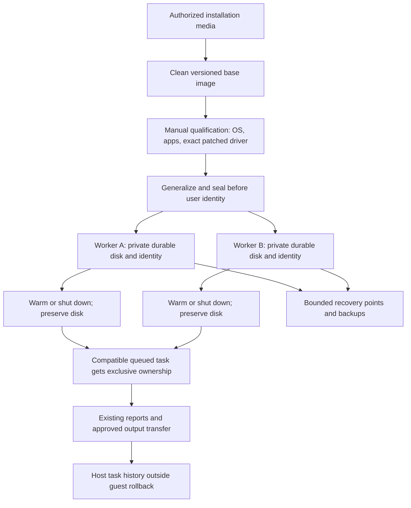

# Windows VM workers: platform, provisioning, identity, and persistence

Research date: **2026-09-24**. This deep dive supports the [main guide](README.md). It builds on the earlier [runtime research](../windows-background/runtime-and-browser.md) and [session research](../windows-background/sessions-and-vms.md), with a new audit of Cua's actual Hyper-V implementation and a more concrete image and persistence strategy.

**Recommendation:** use ordinary, persistent Hyper-V Windows 11 guests for the first qualification. Keep ctrlloop and its pinned, patched CUA Driver inside each guest. Reuse Microsoft's VM management facilities; evaluate Cua Sandbox as a lifecycle provider, but do not adopt its Windows defaults as a ready-made product image. Its current implementation has material persistence, provisioning, and security differences from the broad SDK interface.

Evidence labels in this document:

- **Documented:** a primary vendor document describes the behavior.
- **Source audit:** code was read, not executed. This establishes implementation intent and specific branches, not successful installation or runtime behavior.
- **Recommendation / inference:** an engineering conclusion from the evidence.
- **Unproven:** an acceptance item requiring a later manual prototype.

No VM was installed, started, stopped, or configured. No system feature, networking setting, credential, browser authentication store, or runtime source was changed. Read-only public source retrieval and documentation edits are the only work represented here.

## What this means in ordinary use

Think of a worker as another Windows PC inside this PC. It needs its own Windows installation, applications, user profile, and sign-ins. Installing Chrome in VM-A does not install Chrome in VM-B. Signing into Gmail in VM-A does not automatically sign VM-B in. Signing both into the same Gmail account makes them clients of the same mailbox, so both can observe a message sent by either. That is shared service data, not shared Windows memory.

For durable work, retain the worker's disk and identity between assignments. A completed task can release an idle worker to a queue without deleting the worker. A different task can later reuse it if its account and application requirements match. Two tasks acting simultaneously need two independently owned desktops; task count does not imply a permanent VM for every task.

Restoring a VM is like rewinding that computer's local storage, and sometimes its RAM. It does not rewind the internet. An email sent after a checkpoint stays sent after restoring the checkpoint. A file deleted on an SMB server stays deleted there. The restored browser might show an old page until it reconnects, but the service still has its current state. Treat these examples as **engineering consequences of separate storage authorities**, not a promise of a distributed rollback facility.

## Cua tooling: advertised interface versus audited Windows implementation

### Keep three versions separate

The public [runtime support reference](https://cua.ai/docs/reference/sandbox-sdk/runtime-support) explicitly describes `cua-sandbox 0.7.0` exported by `cua 0.1.6`. It maps `Image.windows()` to Windows Server 2022 and `Image.windows('11')` to a local installation path; the latter has no built-in Fleet mapping in that version. The page expressly limits its verification to source/contract checks rather than a blanket boot certification.

**Source audit:** the upstream revision retrieved during this research was **`ef1905cfda22ef7b1c3746842c1490a93617c0ee`**. Its package manifest declares **`cua-sandbox 0.8.0`**, development status Alpha, and optional dependency **`cua-driver==0.27.0`**. These are separate from ctrlloop's **CUA Driver 0.28.2 plus its tracked patch**. Cua source links identify this immutable research revision or the explicitly named older driver pin. A package manifest does not identify the driver actually installed in a downloaded image. [Audited package manifest](https://github.com/trycua/cua/blob/ef1905cfda22ef7b1c3746842c1490a93617c0ee/libs/python/cua-sandbox/pyproject.toml)

This difference matters: adding a lifecycle SDK is not authorization to replace ctrlloop's driver package, click contract, native records, or Jev questions. Keep the guest driver commit, patch identity, executable hash, guest image identifier, guest OS build, and ctrlloop revision together in the qualification record.

### What the Hyper-V backend actually does

The following is a compact **source audit**, not an installation result. [HyperVRuntime at the research revision](https://github.com/trycua/cua/blob/ef1905cfda22ef7b1c3746842c1490a93617c0ee/libs/python/cua-sandbox/cua_sandbox/runtime/hyperv.py)

| Operation | Audited implementation |
| --- | --- |
| Detect availability | Checks whether PowerShell exposes `New-VM`; this is not a complete host readiness probe. |
| Build | Downloads or accepts an ISO; creates Generation 2 VMs and layered VHDX disks. |
| Defaults | Default Switch, 4,096 MB memory, four virtual processors, 64 GB dynamic disk. |
| Start | Recreates the named session differencing disk and VM definition. |
| Firmware | Explicitly disables Secure Boot; no vTPM setup was present in this file. |
| Ready | Discovers a guest IPv4 address, then waits for HTTP `/status` to return 200. |
| Stop | Removes the VM and deletes its session disk. It is destructive teardown, not durable shutdown. |
| Build concurrency | Reuses fixed build VM names and cache paths. |
| Server installation concern | The Hyper-V builder does not pass `version` into `create_unattend_iso`; the helper defaults to Windows 11. |

**Inference:** a convenient SDK method name cannot substitute for an ownership and persistence policy. The first prototype must establish that the exact backend can adopt a provisioned guest, preserve its disk across shutdown/restart, distinguish this product's VMs from unrelated VMs, recover after controller failure, and serialize image builds. These gaps make a narrow native Hyper-V adapter a reasonable initial choice rather than a new hypervisor.

### Connection persistence is not complete worker persistence

The [local lifecycle guide](https://cua.ai/docs/how-to-guides/sandbox/manage-local-lifecycle) says `Sandbox.create` can outlive its caller, `disconnect` leaves the computer running, and `Sandbox.connect` attaches without starting or stopping it. An ephemeral context destroys its computer on exit. These are valuable ownership semantics to preserve in the product.

**Source audit:** at the audited revision, `disconnect()` closes transport/driver connections without stopping the runtime. A created object's `destroy()` delegates to runtime teardown. Named reconnection reuses the saved HTTP address without reconstructing the runtime ownership object. Persistent local state records `runtime_type='hyperv'`, but local classmethod suspend/resume/delete dispatch has no Hyper-V branch: fallback paths use Docker or reject an unknown runtime. The local snapshot method is unavailable. Thus generic SDK lifecycle methods do not establish a complete durable Hyper-V management path. [Sandbox implementation](https://github.com/trycua/cua/blob/ef1905cfda22ef7b1c3746842c1490a93617c0ee/libs/python/cua-sandbox/cua_sandbox/sandbox.py)

| Product requirement | What can be reused | Qualification still required |
| --- | --- | --- |
| Close a host viewer without stopping a run | Separate connection and computer lifetimes | The viewer must not own the execution connection. |
| Reconnect after controller exit | Named connection concept | Exact Hyper-V discovery and current address handling after process/host restart. |
| Shut down a worker and retain accounts/files | Native Hyper-V durable VM/disk management | Do not translate this into destructive Cua runtime teardown. |
| Suspend/resume a local Windows pool | Hyper-V save/start facilities | SDK provider coverage and post-resume desktop readiness. |
| Reset a disposable worker | Differencing-disk concept | Identity generalization, external-effect accounting, authorized data disposal. |
| View guest desktop | VMConnect initially; other viewers later | No source-level implication that `get_display_url()` supplies a working Hyper-V viewer. |
| Native UIA actions | ctrlloop's existing driver interface | Exact patched driver inside the interactive guest session. |

### The image builder's defaults need an independent decision

**Source audit:** the shared Windows unattended helper requests TPM/Secure Boot/RAM setup bypasses, disables UAC, configures a passwordless administrator with automatic sign-in, permits RDP without network-level authentication, and disables automatic Windows Update. It also contains setup firewall and power-policy changes. Those are properties of public upstream provisioning code, not settings observed on this PC. [Audited unattended helper](https://github.com/trycua/cua/blob/ef1905cfda22ef7b1c3746842c1490a93617c0ee/libs/python/cua-sandbox/cua_sandbox/builder/windows_unattend.py)

**Recommendation:** do not import these defaults into a product baseline. Use supported Windows 11 virtual hardware, an intentionally provisioned account, scoped management access, ordinary security controls, and an update maintenance window. The research does not justify weakening host protections or guest policy to make automation appear successful. If an application needs elevation, make that a setup or human-attention event; do not assume UIA crosses the secure desktop.

### Alternatives that change the engineering tradeoff

| Existing option | Actual fit for this PC and ctrlloop |
| --- | --- |
| **Native Hyper-V + PowerShell/WMI** | Best initial persistent Windows provider. Existing Windows management, guest disks, checkpoints, and VMConnect; ctrlloop still needs allocation, readiness, run status, cancellation, and recovery around them. |
| **Cua HyperVRuntime** | Real local Windows-on-Windows VM provisioning exists. Qualify and improve lifecycle/image behavior before using it for persistent signed-in workers. |
| **Cua QEMU bare-metal** | Another real VM runtime, not an alternative action contract. At this source revision its Windows UEFI path selects software emulation (`tcg`) instead of WHPX; benchmark rather than assuming hardware-accelerated Hyper-V performance. |
| **Cua Docker-wrapped QEMU / QEMU in WSL2** | Still a Windows VM underneath. The audited paths depend on Linux/KVM availability or fallbacks and add another virtualization/runtime layer. Do not assume an enabled Virtual Machine Platform means nested KVM is configured. |
| **Lume** | A compatible Apple-silicon/macOS host path; not the Windows-on-Windows solution. |
| **Lumier** | Repository description is macOS/Linux VMs managed through a Docker wrapper; not evidence of a Windows Hyper-V provider. |
| **Cua Fleet** | Managed capacity and claims can be useful for a future remote worker provider. Cloud image/service authentication and deployment are separate from this local design and would require separate authorization. |

The QEMU distinction above comes from the actual accelerator branches and `QEMUWSL2Runtime`, not a generic claim about all QEMU builds. The same source also contains non-Windows host paths. [Audited QEMU implementation](https://github.com/trycua/cua/blob/ef1905cfda22ef7b1c3746842c1490a93617c0ee/libs/python/cua-sandbox/cua_sandbox/runtime/qemu.py). The platform mapping is documented in [Cua runtime support](https://cua.ai/docs/reference/sandbox-sdk/runtime-support); Lumier's limited description is in its [repository README](https://github.com/trycua/cua/blob/ef1905cfda22ef7b1c3746842c1490a93617c0ee/libs/lumier/README.md).

**Recommendation:** qualify existing tools before extending them, but retain a provider boundary. Use Cua for lifecycle only when that exact provider satisfies the product's durability and security requirements. Do not route existing actions through `sb.mouse` or `sb.window` merely because the lifecycle dependency also exposes those APIs; that would create a competing action/window model.

## Microsoft APIs: what to reuse and what not to build

These layers solve different problems. An execution provider manages computers. The existing CUA transport manages native driver calls. A viewer renders an interactive desktop. None implies the others.

| Facility | Documented scope | Proposed use |
| --- | --- | --- |
| **Hyper-V PowerShell** | Existing commands manage VM definitions, power, disks, memory, networking, checkpoints, and exports. | First implementation: a narrowly privileged local manager invokes explicit commands against owned VM GUIDs. Names are labels, not sufficient ownership evidence. |
| **Hyper-V WMI v2** | Public management interfaces for Hyper-V; classes cover configuration, networking, metrics, and health. | Reuse if an embedded service needs structured management/events without shell text. Use Microsoft's existing object identifiers rather than duplicating their VM schema. |
| **VMConnect** | Console access and user interaction for an existing VM. | First human setup/takeover viewer, not the CUA action transport. Its lifecycle must be independent of task execution. |
| **PowerShell Direct** | Host-to-running-Windows-guest command/file access over the virtualization connection; requires Hyper-V administration and guest credentials. | Provisioning, diagnostics, controlled transfer, guest supervisor coordination. A PowerShell session is not proof of a logged-in interactive desktop. |
| **Guest Service Interface** | Integration service for file-copy operations; disabled by default. | Optional provisioning channel. The actual `Copy-VMFile` cmdlet currently documents only `-FileSource Host`; use PowerShell Direct `Copy-Item -FromSession` for the documented reverse path. |
| **Hyper-V sockets** | Winsock `AF_HYPERV` communication identified by VM and service GUIDs, independent of guest IP networking. | Candidate authenticated control relay when avoiding IP discovery is worth the integration work. It still needs application protocol, authorization, size/time limits, and process/session routing. |
| **Windows Hypervisor Platform (WHP)** | Low-level partition, memory, virtual-processor, and device APIs for virtualization stacks. | Reuse indirectly through a mature runtime. Building a Windows virtual hardware platform/viewer around these APIs is outside ctrlloop's needed work. |
| **Host Compute System (HCS)** | VM/container compute-system lifecycle including VM save/restore; callers provision storage/network resources. Handles become unusable after a compute system stops. | Potential provider substrate, not a ready-made durable desktop pool. Prefer managed Hyper-V VMs first. |
| **Host Compute Network (HCN)** | Win32 APIs for networks, endpoints, namespaces, and policies. | Useful to a virtualization provider; unnecessary to invent a network stack for the first guest. |

Primary references for the table: [Hyper-V PowerShell module](https://learn.microsoft.com/en-us/powershell/module/hyper-v/?view=windowsserver2025-ps), [WMI v2](https://learn.microsoft.com/en-us/windows/win32/hyperv_v2/windows-virtualization-portal), [VMConnect](https://learn.microsoft.com/en-us/windows-server/virtualization/hyper-v/virtual-machine-connection), [PowerShell Direct](https://learn.microsoft.com/en-us/windows-server/virtualization/hyper-v/powershell-direct), [integration services](https://learn.microsoft.com/en-us/windows-server/virtualization/hyper-v/integration-services), [Copy-VMFile](https://learn.microsoft.com/en-us/powershell/module/hyper-v/copy-vmfile?view=windowsserver2025-ps), [Hyper-V sockets](https://learn.microsoft.com/en-us/windows-server/virtualization/hyper-v/make-integration-service), [WHP](https://learn.microsoft.com/en-us/virtualization/api/hypervisor-platform/hypervisor-platform), [HCS](https://learn.microsoft.com/en-us/virtualization/api/hcs/overview), [HCN](https://learn.microsoft.com/en-us/windows-server/networking/technologies/hcn/hcn-top).

The difference between the broad integration-service description and the actual file-copy cmdlet is deliberate: use the narrower, executable contract when planning a feature. Likewise a VM heartbeat establishes that its guest OS booted, not that an application is ready for UIA and foreground input. [Integration heartbeat semantics](https://learn.microsoft.com/en-us/windows-server/virtualization/hyper-v/integration-services)

**Recommendation:** privileged management should accept only intended lifecycle operations against registered worker IDs. Guest tasks do not need host administration rights, arbitrary host command execution, or the right to attach arbitrary host disks. Store the established native driver results unchanged; wrap their routing in worker ownership rather than creating a second set of controls and actions. Implement only missing orchestration, not a replacement for the hypervisor, window model, or Jev decision logic.

## Windows 11 versus Windows Server guests

**Recommendation:** select Windows 11 for a consumer/workstation-app prototype because it most closely matches the user's app environment. Server is an alternative to qualify when a target application, deployment model, or license favors it. UIA availability alone does not imply equivalent application support or identical accessibility trees across editions.

| Consideration | Windows 11 guest | Windows Server guest |
| --- | --- | --- |
| Desktop | Normal workstation desktop and client app ecosystem | Choose **Desktop Experience** for this workflow. Server Core is not equivalent. |
| Provisioning | Supported Generation 2 virtual hardware and ordinary client setup | Server installation image/edition and desktop option must match the automation recipe. |
| Accounts/apps | Independent local/organizational account and app sign-ins | Same need; server policies and app support may differ. |
| Multiple workers | One independently acting worker per guest for initial design | RDS can later place sessions within one OS, trading isolation for density and extra management/licensing. |
| Store/client app availability | Qualify the exact app/version to be used | Do not assume client-only applications, installers, Store behavior, or features are supported. |
| Office | Check the specific product and automation entitlement | Also check the Server version support window. |

**Documented:** Microsoft requires at least two virtual processors, 4 GB RAM, 64 GB storage, and Generation 2 with Secure Boot and virtual TPM for a supported Hyper-V Windows 11 configuration. These are minimums, not sensible performance targets for every application. [Windows 11 VM requirements](https://learn.microsoft.com/en-us/windows/whats-new/windows-11-requirements)

**Documented:** Server Core and Desktop Experience differ in installed UI components, and current Server installation options cannot be switched after installation without a clean install. [Server installation options](https://learn.microsoft.com/en-us/windows-server/get-started/install-options-server-core-desktop-experience)

**Date-sensitive application example:** on the research date, Microsoft's supported Microsoft 365 Apps configuration on Server 2022 ends in **October 2026**; security-only updates through **October 10, 2028** do not extend full support. Server 2025's stated support window is through October 2029. Therefore Cua's default Server 2022 image is not automatically a good long-lived Office worker. [Microsoft 365 Apps on Windows Server](https://learn.microsoft.com/en-us/microsoft-365-apps/end-of-support/windows-server-support)

### Application and identity setup

Recommended provisioning sequence:

1. Establish guest OS and app entitlement, create supported virtual hardware, and install from authorized media.
2. Install approved application versions and the exact ctrlloop/driver build. Finish administrator-only setup before normal task runs.
3. Establish the dedicated guest user session and confirm native driver readiness there. Do not mistake a Session 0 service, SSH shell, or PowerShell Direct session for the interactive worker.
4. Let the user sign in and satisfy MFA through the viewer. Pause agent action for this handoff. Do not export host browser cookies, password databases, token stores, or a whole logged-in Windows profile as a shortcut.
5. Retain that personalized worker for compatible future work. Record account **affinity labels**, not credentials in reports. Treat an expired login or conditional-access prompt as attention needed.
6. Share only the intended documents/output location. Keep each worker's Windows profile and browser user-data directory private.
7. Drain workers for updates, qualify the new baseline with the same bounded manual scenarios, then return them to the pool. Pin versions for reproducibility without suppressing security servicing indefinitely.

**Documented identity caveat:** Microsoft advises against using snapshots of already hybrid-joined VMs as clone sources and warns about stale device registrations after resets. Its identity guidance also excludes roaming several device-bound identity caches and certificates. **Inference:** generalize a clean base before user sign-in, and establish each worker's identity after cloning; do not treat copying a signed-in disk as an identity provisioning strategy. [Device identity and desktop virtualization](https://learn.microsoft.com/en-us/entra/identity/devices/howto-device-identity-virtual-desktop-infrastructure)

**Unproven:** whether a particular organization permits the guest device to sign in; whether MFA, device compliance, Windows Hello, a security key, or specialized peripherals work with the chosen viewer; whether a given app allows simultaneous sessions; and whether the app exposes the same usable UIA controls in that guest. These are app/account qualification items, not reasons to inspect authentication stores.

## Licensing and distribution: separate questions to settle

This is a product-design assessment, not an entitlement determination for the user's existing purchases. The correct answer depends on acquisition channel, edition, license assignment, local versus remote use, and the commercial deployment. Resolve those facts against the actual terms before provisioning or distribution; this research does not authorize buying anything.

| Question | Evidence-based boundary |
| --- | --- |
| Does Windows 11 Pro on the host give us unlimited Windows guests? | **No.** Hyper-V availability and guest OS rights are separate. Microsoft's Windows terms allow an instance on a physical or virtual device and require separate licensing for additional instances, subject to the applicable agreement. |
| Are retail/OEM Windows VMs always forbidden? | That blanket statement is wrong. The cited terms explicitly address virtual devices, while also restricting transfer, remote-only/server use, and commercial hosting. The particular license must fit the actual arrangement. |
| Can a commercial Windows entitlement cover several VMs? | Some eligible Enterprise/VDA/Microsoft 365 arrangements have virtualization rights with qualifying-device, assignment, access, and program conditions. Do not apply a Commercial Licensing summary as the user's retail/OEM entitlement. |
| Is “up to four VMs” always four workers while using the host normally? | No. Product Terms' local-virtualization provision includes a physical-OS-use restriction when all permitted virtual OSEs are used. The applicable program matters. |
| Does a successful activation prove rights? | No. The Windows terms distinguish activation from proper licensing. |

The first, second, and fifth boundaries are grounded in sections 2, 4, and 5 of the [Windows software license terms](https://www.microsoft.com/content/dam/microsoft/usetm/documents/windows/11/oem-%28pre-installed%29/UseTerms_OEM_Windows_11_English.pdf). The commercial distinctions are in [Windows virtual desktop licensing guidance](https://www.microsoft.com/licensing/guidance/Windows-11-Licensing-for-Virtual-Desktops) and the applicable-program [Windows Desktop Product Terms](https://www.microsoft.com/licensing/terms/en-US/productoffering/WindowsDesktopOperatingSystem/SS).

**Windows Server is not a free substitute.** Its licensing can use physical cores or eligible per-VM arrangements, with minimums and Software Assurance/subscription conditions. Server CAL and RDS access obligations depend on how it is used. Technical availability of administrative remote connections is not an entitlement for a production multi-user automation service. [Server virtualization licensing](https://www.microsoft.com/licensing/guidance/Windows-Server-Virtualization-Technologies), [RDS CALs](https://learn.microsoft.com/en-us/windows-server/remote/remote-desktop-services/rds-client-access-license)

**Application licensing is separate again.** Microsoft specifically documents an unattended Microsoft 365 Apps for enterprise entitlement for the account performing unattended RPA, one unique physical or virtual OSE per license, and no shared-computer-activation support for that scenario. Merely installing Office or signing in with an ordinary user subscription does not establish the correct unattended entitlement. Classify the actual product workflow against the terms rather than equating “the owner is somewhere at the PC” with attended use. Other vendors may use per-user, per-device, concurrent-use, or automation-specific terms. [Microsoft 365 Apps unattended automation](https://learn.microsoft.com/en-us/microsoft-365-apps/licensing-activation/overview-unattended)

**Image construction and image redistribution are different rights.** Microsoft's reimaging guidance describes qualified customers using eligible media to image appropriately licensed devices, with product/version/edition/language conditions. It does not grant every application publisher permission to ship a Windows VHDX to customers. An evaluation ISO or public registry artifact is not proof of production or redistribution rights. [Reimaging rights](https://www.microsoft.com/licensing/guidance/Reimaging-rights)

**Recommendation for our product:** initially distribute ctrlloop, its permitted dependencies, and a provisioning recipe that accepts customer-authorized media or an existing licensed VM. Offer “connect to an existing worker” alongside provisioning. Distributing prebuilt Windows/app images or offering hosted desktops is a separate packaging decision requiring the corresponding distribution/hosting agreements. Review dependency licenses independently; a lifecycle package's open-source license does not license the guest OS or installed apps.

### Cua source and patched-driver distribution

**Source audit:** the local pinned Cua checkout (`fc188250b4ca8549b8e61f937fdb1fb560770e86`, Driver 0.28.2) contains a root **MIT** license, copyright Cua AI, Inc., and its Driver Rust workspace declares MIT. A tracked-path inventory found no separate license file under `libs/cua-driver`. The same root MIT license and Driver workspace declaration were verified at the newer research revision. The actual MIT text permits modification and redistribution, including sale, while requiring its copyright and permission notice in copies or substantial portions. [Pinned root license](https://github.com/trycua/cua/blob/fc188250b4ca8549b8e61f937fdb1fb560770e86/LICENSE.md), [pinned Driver workspace](https://github.com/trycua/cua/blob/fc188250b4ca8549b8e61f937fdb1fb560770e86/libs/cua-driver/rust/Cargo.toml), [research-revision root license](https://github.com/trycua/cua/blob/ef1905cfda22ef7b1c3746842c1490a93617c0ee/LICENSE.md)

**Packaging recommendation:** distributing our built, patched Driver is supported by that upstream license, provided the required notice accompanies the distribution and the included dependencies' terms are satisfied. Preserve the upstream attribution, label our patch/build accurately, and assemble notices from the actual bundled binary/dependency set. This research did not complete a transitive dependency or bundled-asset license inventory; a manifest's MIT field alone cannot establish every component's obligations.

There are explicit adjacent boundaries. The pinned Driver README distinguishes MIT repository skill source from MIT-0 copies published through ClawHub. At the newer research revision, its README also identifies an **optional** `cua-perception` extension with an AGPL-3.0-only OmniParser detector; that extension is separate from the default MIT Driver. Do not silently add it to our packaging or apply the root MIT label to it. [Pinned skill distribution boundary](https://github.com/trycua/cua/blob/fc188250b4ca8549b8e61f937fdb1fb560770e86/libs/cua-driver/README.md), [newer optional-extension boundary](https://github.com/trycua/cua/blob/ef1905cfda22ef7b1c3746842c1490a93617c0ee/libs/cua-driver/README.md)

None of these software licenses grants Windows, Office, evaluation-image, or customer-authentication redistribution rights.

## Checkpoints, copies, and what a restore really does

### Different objects preserve different state

| Mechanism | Preserves | What it does not establish |
| --- | --- | --- |
| **Standard checkpoint** | VM checkpoint state including memory for a running VM | A full backup, external consistency, or undo of actions outside captured guest storage. |
| **Production checkpoint** | Data-consistent guest disk state using VSS/filesystem coordination | Guest RAM, unsaved editor buffers, or an already-open interactive session after restore. |
| **VM export** | A package of VM configuration, virtual disks, and checkpoint files | Automatic guest identity generalization or rights to redistribute software. |
| **Import as copy** | A copied VM with a new Hyper-V VM ID | A new Windows/device/cloud identity inside the copied OS. |
| **Differencing disk** | Changes relative to a required parent virtual disk | An independent backup without the parent chain, or permission to modify the parent underneath children. |
| **Guest shutdown** | Files actually persisted by guest apps/OS | Unsaved state; the viewer being absent says nothing about what has been saved. |
| **Hypervisor save/suspend** | Suspended execution state according to the selected provider | Continued work while suspended or correctness of stale external connections after resume. |

Microsoft documents memory versus data-consistent checkpoint behavior and warns that ordinary snapshots are not full backups. Production mode can fall back to a standard checkpoint; `ProductionOnly` refuses that fallback. Choose deliberately rather than trusting the label. Deleting a checkpoint causes Hyper-V to merge its `.avhdx` data; manually deleting these files is not safe cleanup. [Checkpoint behavior](https://learn.microsoft.com/en-us/windows-server/virtualization/hyper-v/checkpoints)

An export gathers the VM's files, and import modes either retain or regenerate the VM ID. Configuration-version and virtual-hardware compatibility still matter when moving a VM to another host. [Export/import](https://learn.microsoft.com/en-us/windows-server/virtualization/hyper-v/deploy/export-and-import-virtual-machines). Microsoft's `New-VHD` supports an explicit parent path and differencing disk; use it as a storage primitive, with an immutable parent policy in our image manager. [New-VHD](https://learn.microsoft.com/en-us/powershell/module/hyper-v/new-vhd?view=windowsserver2025-ps)

### Concrete recovery examples

These are **inferences from the storage boundary**. Verify with disposable local data during the prototype; do not send messages or delete real shared data to demonstrate them.

| Change after checkpoint | Applying the earlier checkpoint to VM-A |
| --- | --- |
| Create `C:\Worker\draft.txt` on VM-A's captured private disk | Reverts that guest disk to its earlier state; the later file is absent. |
| Delete an earlier file on VM-A's captured private disk | Restores the earlier file content if it was captured. |
| Type into an unsaved local editor | A standard checkpoint can restore its earlier RAM/UI state; a production checkpoint does not preserve that buffer. |
| Save into `\\host\approved-share\report.docx` | Does not rewind the host share. The VM's old view may need refresh. |
| Change a cloud document | Does not rewind the cloud document; a client may resynchronize with newer data. |
| Send an email, place an order, submit a form | Does not undo the external effect. A restored queued action can cause a duplicate if replayed. |
| Change an account password or revoke a session in a service | Does not revert the service's account state; old local credentials/session state may stop working. |
| VM-B changes its own private file | No effect; restoring VM-A is not restoring VM-B. |
| Host deletes/moves a required parent VHDX | Can break dependent workers, even though their guest filesystems were otherwise isolated. |

**Recommendation:** keep the task's action receipt/history outside the VM rollback domain, using existing reports and run records. After any restore, invalidate the execution connection and cached observation capabilities, observe fresh state, and reconcile external effects before continuing. Never equate “checkpoint restored” with “the previous action did not happen.”

### Clone identity and storage growth

**Documented:** Microsoft requires generalization before deploying a Windows image to other machines, even with similar hardware; Sysprep removes machine-specific information. Per-user Store app changes can prevent generalization. **Recommendation:** build the generalizable base before individual users customize or sign in, then specialize each clone. A new Hyper-V GUID alone does not perform this work. [Sysprep generalization](https://learn.microsoft.com/en-us/windows-hardware/manufacture/desktop/sysprep--generalize--a-windows-installation?view=windows-11)

**Inference:** cloning an already personalized worker may duplicate machine names, local task startup, cloud device registrations, app credentials, scheduled sync, and queued operations. Some services reject these copies; others accept them as additional clients of the same account. Neither behavior is reliable task isolation. Restoring a retained worker also differs from creating a new sibling: a recovery point can legitimately contain its existing identity, while a distributable template should not.

Disk space planning must include the base image, every worker's changed blocks, checkpoint chains, memory state where captured, downloads, app/browser caches, update staging, retained reports, and exported backups. Dynamic allocation saves initial space, not maximum liability. Set quotas and a free-space reserve; perform checkpoint merge/export only through the platform while accounting for temporary working space. Do not infer capacity by dividing today's free disk by the nominal base image size.

### Proposed image and persistence strategy

1. Keep an immutable, versioned baseline with no personal authentication. Prefer full independent disks for the first two guests; introduce shared-parent differencing only after parent-chain management is proven.
2. Personalize each durable worker separately. Retain workers by app/account affinity instead of repeatedly cloning a signed-in profile.
3. Keep one or two workers warm during the initial qualification. A stopped worker may retain its disk without consuming its configured guest RAM; returning it to automation still requires boot/session/app readiness checks.
4. Use short-lived recovery points before planned guest changes, with explicit retention and storage accounting. Use independent backup/export for recovery from host-disk loss.
5. Build a new baseline for updates. Drain/replace or upgrade workers deliberately; never mutate the common parent of running children.
6. Destroy only deliberately disposable or retired workers, after capturing authorized output and addressing relevant account/device cleanup. Task completion and worker destruction are separate operations.

All six points are **engineering recommendations**. No image builder, persistence manager, or pool is implemented by this research.

## Fit for this PC and a bounded sizing hypothesis

The prior read-only sample reported Windows 11 Pro build 26200; AMD Ryzen AI 9 HX PRO 375, 12 physical cores/24 logical processors; 63.3 GiB usable RAM, 30.7 GiB available, and 575.6 GiB free disk. Virtual Machine Platform was enabled, full Hyper-V and Windows Sandbox disabled, and a hypervisor present. These observations are carried forward; they were not refreshed into a capacity claim.

**Documented:** Windows 11 Pro is a Hyper-V host edition; Hyper-V requires hardware virtualization and SLAT, among other conditions. Microsoft's hardware guide explains that an active hypervisor changes what `systeminfo` reports about requirements. Consequently the earlier WMI `SLAT=false` value, alongside a running hypervisor, is insufficient to declare this PC incompatible. Full feature availability and a successful supported guest boot remain unproven. [Hyper-V host requirements](https://learn.microsoft.com/en-us/windows-server/virtualization/hyper-v/host-hardware-requirements)

**Sizing hypothesis, not a measured capacity:** begin with one Windows 11 guest using four vCPUs, 8 GiB RAM, and a 100 GiB dynamic disk cap. Keep substantial RAM and disk headroom for the actively used host. If one guest passes the manual scenarios, try a second guest with the same starting allocation. Change these numbers for the actual apps; heavy browser tabs, Office documents, indexing, updates, and antivirus scans can dominate resource use.

Two 8 GiB assignments would consume 16 GiB before guest/platform overhead. That arithmetic does not guarantee two healthy workers: today's available-memory snapshot is not a reserve, and vCPUs do not correspond to exclusive physical cores. Measure host responsiveness, guest working sets, paging, CPU contention, storage latency, network/model latency, and complete loop time while the owner uses ordinary host apps. The product should admit work from measured resource headroom and exclusive desktop ownership, not the number of sidebar tasks.

## Platform-specific manual acceptance evidence

These items supplement the main prototype plan. They are bounded manual demonstrations using disposable files/accounts where needed; they are not new automated tests.

| Qualification | Evidence to retain | Failure implication |
| --- | --- | --- |
| Durable native guest | File content and worker identity survive guest shutdown/start and controller restart | Persistence provider is not ready. |
| Cua provider, if selected | Exact package/revision; create/disconnect/reconnect/destroy outcomes; method-level suspend/resume/delete behavior | Disable unsupported methods and retain native management until corrected. |
| Supported image baseline | Secure Boot/vTPM, OS build/edition, update policy, application versions, patched driver identity | Rebuild/adjust provisioning before app work. |
| Identity separation | Distinct machine/worker identities, separate legitimate sign-ins; no copied authentication stores | Template/personalization workflow is wrong. |
| Checkpoint semantics | Private disposable file restore; standard-versus-production unsaved-buffer behavior; external mock state unchanged | Document actual recovery limits; do not replay uncertain actions. |
| Independent disk/parent policy | VM-A change absent in VM-B private disk; any parent chain recorded and retained | Cannot safely pool or retire images. |
| Resource fit | One- and two-worker measurements during ordinary host activity, plus disk-growth sample | Reduce admission cap or move heavy work to another host. |
| Upgrade/recovery | Drain, backup, update, fresh session verification, and explicit reconciliation after restore | Do not claim seamless unattended recovery. |

The central open question remains whether the **exact pinned native stack** maintains correct in-guest observation and input while the selected viewer is minimized or absent. Hyper-V's VM lifecycle, Cua's `/status`, or a successfully booted Windows desktop cannot answer that alone.
