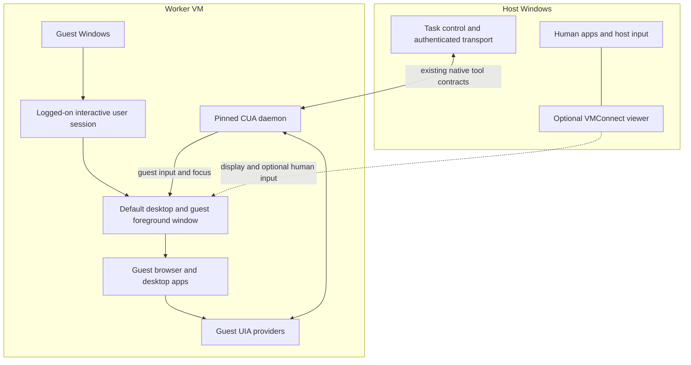

# Viewers, guest desktops, and uninterrupted automation

Research date: 2026-09-24. Part of the [Windows VM worker dossier](README.md). This is a design and evidence review. No VM, viewer, registry setting, scheduled task, or automation session was created or changed for this report.

## What happens when I minimize the worker?

**The intended behavior is that you minimize the VM viewer on your real desktop while the agent keeps using a normal, restored app window inside the VM.** Your mouse and keyboard remain available to you. The VM has its own Windows desktop, and the agent's driver runs there. Minimizing the viewer must not mean minimizing the app, locking the guest, disconnecting the worker's control channel, or pausing the VM.

The strongest first candidate is **an in-guest worker in a logged-on, unlocked console session, with basic VMConnect used only for optional viewing and human takeover**. This is an engineering recommendation, not demonstrated ctrlloop compatibility. Microsoft documents VM startup and viewer connection as separate operations. That establishes the architectural separation; it does not promise that this driver's UIA, typing, hotkeys, browser rendering, or screenshots remain healthy through every viewer transition. [Create and start a Hyper-V VM](https://learn.microsoft.com/en-us/windows-server/virtualization/hyper-v/get-started/create-a-virtual-machine-in-hyper-v#start-and-connect-to-the-virtual-machine)

Three examples make the distinction concrete:

| User action | Meaning for the worker |
| --- | --- |
| Minimize the **host's VMConnect window** while guest Notepad stays restored | This is the target background experience. Qualify it with the pinned driver; do not treat the viewer's visibility as worker readiness. |
| Minimize **Notepad inside the guest** | The tracked direct-accessibility click patch still rejects a minimized target with `window_minimized`. Restore the guest app and take fresh state before acting. |
| Close the basic VMConnect window | The VM need not stop, but the console can lock on disconnect according to the VM's `LockOnDisconnect` setting. An alive VM can therefore become unusable for GUI input. |

The second row is a **repository/source observation** from the [tracked click patch](../../../scripts/patches/cua-driver-0.28.2-direct-accessibility-only.patch) and the pinned helper it retains. The third is **documented behavior**: `Set-VM -LockOnDisconnect` controls whether a basic VMConnect disconnect locks the console. Its cmdlet parameter table does not establish the value on a future VM; inspect the actual VM and applicable policy during provisioning. [Set-VM: LockOnDisconnect](https://learn.microsoft.com/en-us/powershell/module/hyper-v/set-vm?view=windowsserver2025-ps#-lockondisconnect)

## Evidence labels and the boundary of this conclusion

- **Documented:** behavior stated by Microsoft or the browser project in a cited primary source.
- **Repository/source observation:** behavior read in ctrlloop or CUA Driver 0.28.2 source. This is not a new live observation in a VM.
- **Recommendation:** an engineering choice derived from the preceding evidence.
- **Requires proof:** behavior to measure on the exact host build, guest build, driver binary, browser/app versions, and viewer mode.

The prior [sessions and VMs research](../windows-background/sessions-and-vms.md) established why VMs are promising. This report adds the session, display, disconnect, and driver constraints needed to make the proposed promise precise. The host-side validation in [direct accessibility activation](../../cua-driver/direct-accessibility-only.md) demonstrated some covered/offscreen controls on a physical Windows desktop. It did not exercise Hyper-V, basic VMConnect minimization, enhanced-mode disconnect, or host lock.

## The viewer is separate from the desktop being automated

The diagram is a **proposed logical arrangement**, not a new API or a claim that Windows exposes a desktop object directly over the illustrated transport. The full Jev loop can run in the guest, or a host-side loop can send existing tool calls to the guest. In either arrangement, the native Windows/UIA endpoint belongs in the guest's intended interactive session. The control path must not be implemented by typing into the host viewer window.

**Documented:** a Windows desktop owns windows, menus, and hooks. Within an interactive window station, only one desktop is the active input desktop. Windows uses other desktops for logon and secure UI. Ordinary app threads do not gain access to protected desktops just because the OS is virtualized. [Windows desktop objects](https://learn.microsoft.com/en-us/windows/win32/winstation/desktops)

**Documented:** UIA clients call the UIA core and app-provided elements/patterns. Microsoft also distinguishes remote-app UIA redirection from full Remote Desktop sessions; its policy documentation says full Remote Desktop sessions do not currently support UIA redirection. Specialized remote automation can expose richer information using an installed guest component—Microsoft's Power Automate virtual-desktop automation does exactly that. These are precedents for an in-guest endpoint, not dependencies being selected for ctrlloop. [UIA client architecture](https://learn.microsoft.com/en-us/windows/win32/winauto/uiauto-clientsoverview), [UIA redirection policy](https://learn.microsoft.com/en-us/windows/client-management/mdm/policy-csp-admx-terminalserver#ts_uia), [Power Automate virtual-desktop agent](https://learn.microsoft.com/en-us/power-automate/desktop-flows/virtual-desktops)

**Recommendation:** host UIA should be understood as seeing the viewer's host window and whatever accessibility that viewer deliberately implements. Do not assume that opening VMConnect automatically makes the guest's File Explorer buttons into native host CUA elements. A guest PID/HWND or element token belongs to the guest daemon's observations. Sending it to a host daemon does not address the same object.

### A service that is alive is not necessarily an interactive worker

**Documented:** ordinary Windows services cannot directly interact with user desktops; Microsoft recommends a separate process in the interactive user's context plus controlled IPC. A Task Scheduler interactive-token task requires an already logged-on user. An S4U task instead runs on a noninteractive desktop and has additional network/encrypted-file limitations. [Interactive services](https://learn.microsoft.com/en-us/windows/win32/services/interactive-services), [Task Scheduler logon types](https://learn.microsoft.com/en-us/windows/win32/api/taskschd/ne-taskschd-task_logon_type)

**Repository/source observation:** the local upstream source checkout was read at commit `fc188250b4ca8549b8e61f937fdb1fb560770e86`, the commit pinned by [the build script](../../../scripts/build-cua-driver.ps1). Its `autostart.rs` registers a logon-triggered task using `-LogonType Interactive -RunLevel Highest`; the source comments explicitly distinguish this from Session 0. Its `debug_window_info` diagnostic reports the daemon's session perspective and was designed to distinguish it from Session-0 probes. These properties are not a remote-session manager or automatic guest sign-in implementation. [Pinned CUA autostart source](https://github.com/trycua/cua/blob/fc188250b4ca8549b8e61f937fdb1fb560770e86/libs/cua-driver/rust/crates/cua-driver/src/autostart.rs), [Pinned Windows tool implementation](https://github.com/trycua/cua/blob/fc188250b4ca8549b8e61f937fdb1fb560770e86/libs/cua-driver/rust/crates/platform-windows/src/tools/impl_.rs)

**Recommendation:** a product may use a service for VM lifecycle, heartbeat, and authenticated dispatch, but retain a separate interactive guest process for CUA. Reuse the driver's supported launch path after checking its privileges and pipe ownership. Do not mistake a successful PowerShell Direct/SSH command or a running service for evidence that its process can read the intended desktop. Startup must distinguish OS boot, user sign-in, daemon connection, useful UIA state, and usable input.

## Comparing the viewer paths

| Path | What it contributes | Why it might help | Constraint for ctrlloop |
| --- | --- | --- | --- |
| **Basic VMConnect** | Virtual console viewing and human keyboard/mouse access | Best first candidate for maintaining one console desktop while the host viewer is hidden | Need measured minimized/closed behavior, actual `LockOnDisconnect`, stable guest display, and guest-session identity. |
| **Enhanced VMConnect** | RDP-based session, resizing/high-DPI support, configurable redirection | Convenient sign-in, setup, file transfer, and human intervention | RDP session/display lifecycle and redirection can change readiness or share host resources. Treat transition between modes as a reconnect. |
| **Ordinary RDP over guest networking** | Remote Windows desktop using network transport | Familiar viewer and useful administration | Network reachability is required; disconnect, minimization, and session policy are separate from VM liveness. Do not assume it is the console where CUA already runs. |
| **Read-only guest capture sent through ctrlloop** | A preview of the existing worker desktop | Can make the product's preview purely optional without creating an RDP session | Needs qualified capture on the actual virtual GPU/desktop. Stop requesting frames when hidden without stopping the worker. Not implemented by this research. |
| **Hyper-V thumbnail API** | Host retrieval of VM thumbnail pixels | Possible low-rate status preview using an existing Windows virtualization API | Not a guest UIA channel, not an input API, and not proof of application-specific screenshot fidelity. |
| **VNC-style or other guest remote-control server** | Alternative display/input service | A candidate if RDP changes the desired session | Adds a dependency and another input owner. Qualify its session, lock, capture, security, and minimized-viewer behavior separately; no product selected here. |

The Microsoft [VMConnect guide](https://learn.microsoft.com/en-us/windows-server/virtualization/hyper-v/virtual-machine-connection) documents console interaction and warns that another authorized basic connection can take over the existing connection. The [enhanced-mode guide](https://learn.microsoft.com/en-us/windows-server/virtualization/hyper-v/enhanced-session-mode) establishes its RDP basis, display benefits, and switching/reconnection. Microsoft's [thumbnail API](https://learn.microsoft.com/en-us/windows/win32/hyperv_v2/getvirtualsystemthumbnailimage-msvm-virtualsystemmanagementservice) returns an image for a VM or snapshot, in RGB565, with width/height parameters. The recommendations and limitations in the comparison are our design judgments; none is a newly demonstrated ctrlloop viewer.

Enhanced mode's convenient file sharing is not evidence that the guest's network is working. Microsoft explicitly lists troubleshooting a guest without a network connection as a use for VMConnect resource sharing. Conversely, choosing basic mode does not prevent a separately configured guest browser from reaching the internet. Keep viewer transport, worker control transport, and guest web networking conceptually separate. [VMConnect local resources](https://learn.microsoft.com/en-us/windows-server/virtualization/hyper-v/use-local-resources-virtual-machine-connection)

### Why enhanced mode is not the default execution dependency

**Documented:** Microsoft identifies a minimized RDP window as a cause of UI/browser automation failure and describes a client-side `RemoteDesktop_SuppressWhenMinimized` registry workaround. The same troubleshooting page discusses locked desktops, UAC, and elevated apps. This is strong evidence of a real failure class. It is not a specification proving every RDP client, enhanced VMConnect session, or CUA action will fail—or proving that a registry value makes all of them reliable. [Microsoft RDP/UI automation troubleshooting](https://learn.microsoft.com/en-us/troubleshoot/power-platform/power-automate/desktop-flows/ui-automation/uipi-issues)

**Recommendation:** do not make a host registry workaround the first architectural dependency. Try the console-based worker first. If enhanced mode is later required, qualify the precise client version, process architecture, relevant policy, session behavior, and action types. Any mitigation belongs in an explicit supported configuration after measurement. No workaround was applied here.

An API called `allowBackgroundInput` is not an answer to this question: Microsoft's RDP ActiveX property controls whether a client accepts input while it lacks focus. It does not promise independent guest rendering, guest UIA availability, or host input isolation. An agent generating host-side input into such a viewer would also be a different architecture from in-guest CUA. [RDP client background-input property](https://learn.microsoft.com/en-us/windows/win32/termserv/imstscadvancedsettings-allowbackgroundinput)

### Closing is different from minimizing

**Documented:** disconnecting an RDS session preserves its running applications for reconnection; signing out ends the session's processes. RDS policy can impose limits on disconnected sessions. The console is not simply a disconnected RDS session. [Session disconnection](https://learn.microsoft.com/en-us/windows-server/administration/windows-commands/tsdiscon), [Session logoff](https://learn.microsoft.com/en-us/windows-server/administration/windows-commands/logoff), [Disconnected-session policy](https://learn.microsoft.com/en-us/windows/client-management/mdm/policy-csp-admx-terminalserver#ts_sessions_disconnected_timeout_2)

**Recommendation:** the product should define separate user actions for **hide viewer**, **human takeover**, **pause task**, and **stop worker**. Closing a preview should have the same product meaning as hiding it, provided the chosen underlying viewer path satisfies that promise. Do not silently implement Close by signing out the guest or calling `Stop-VM`. Basic VMConnect's disconnect-lock setting is a concrete reason to validate closure separately from minimization.

## Lifecycle matrix: what remains alive, and what can still act?

This table assumes CUA and target apps are in the same intended guest interactive session. “Expected” marks an inference to qualify, not a guarantee. A worker's task loop may live in the host or guest; that placement matters when the host user signs out.

| Event | VM/apps | UIA/input implication | Product handling and acceptance evidence |
| --- | --- | --- | --- |
| Host viewer covered by another host window | VM normally still running | In-guest tree/input should be independent of host z-order; verify virtual display/browser behavior | Keep worker active. Show timestamped guest changes while host use continues. |
| Basic VMConnect minimized | No requested VM stop | Leading expected success case; no reviewed Microsoft guarantee for this pinned driver | Verify repeated fresh UIA observations, direct activation, guest foreground typing/hotkeys, and separate changed state while minimized. |
| Basic VMConnect closed/disconnected | VM can remain running | `LockOnDisconnect` can lock console; automation readiness can be lost | Record setting and resulting guest desktop; distinguish supported minimize from unsupported closure if necessary. |
| Enhanced/RDP viewer minimized | Session/processes may remain | Known automation failure class; action and rendering behavior require measurement | Qualify independently. VM uptime or a heartbeat alone is insufficient. |
| Enhanced/RDP connection closed or network lost | Processes may survive in disconnected session | A retained session is not assurance that capture or input still works; policy may later end it | Stop new action dispatch on lost readiness; reconnect, reacquire state, and reconcile uncertain effects. |
| Switch basic/enhanced viewer mode | Guest OS stays running in normal operation | Reconnect may change session/display context; a driver can remain in a session different from the visible one | Pause before switch; identify guest user/session and daemon again, discard prior UI targets, observe fresh state. |
| Minimize an app **inside** guest | App process can remain | Patched click retains explicit minimized-window refusal; capture may be unavailable | Restore via the existing native window action, then reacquire state. Do not silently add a mouse fallback. |
| Cover guest browser with another guest app | Both apps remain | Some UIA actions may work; browser can throttle or stop rendering when occluded | Keep actively automated app restored and use guest focus as needed. Qualify covered-window behavior per app. |
| Lock guest, switch to secure desktop, or show UAC | VM and many processes remain | Ordinary GUI input is not a normal unlocked-desktop operation; UIA access can be restricted | Mark attention required/readiness lost; avoid declaring success or blindly typing. Human resolves guest prompt, followed by fresh observation. |
| Lock the **host** | Different OS's session changes | In-guest console automation is expected to remain independent; viewer/transport or subsequent host sleep may interfere | Separate host-lock acceptance from guest-lock acceptance. Record guest effects during host lock, not just after unlocking. |
| Turn off host display | Not necessarily host sleep | Virtual display and browser consequences depend on stack | Qualify separately; a black preview should not be interpreted as empty app state. |
| Sign out guest user | Guest OS may stay running | User apps and interactive CUA exit; UI targets are invalid | Worker becomes unavailable until sign-in and driver readiness are reestablished. |
| Sign out host user | Hyper-V VM may remain running | Host user-process loop/relay/viewer can exit even if guest daemon survives | For initial prototype, treat host sign-out as interruption. A later service or guest-resident loop needs explicit cancellation/orphan rules. |
| Pause/save VM | Execution suspended | No ongoing UI progress; network peers may time out | Mark suspended, stop scheduling it. Reobserve and reconcile after resume. |
| Host sleep/hibernate | Do not promise useful continuous local execution | Virtual CPUs, control channel, timers, and network continuity cannot be assumed | Record interruption and duration; qualify recovery, not “runs while asleep.” Modern Standby behavior is not a reliability contract. |
| Host restart/shutdown | Guest lifecycle depends on configured automatic stop action | Saved state or clean shutdown differs from power-off; all interrupt progress | Inspect start/stop policy, recover ownership, verify app state, and reconcile external actions before resuming. |
| Guest/app/driver crash or update restart | Depends on failed component | Cached UI elements, process IDs, and pending action effects become suspect | Re-establish the intended session and exact daemon, take fresh state; never infer task completion from process exit. |

The table combines the documented desktop/session distinctions above with these specific lifecycle primitives: `Save-VM` is analogous to hibernation; `Set-VM` exposes automatic stop choices of save, shutdown, or turn off and automatic start choices; `Stop-VM -TurnOff` is equivalent to cutting power and can lose unsaved data. These commands were researched, not run. [Save-VM](https://learn.microsoft.com/en-us/powershell/module/hyper-v/save-vm?view=windowsserver2025-ps), [Set-VM lifecycle settings](https://learn.microsoft.com/en-us/powershell/module/hyper-v/set-vm?view=windowsserver2025-ps), [Stop-VM](https://learn.microsoft.com/en-us/powershell/module/hyper-v/stop-vm?view=windowsserver2025-ps)

## What the pinned driver changes about the acceptance criteria

The current design is not a generic screen-coordinate agent, and a VM does not erase existing driver limitations.

1. **Direct click is still direct accessibility activation.** The tracked patch chooses among UIA Invoke, Toggle, SelectionItem.Select, ExpandCollapse.Expand, or an MSAA default action. It rejects unsupported patterns and does not turn a VM into permission for DOM/mouse fallbacks. A dispatched action remains `effect: unverifiable` until a later observation establishes its effect. [Tracked behavior and validation](../../cua-driver/direct-accessibility-only.md)
2. **Minimized guest apps are explicitly refused.** The patch calls the pinned `minimized_element_refusal` helper before activation. That helper checks the target HWND's iconic state, returns `window_minimized`, and requests restoration/fresh state. Its diagnostic text describes legacy coordinate concerns; the retained guard is still executable behavior even though direct click no longer sends those coordinates. Do not generalize old upstream descriptions saying element clicks work on minimized windows. [Tracked patch](../../../scripts/patches/cua-driver-0.28.2-direct-accessibility-only.patch), [Pinned helper source](https://github.com/trycua/cua/blob/fc188250b4ca8549b8e61f937fdb1fb560770e86/libs/cua-driver/rust/crates/platform-windows/src/tools/impl_.rs)
3. **Typing and hotkeys require their own evidence.** The direct-click patch did not rewrite text focus or desktop input. ctrlloop already exposes native `type_text`, `hotkey`, and `bring_to_front`; qualifying click alone says nothing conclusive about those routes. A guest can safely own its own foreground window while the host user owns theirs, but the driver must actually operate in that guest desktop. [Current driver adapter](../../../src/driver.py), [Patch scope](../../cua-driver/direct-accessibility-only.md)
4. **Integrity boundaries remain.** Windows `SendInput` is subject to UIPI; UIA access to protected/elevated UI also has constraints. A Hyper-V administrator on the host does not thereby make every ordinary guest process capable of controlling guest UAC/logon UI. Provision required apps before routine runs and make unsupported elevation a visible attention condition. [SendInput restrictions](https://learn.microsoft.com/en-us/windows/win32/api/winuser/nf-winuser-sendinput), [UIA security](https://learn.microsoft.com/en-us/windows/win32/winauto/uiauto-securityoverview)
5. **No guest-image claim follows from host validation.** The previously measured covered/offscreen Chrome activation is useful evidence about the patch, but driver/app/virtual-display combinations require their own record. Preserve the exact version, patch provenance, and native result envelopes so failures can be assigned to the right layer.

The existing `[pid, window_id]` records, snapshot identifiers/tokens, actions, and `CallToolResult` envelope should cross whatever transport the architecture selects. Lifecycle monitoring should report the environment containing those contracts; it should not introduce another window/control/action representation.

## Display resolution, DPI, capture, and browser rendering

### Four kinds of visibility can disagree

| Signal | What it establishes | What it does not establish |
| --- | --- | --- |
| VM is `Running` | Hypervisor is executing its guest | Signed-in user, unlocked desktop, healthy apps, successful task progress |
| A useful UIA tree was returned | Guest accessibility providers supplied some semantic state | The display is rendering fresh pixels, text input will land correctly, or the intended action succeeded |
| A screenshot/preview exists | A capture path returned pixels | The frame is fresh, the intended app is represented, or it belongs to the same session as the driver |
| A native action reply is successful | The driver accepted/dispatched its action according to that reply | App outcome or task completion; subsequent observation is necessary |

**Repository/source observation:** ctrlloop's normal `get_window_state` request sets `include_accessibility_tree: true` and `include_screenshot: false`. Therefore a viewer's frame failure is not automatically a failure of the current Jev candidate pipeline. It can still reveal a deeper session/rendering problem or make human takeover impossible. Test tree, action, and capture independently. [Current observation request](../../../src/driver.py)

**Repository/source observation:** pinned Windows capture uses PrintWindow, Windows.Graphics.Capture, and screen-region fallbacks. Its WGC path explicitly rejects minimized windows and creates a hardware D3D11 device. The source also handles missing compatible devices and potential black or occluded captures. A generic claim that “Hyper-V has a screen, so screenshots work” is insufficient; app composition and the virtual graphics driver matter. The current upstream comments are not proof that all branches succeed in this guest. [Pinned capture implementation](https://github.com/trycua/cua/blob/fc188250b4ca8549b8e61f937fdb1fb560770e86/libs/cua-driver/rust/crates/platform-windows/src/capture.rs), [Pinned WGC implementation](https://github.com/trycua/cua/blob/fc188250b4ca8549b8e61f937fdb1fb560770e86/libs/cua-driver/rust/crates/platform-windows/src/wgc.rs)

**Documented, supporting comparison:** Microsoft's desktop-duplication API can report a disconnected-session error or lack of access to the secure desktop. That is independent evidence that “process still running” and “screen capture works” differ. It is **not** evidence that pinned CUA uses desktop duplication; the pinned implementation above is the relevant source for CUA's capture routes. [DXGI DuplicateOutput failure modes](https://learn.microsoft.com/en-us/windows/win32/api/dxgi1_2/nf-dxgi1_2-idxgioutput1-duplicateoutput)

### Fix the guest display baseline before measuring reliability

**Recommendation:** start with one fixed guest display, one chosen resolution, and one recorded scale factor. A practical initial experiment can use 1920×1080 at 100% if the guest display supports it; that is a proposal, not an established Hyper-V or application requirement. Record the actual dimensions returned by the driver. Treat viewer scaling on the host separately from changing the guest resolution.

**Documented:** UIA bounding rectangles and point APIs use physical coordinates, while Windows applications can also work with logical/scaled coordinates. Enhanced VMConnect is high-DPI aware and resizable. Therefore resizing/reconnecting the viewer can alter layout or display settings and must be treated as a possible observation boundary. [UIA screen scaling](https://learn.microsoft.com/en-us/windows/win32/winauto/uiauto-screenscaling), [Enhanced-session display behavior](https://learn.microsoft.com/en-us/windows-server/virtualization/hyper-v/enhanced-session-mode)

**Recommendation:** after a display change, reacquire windows, snapshot tokens, and expected UI layout. A screenshot thumbnail's dimensions are not guest-native input coordinates. Even though click uses semantic activation, browser responsive layout, virtualized lists, available labels, text focus, and later capture can change. Do not hold cached element targets across takeover, reconnect, or resolution changes.

### Minimized host viewer is not a hidden guest browser tab

**Documented:** Chromium's native-window-occlusion design treats covered windows like background tabs, with rendering stopped and JavaScript throttled. It marks minimized windows hidden and considers a locked session occluded. That gives a concrete reason to keep the active task's browser restored and its relevant tab active **inside the guest**. [Chromium Windows occlusion design](https://chromium.googlesource.com/chromium/src/+/master/docs/windows_native_window_occlusion_tracking.md)

**Inference requiring proof:** the host's unrelated windows are outside the guest browser's HWND enumeration. Covering/minimizing the host viewer should not be treated as proof that the guest browser itself becomes a minimized HWND. However, the virtual display or remote-session path can still generate display/session changes inside the guest. The exact browser version and viewer combination must establish what happens; do not promise that all web rendering remains active solely because the two OSes are separate.

This is why the acceptance exercise must include an app outcome produced during the hidden period and observed through guest UIA. A final screenshot taken only after reopening the viewer can hide a failure: the browser may resume rendering or deferred work only when the viewer is restored.

## Human takeover and truthful readiness

**Recommendation:** only one actor owns guest input at a time. Viewing can be passive; typing/clicking requires takeover. Since basic VMConnect can let another authorized connection replace the first, a product cannot infer ownership just from “our viewer is open.” [VMConnect connection takeover](https://learn.microsoft.com/en-us/windows-server/virtualization/hyper-v/virtual-machine-connection)

A minimal handoff policy, expressed as behavior rather than another UI-control API:

1. Stop dispatching new actions before granting human input. Retain whether an action is currently in flight.
2. Allow that action to return if practical. If transport or provider timeout obscures its outcome, retain the uncertainty instead of assuming cancellation undid it.
3. Human uses the intended existing guest session. Sign-in, MFA, UAC, display changes, and navigation may alter all previously observed targets.
4. On release, confirm the intended guest/session/daemon and take new native observations. Reconcile the prior action's observable effect before a retry.
5. Resume the task only after ownership and readiness are reestablished. The viewer can remain open in a passive mode or be minimized.

For initial work, keep “worker process alive,” “control channel reachable,” “correct interactive session,” “desktop usable,” and “latest observed effect” as distinct evidence in the existing run/report path. This is a monitoring recommendation, not an implemented full task manager. `WTSActive` and `WTSDisconnected` help characterize sessions but are not standalone UIA or task-success probes. [Windows session connection states](https://learn.microsoft.com/en-us/windows/win32/api/wtsapi32/ne-wtsapi32-wts_connectstate_class)

The current client already serializes calls and does not replay a failed call automatically. Preserve that behavior across remote transport. A timeout after a guest button press may mean it happened; the VM staying alive does not resolve the ambiguity. Likewise, reaching `iteration_limit` indicates a bound on the run, not that the requested task is complete. [Current MCP transport](../../../src/cua_mcp.py)

## Bounded manual qualification of the viewer promise

This is the viewer portion of a future manual prototype, **not an instruction to configure or run one now**. It introduces no automated tests, new Jev questions, or new action schemas. Use non-sensitive scratch data and a small set of normal apps: a text editor, File Explorer, a browser with a harmless local page, and one intended real application. Existing direct tool calls can isolate transport/session failures before running the unchanged Jev loop.

### Record the baseline once

Capture host and guest Windows builds, VM configuration version, guest user/session ID, daemon process/session ID, driver version and binary hash, tracked patch provenance, app/browser versions, virtual display adapter, guest resolution/DPI, viewer mode/version, `LockOnDisconnect`, and relevant lock/disconnect policies. Record these as evidence, not assumptions. Do not inspect credentials, browser auth stores, or tokens.

Confirm a fresh native window/control observation, one supported direct activation with separately visible effect, existing text entry/hotkeys in scratch content, and a fresh screenshot if preview is a requirement. Record timestamps, native tool results, and subsequent observations. The actual target app must be restored in the guest.

### Separate each transition

| Manual case | Bounded exercise | Required evidence to call it a pass |
| --- | --- | --- |
| Visible baseline | A few existing actions in each chosen app | Driver points at the correct guest session; app changes are separately observed. |
| Host viewer covered | Cover for 2 minutes while using a host editor | Guest effects continue during interval; host text/focus remain under human control. |
| Basic viewer minimized | Accumulate 10 hidden minutes across three minimize/restore cycles | Time-stamped fresh UIA and effects within each hidden interval; input reaches only guest; no progress burst only upon restore. |
| Basic viewer closed | Close for 2 minutes, then reconnect | Record whether console locked, driver session remained correct, and progress occurred while closed. A configured disconnect lock is an expected failure of this case, not a VM crash. |
| Host lock/display off | Separately lock host for 2 minutes and later qualify display-off behavior | Guest-side timestamps establish progress during each interval; distinguish transport loss, guest lock, and display failure. |
| Guest app minimized | Minimize only the guest target app | Expected `window_minimized` refusal, restoration through existing window action, fresh snapshot, then verified action. This is a correct bounded limitation, not a required success while minimized. |
| Guest lock | Lock guest briefly | No claim of successful normal GUI work; clear readiness loss/attention state; human unlock followed by fresh observations. |
| Human takeover | Pause dispatch, edit scratch state manually, release | No simultaneous input; stale targets discarded; agent sees and uses changed state. |
| Display change/reconnect | Change one supported guest display setting or reconnect at a different size | Record new geometry and useful fresh UIA/capture; action targets use reacquired state. |
| Enhanced/RDP comparison | Repeat visible, minimized, and disconnected subsets only if needed | Results tied to exact mode/client/policy; no borrowing a basic-mode pass. |
| Driver or relay interruption | Interrupt one component with only scratch work pending | No blind replay; distinguish dispatched-but-uncertain action from an action never sent; recovery uses new state. |

**Stop boundary:** after a reproducible loss of readiness, preserve evidence and diagnose that layer instead of increasing Jev rounds. Do not weaken lock/UAC policy, apply registry workarounds, or switch action routes silently to manufacture a pass. Such configuration changes would be a separately reviewable proposal. No driver changes are required merely to conduct this research.

### What would establish the requested capability?

A useful initial acceptance statement is narrow and auditable:

> On the recorded host/guest/driver/app configuration, the guest worker completed the listed scratch UIA, direct-activation, text-entry, and hotkey operations while basic VMConnect was minimized for the measured intervals. Each effect was observed in the guest during those intervals; host input remained usable and separate. Reopening the viewer showed the existing session.

That statement would support the requested minimized-viewer experience for the exercised paths. It would not establish unattended guest sign-in, every app's UIA support, elevated/secure desktop control, flawless screenshots, closure with disconnect-lock enabled, host-sleep execution, indefinite uptime, or production concurrency capacity. Each is a separate claim with its own evidence.

Until that record exists, the conclusion is: **local Hyper-V console workers are a strong architecture candidate; viewer-independent GUI automation on this exact stack remains a bounded experimental question.**
